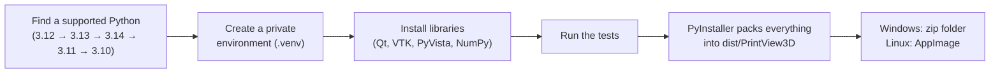

<p align="center">
  
</p>

<h1 align="center">PrintView3D</h1>

<p align="center">
  A fast, free viewer for <b>STL</b>, <b>3MF</b>, <b>G-code</b>, <b>FreeCAD</b>, <b>STEP</b>, <b>OBJ</b>, <b>PLY</b> and <b>glTF</b> files on <b>Windows</b>, <b>Linux</b> and <b>macOS</b>,<br>
  with a one-click button that opens the file in <b>your slicer</b>.<br>
  Open a <b>FreeCAD</b> file and send it as a model straight to your slicer, no export step needed.
</p>

<p align="center">
  📖 <b>Read the guide on the website:</b>
  <a href="https://sevagjb.github.io/PrintView3D/">English</a> ·
  <a href="https://sevagjb.github.io/PrintView3D/ar/">العربية</a> ·
  <a href="https://sevagjb.github.io/PrintView3D/nl/">Nederlands</a>
</p>

<p align="center">
  <a href="../../releases/latest"><b>⬇ Download</b></a> ·
  <a href="#windows">Windows</a> ·
  <a href="#linux">Linux</a> ·
  <a href="#macos">macOS</a> ·
  <a href="#using-printview3d">How to use</a> ·
  <a href="#build-it-yourself">Build it yourself</a> ·
  <a href="CHANGELOG.md">What's new</a>
</p>


Microsoft retired its **3D Viewer** app, and Linux never had a good one. PrintView3D fills the gap, made for people who 3D-print:
it shows models *and* sliced G-code, tells you the size, print time and filament use, and sends the
file to Creality Print, OrcaSlicer, Bambu Studio, PrusaSlicer, Cura and others with one click.
Designing in FreeCAD? Open the `.FCStd` file and send it to your slicer as a model directly,
without exporting an STL first.

---

## Features

| | |
|---|---|
| **STL** | Smooth-shaded model on a build plate, with size, triangle count and volume. |
| **3MF** | Every object on the plate, including projects from Creality Print, OrcaSlicer and Bambu Studio. Show or hide each object, see the project's printer and filament settings and its thumbnail. If the project is already sliced, view its toolpaths without re-slicing. **Export STL**: save the objects as plain STL files, combined or one per object. |
| **G-code** | Toolpaths coloured by type (walls, infill, top/bottom, supports, bridges, travel…), a layer slider, "show only this layer", print time, filament use and the slicer's preview picture. |
| **FreeCAD** | Open `.FCStd` documents to look at them: shown in 3D exactly as FreeCAD displays them (visible bodies only), with one click to open in FreeCAD or send to your slicer as STL. Uses your installed FreeCAD; without it you still see the preview picture. [Details](#freecad-files). |
| **STEP** | Open `.step` / `.stp` CAD files: shown in 3D with the help of your installed FreeCAD (converted in the background, remembered afterwards), with the CAD program, author and date from the file. OrcaSlicer, PrusaSlicer and Bambu Studio get the STEP file itself; other slicers get an STL. [Details](#step-files). |
| **OBJ, PLY, OFF, glTF / GLB** | Other common 3D formats, with the colours saved in the file (textures are not shown). OBJ objects and glTF scenes are listed as separate objects. OBJ goes to your slicer as it is; PLY, OFF and glTF are sent as STL, because not every slicer reads them. [Details](#other-3d-formats). |
| **ZIP files** | Open a downloaded model package (Printables, Thingiverse, …) directly. Only the 3D files are used; pictures, documents and links are skipped. Pick a model from the list, or **show all** side by side; send one model or all of them to your slicer. [Details](#zip-files). |
| **Open in your slicer** | One click (or `Ctrl+P`) opens the current file in your slicer. Installed slicers are found automatically. |
| **Default app** | Optional: make PrintView3D open `.stl`, `.3mf` and `.gcode` files when you double-click them. Fully reversible. |
| **Your language** | English, العربية (Arabic, right-to-left), Nederlands, Deutsch, Français, Español and Română; switch any time in Settings, no restart needed. [Help translate](#translations). |
| **Themes** | Automatic (follows your system), Dark, Gray, Graphite (warm, easy on the eyes), Light, Ember Light or Ember Dark (warm orange and teal), for the window and the 3D view. Pick one from picture cards in Settings, the palette icon or `Ctrl+T`. Toolpath colours stay the same in every theme. |
| **Thumbnails** | Windows File Explorer shows previews of 3MF, STL, G-code and FreeCAD files (installed with PrintView3D, optional). |
| **Updates** | **Check for updates** in Settings, or once a day if you allow it. On Windows one click downloads, checks and installs the new version. The version in the corner gets a red dot when an update is ready. [What is sent](#updates-and-privacy). |
| **One window** | A file you double-click while PrintView3D is open is shown in that window, instead of opening another one. Prefer a window per file? **Settings → Files → Open each file in a new window**. |
| **Comfortable to use** | Slicer-style camera, drag & drop, recent files, screenshots. |

<table>
<tr>
<td width="50%"><br><sub>3MF project: every object listed, each can be hidden.</sub></td>
<td width="50%"><br><sub>"Show only this layer": walls and infill of a single layer.</sub></td>
</tr>
<tr>
<td width="50%"><br><sub>STL model with size and volume.</sub></td>
<td width="50%"><br><sub>The ▾ arrow sends the file to another slicer just once.</sub></td>
</tr>
</table>

### Supported slicers

Found automatically when installed:

**Creality Print · OrcaSlicer · Bambu Studio · PrusaSlicer · UltiMaker Cura · Elegoo Slicer · Anycubic Slicer Next**

Any other slicer works too: choose it as **Custom** in Settings.

---

## Install

You do **not** need Python or anything else to use PrintView3D. Pick your system:

| System | Download | |
|---|---|---|
| **Windows 10 / 11** | `PrintView3D-Setup.exe` (or the portable `PrintView3D-windows.zip`) | [Instructions](#windows) |
| **Linux** (64-bit, x86-64) | `PrintView3D-x86_64.AppImage` | [Instructions](#linux) |
| **macOS 14.4+** (Apple silicon: M1 and newer), beta | `PrintView3D-macOS-AppleSilicon.dmg` | [Instructions](#macos) |
| **macOS 14.4+** (Intel), beta | `PrintView3D-macOS-Intel.dmg` | [Instructions](#macos) |

All downloads are on the **[latest release](../../releases/latest)** page.

### Windows

1. Go to the **[latest release](../../releases/latest)** and download **`PrintView3D-Setup.exe`**.
2. Double-click it and click **Next → Install → Finish**.
   - Installs for your user account only, so **no administrator password** is needed.
   - Adds PrintView3D to the Start menu (desktop shortcut optional) and to "Open with" for
     `.stl`, `.3mf` and `.gcode` files.
3. PrintView3D starts. Done.

**Previews in File Explorer:** the installer also shows **thumbnails of 3MF, STL, G-code and
FreeCAD files** in File Explorer (you can untick this during installation). 3MF, G-code and FreeCAD
show the preview picture saved by your slicer or FreeCAD; STL files are drawn. If thumbnails don't
appear at once, switch the folder view to *Large icons*, or sign out and in again. (If PowerToys'
File Explorer add-ons are on, PowerToys keeps showing STL and G-code thumbnails.)

**Updating:** download the new `PrintView3D-Setup.exe` and run it. It replaces the old version and
keeps your settings.

> **"Windows protected your PC"?** Releases are not code-signed yet (free signing through the
> SignPath Foundation is being applied for, see [Code signing policy](#code-signing-policy)), so
> Windows SmartScreen may warn the first time. Click **More info → Run anyway**. All the source code
> is in this repository, and every release is built automatically by [GitHub Actions](../../actions)
> from that code.

**Portable version:** download `PrintView3D-windows.zip`, extract it and run `PrintView3D.exe`.
Nothing is installed. (`install_windows.bat` in the zip still works too.)

#### Make it the default program for 3D files (optional)

1. In PrintView3D, click **Settings**.
2. Open the **Files** page and click **Register & choose as default…**.
3. Windows Settings opens. Pick **PrintView3D** for `.stl`, `.3mf` and `.gcode`.

Windows requires you to confirm this last step yourself; no program is allowed to do it silently.
**Remove registration** in the same place undoes everything.

#### Uninstall

**Windows Settings → Apps → Installed apps → PrintView3D → Uninstall**. This removes the program,
its shortcuts and file associations, and asks whether to delete your settings too.
(Portable version: run `uninstall_windows.bat` from the extracted folder.)

### Linux

PrintView3D for Linux is a single **AppImage** file: it contains everything it needs and runs on
most distributions without installing packages: Ubuntu 22.04 or newer, Linux Mint 21+, Debian 12+,
Fedora 36+, openSUSE Tumbleweed, Arch, Manjaro, Pop!_OS, elementary OS, Zorin OS and others.

1. Download **`PrintView3D-x86_64.AppImage`** from the **[latest release](../../releases/latest)**.
2. Make it executable: right-click it → **Properties → Permissions → Allow executing file as
   program**, or in a terminal:
   ```bash
   chmod +x PrintView3D-x86_64.AppImage
   ```
3. Double-click it, or run `./PrintView3D-x86_64.AppImage`.

**Add it to your applications menu** (optional, recommended): in PrintView3D open **Settings → Files**
and click **Register & make default**. PrintView3D then appears in your applications menu and in
"Open With", and opens `.stl`, `.3mf` and `.gcode` files on double-click. On Linux this takes effect
immediately; **Remove registration** undoes it.

Tip: keep the AppImage in a fixed place such as `~/Applications` before registering, because the
menu entry points to wherever the file is. Or let the script do it all:

```bash
./install_linux.sh PrintView3D-x86_64.AppImage     # copies to ~/Applications + adds the menu entry
./uninstall_linux.sh                               # removes it again
```

(The two scripts are in the [source code](../../archive/refs/heads/main.zip).)

**Slicers on Linux** are found automatically when installed as an AppImage (in `~/Applications`,
`~/Downloads`, `~/Desktop`, `~/bin`, `/opt`…), as a **Flatpak** or **Snap**, from your
distribution's packages, or in `/opt`. Otherwise choose it once with **Browse…** in Settings.

<details>
<summary><b>Linux troubleshooting</b></summary>

| Problem | Fix |
|---|---|
| Nothing happens / "AppImages require FUSE" | Install FUSE: `sudo apt install libfuse2` (Ubuntu/Debian), `sudo dnf install fuse fuse-libs` (Fedora). Or run it without FUSE: `./PrintView3D-x86_64.AppImage --appimage-extract-and-run` |
| `GLIBC_2.35 not found` | Your distribution is older than Ubuntu 22.04 / Debian 12. Build from source instead (below). |
| Window opens but the 3D view stays black | Make sure your graphics driver is installed (Mesa or the NVIDIA driver). In a virtual machine, enable 3D acceleration. |
| Wayland desktop | Supported. PrintView3D automatically runs through XWayland, because the 3D view needs it. |
| Slow rotation on a laptop with two GPUs | Start PrintView3D from the applications menu after **Register** (the menu entry asks for the dedicated GPU), or use your desktop's *Launch using Dedicated Graphics Card* option. |

</details>

### macOS

> **Beta.** The Mac version is built and checked automatically, but has not been tried by many people
> on real Macs yet. Please [tell us how it works](../../issues/new?template=mac_build.md): your Mac
> model, macOS version, and anything that looks wrong.

For **macOS 14.4 (Sonoma) or newer**, in two versions; pick the one for your Mac
( → **About This Mac**: *Chip* means Apple silicon, *Processor* means Intel):

| Your Mac | Download |
|---|---|
| **Apple silicon** (M1, M2, M3, M4 and newer) | `PrintView3D-macOS-AppleSilicon.dmg` |
| **Intel** (2018 and newer, the Macs that run macOS 14) | `PrintView3D-macOS-Intel.dmg` |

1. From the **[latest release](../../releases/latest)** download the `.dmg` for your Mac.
2. Open it and drag **PrintView3D** onto **Applications**.
3. Start PrintView3D from Applications. **The first time**, macOS says it *cannot verify* the app.
   Click **Done** (not "Move to Trash").
4. Open **System Settings → Privacy & Security**, scroll down to *Security* and click
   **Open Anyway** next to PrintView3D. Confirm with your password or Touch ID.

From then on it opens normally.

> **Why this extra step?** Apple only skips it for apps from developers who pay Apple every year
> for a certificate and "notarization". PrintView3D is free and has no budget for that, so it is
> signed without an Apple account instead. The program is the same open-source code as on Windows
> and Linux, built automatically by [GitHub Actions](../../actions). (Right-click → Open no longer
> works for this on macOS 15 and newer; use Open Anyway as above.)

**Open files with PrintView3D:** in Finder, right-click a `.stl`, `.3mf`, `.gcode` or `.FCStd` file →
**Open With → PrintView3D**. To make it the default: right-click the file → **Get Info** →
*Open with:* **PrintView3D** → **Change All…**.

**Slicers** in Applications (Creality Print, OrcaSlicer, Bambu Studio, PrusaSlicer, Cura, …) are
found automatically. **Updates:** *Download update* opens the release page; drag the new version
into Applications to replace the old one. Older Macs that can't run macOS 14:
[let us know](../../issues/new?template=mac_build.md) if you need a version for them.

---

## Using PrintView3D

**Open a file:** double-click it (if PrintView3D is the default), drag it onto the window, use
**Open**, or pick it from **Recent**. Try the files in [`examples/`](examples) to get started.

**Home:** the house button (`Ctrl+W`) closes the open file and goes back to the start page, with
your recent files. It also gives back the memory the file took, which matters most after a large
G-code or ZIP.

**One window:** a file you double-click while PrintView3D is already open is shown in that window,
which comes to the front. To give every file its own window (to compare two models side by side),
tick **Settings → Files → Open each file in a new window**. Starting PrintView3D from the Start
menu or applications menu, without a file, always opens a new window.

### Mouse

| Action | What it does |
|---|---|
| **Left-drag** | Rotate. Press *on the model* to rotate around that exact point; press on empty space to rotate around the model's centre. The plate always stays level. |
| **Right-drag** (or middle-drag, or Shift + left-drag) | Move (pan) |
| **Mouse wheel** | Zoom towards the mouse pointer |

Looking from underneath? The plate gets out of the way so you can see the bottom of the part.

### Keyboard

The same list is in the program under **Settings → About → Keyboard and mouse**.

| Key | Action |
|---|---|
| `Ctrl+O` | Open a file |
| `Ctrl+W` | Close the file (back to the start page) |
| `Ctrl+P` | Open the file in your default slicer |
| `Ctrl+E` | Export STL (3MF projects, FreeCAD and STEP files) |
| `Ctrl+T` | Next theme (Dark → Gray → Graphite → Light → Ember Light → Ember Dark) |
| `F` · `1` · `2` · `3` · `4` | Fit · Iso · Top · Front · Right view |
| `↑` / `↓` | Next / previous layer (G-code), or the previous / next file in a ZIP |
| `Page Up` / `Page Down` | 10 layers up / down |
| `Home` / `End` | First / last layer |

### Choosing your slicer


**Settings → Slicer → Default slicer.** Each slicer is marked *installed* or *not found*. If yours
is installed in an unusual place, click **Browse…** and select its program file. For a slicer that
is not in the list, choose **Custom program…**, give it a name and select its `.exe`.

The green button is renamed to match ("Open in OrcaSlicer"). The small **▾** arrow next to it lists
your other installed slicers, for opening a file in one of them just once.

### FreeCAD files

Open a FreeCAD document (`.FCStd`) with **Open** or drag & drop it onto the window
(PrintView3D does not take over the double-click from FreeCAD).
It is for looking only; nothing in the file is changed.

- **With FreeCAD installed** (free, [freecad.org](https://www.freecad.org/downloads.php)) the model is
  shown in 3D as FreeCAD displays it: visible bodies and solids only, without sketches, hidden
  objects or datum planes. PrintView3D starts FreeCAD invisibly in the background to convert the
  shapes (a few seconds the first time; then it is remembered until the file changes).
  The big button becomes **Open in FreeCAD**, and the ▾ arrow sends the visible model to
  your slicer as an STL. **Export STL** (`Ctrl+E`) saves the visible solids as STL files: all in
  one file, or one file per solid (the same choices as for a 3MF project). This also works for
  STEP files.
- **Without FreeCAD** you see the file's preview picture, the FreeCAD version and the visible
  objects, with a button to download FreeCAD.

FreeCAD is found automatically in its usual places (Windows installer, Linux packages, Snap,
Flatpak, AppImage). If yours is elsewhere, choose it in **Settings → FreeCAD**.

Because FreeCAD itself opens the file, a FreeCAD or STEP file deserves the same trust as when you
open it in FreeCAD: open files from people and sites you trust.

<table>
<tr>
<td width="50%"><br><sub>With FreeCAD installed: the bracket in 3D.</sub></td>
<td width="50%"><br><sub>Without FreeCAD: the preview picture saved in the file.</sub></td>
</tr>
</table>

### Export STL from 3MF

With a 3MF project open, **Export STL** in the toolbar (`Ctrl+E`) saves its objects as plain STL
files, for example to share a model or open it in a program that does not read 3MF.

- A dialog lists every object with its name and triangle count, all ticked; untick what you don't
  need.
- **The arrow next to the button** offers every way directly: *All objects as one STL*, *One STL per
  object* and *Choose objects…* (the dialog). The one a click makes is shown in bold.
- **What a click does** (and `Ctrl+E`) is chosen in **Settings → Files → Export STL**: show the list
  of objects (the default), save everything as one STL, or save one STL per object. *Change what a
  click does…* at the bottom of the arrow's menu opens that setting.
- **One combined STL**: the ticked objects in one file, placed as they are on the plate.
- **One STL per object**: each file is named after its object and saved into a folder you choose
  (PrintView3D asks before replacing files that are already there).
- A file with only one object always goes straight to the Save dialog.
- **Raw geometry only:** modifiers, negative parts and support blockers / enforcers are left out
  (as recorded by Creality Print, OrcaSlicer, Bambu Studio and PrusaSlicer), and so are colours,
  materials and print settings. Sizes are in millimetres; the files are binary STL.

### ZIP files

Model downloads often come as a ZIP. Open it like any other file (**Open…** or drag it onto the
window); there is no need to unpack it first.

<table>
<tr>
<td width="50%"><br><sub><b>Show all side by side</b>: tick or untick each model; the G-code opens on its own.</sub></td>
<td width="50%"><br><sub>Click a file in the list, or use ↑ / ↓: here the sliced G-code from the same ZIP.</sub></td>
</tr>
</table>

- **Only the 3D files are used**: STL, 3MF, OBJ, PLY, OFF, glTF/GLB, STEP, FreeCAD and G-code.
  Pictures, PDFs, read-me files, web links, ZIPs inside the ZIP and the hidden `__MACOSX` folder
  are skipped, and the panel says how many were skipped.
- **A ZIP with one 3D file** opens just like that file.
- **More files** are listed in the side panel with a coloured label for their type (STL, 3MF,
  G-code, …) and a short explanation of each type. The first file is shown; click another one, or
  use **↑ / ↓**, to switch.
- **Show all side by side** places the models next to each other: up to three in one row, then a
  grid (four as 2 × 2, six as 3 × 2, nine as 3 × 3, …), spaced by their real size. Untick models in
  **Objects** to hide them. G-code, STEP and FreeCAD files are opened one at a time.
- **Open in slicer** sends the model you are looking at; in Show all, the ticked models. The arrow
  next to the button has **Send all models in the ZIP**.
- A slicer opens a **3MF as a project on its own**, so it cannot take a 3MF together with other
  files. When the models to send include a 3MF, PrintView3D asks: the 3MF project (with its
  plates and settings), the other models on one plate, or **everything as STL** (the project's
  objects become a plain STL, so all models go on one plate).

  

The 3D files are unpacked into PrintView3D's own cache folder (slicers need real files); the sizes
are checked first, so a damaged or malicious ZIP cannot fill your disk. Files from ZIPs opened more
than a day ago are removed automatically.

### STEP files

STEP (`.step`, `.stp`) is the common format for exchanging CAD models between programs. It stores
exact shapes (curved surfaces), not triangles, so PrintView3D uses **FreeCAD** to turn them into a
mesh, the same way as for [FreeCAD files](#freecad-files): hidden in the background, a few seconds
the first time, then remembered until the file changes.

- **Parts:** an assembly's parts are listed separately with their names from the file, and can be
  hidden. (If FreeCAD's import gives anything unexpected, PrintView3D shows each solid instead, so
  the shape is always right.)
- **Without FreeCAD** you still see the details from the file (STEP version, the CAD program it was
  made with, author, organization, date) and a button to download FreeCAD.
- **Send to slicer:** OrcaSlicer, PrusaSlicer and Bambu Studio open STEP files themselves and get the
  file as it is (also without FreeCAD). Other slicers get the visible parts as STL, which needs FreeCAD.
- STEP files are added to **Open with**, but PrintView3D never makes itself their default app.

### Other 3D formats

| Format | What is read | Sent to your slicer as |
|---|---|---|
| **OBJ** (`.obj`) | Objects (`o`) or groups (`g`) as separate objects; colours from the `.mtl` file next to it, or vertex colours. | The `.obj` itself |
| **PLY** (`.ply`) | Text and binary; vertex or face colours. Point clouds (no faces) can't be shown. | STL |
| **OFF** (`.off`) | Text files (also COFF), with vertex or face colours. | STL |
| **glTF / GLB** (`.gltf`, `.glb`) | Every object in the scene at its position, with its material colour or vertex colours. | STL |

- **Sizes:** OBJ, PLY and OFF have no units; PrintView3D treats the numbers as millimetres, like
  slicers do. If a model shows up tiny, the file was probably made in metres; your slicer can scale it.
  glTF is always in metres and is shown in millimetres (with Z up, as on a printer).
- **Not read:** textures (image files on the model), animations, and glTF files compressed with Draco
  or meshoptimizer (PrintView3D says so; export them again without compression).
- These types are added to **Open with**, but PrintView3D never makes itself their default app.

### Language

**Settings → Language** switches the whole program immediately, including file dialogs and
standard buttons. English is the default; *Automatic* follows your system language. Arabic uses a
right-to-left layout; measurements always use Western digits (0.20 mm).
A wrong or missing word? The link on that page leads to [How to translate](docs/TRANSLATING.md).

### Themes

There are three ways to pick a theme:

- **Settings → Appearance → Theme** shows every theme as a **picture card**: a small view of
  PrintView3D in that theme, with its toolbar, side panel and 3D view. Click a card and every
  window switches at once, so you can try them one after another. **OK** keeps the theme you
  clicked last; **Cancel** goes back to the theme you had when you opened Settings.
- The **palette icon** at the right end of the toolbar opens a menu of all themes, each with a
  small colour swatch.
- **`Ctrl+T`** steps to the next theme.

The themes:

- **Automatic** follows the dark/light setting of Windows or your Linux desktop (and switches
  along when that changes).
- **Dark**, **Gray**, **Graphite** (a warm, dark brownish tone that is soft on the eyes) or
  **Light**, with teal buttons.
- **Ember Light**: warm cream with a bright orange and a lagoon teal. The slicer button, OK and the
  chosen Settings page are orange; the toolbar tiles, sliders and focus are teal; text is a soft
  slate grey instead of black. The 3D view is a deeper sand colour, so white and yellow toolpaths
  stay visible.
- **Ember Dark**: the same orange and teal at night, on deep lagoon greens instead of grey, with a
  teal-lit build plate.

The switch is immediate; the 3D background, plate and grid change with it, while G-code and
model colours stay the same so they always match your slicer. In every theme, text and grey labels
have a contrast of at least 4.5 : 1 against the window, so they stay easy to read.


#### Window transparency (Windows 11)

**Settings → Appearance → Window transparency** lets the toolbar, side panel and status bar show
what lies behind the window, in any theme:

- **Mica**: a soft tint of your desktop wallpaper (as in File Explorer).
- **Acrylic**: frosted glass that blurs the desktop and other windows behind it.
- **Off** (default): solid, as before.

The 3D view always stays solid. It takes effect after a restart: when you click OK, PrintView3D
asks **Restart now** (it closes and opens again, with the same file) or **Later**. Windows draws the
effect itself and shows a plain colour while the window is not active, and switches it off with
*Transparency effects* off in Windows Settings or in battery saver. Windows 10 and other systems
keep the normal look.

### Updates

**Settings → Updates** shows your version and has **Check for updates now**. You can also switch on
**Check for updates automatically (once a day)**; PrintView3D asks once whether you want this, and
you can change it there at any time.

When a new version exists, the version in the bottom-right corner shows a **red dot** (`● v0.10.0 →
0.11.0`), and so does *Updates* in Settings. Click it to see **What's new**, then:

- **Windows (installed with Setup.exe): Install update.** PrintView3D downloads the new installer,
  checks its SHA-256 fingerprint against the one GitHub publishes, installs it (no questions, your
  settings are kept) and starts the new version.
- **Linux (AppImage) and the portable Windows zip: Download update** opens the release page;
  download the new file and replace the old one.
- **Skip this version** hides that version; the next one is shown again.

After an update, the first start shows **What's new** for the version you now have, once, however
you updated (installer, winget, zip or AppImage). It is read from the changelog that comes with the
program, so it needs no connection. A fresh install doesn't show it.


#### Updates and privacy

PrintView3D works offline. It connects to the internet **only** for updates, and only when you
click *Check for updates now* or have switched on the daily check:

| | |
|---|---|
| **What is contacted** | `api.github.com` (to ask for the newest release of this project) and, when you click *Install update*, the download from `github.com` |
| **How often** | At most once a day (automatic check), or when you click *Check for updates now* |
| **What is sent** | Only the request for the newest version, with the program name and version (`PrintView3D/0.10.0`). No personal data, no files, no usage statistics, no ID. |
| **What GitHub sees** | Like any website: your IP address. See [GitHub's privacy statement](https://docs.github.com/site-policy/privacy-policies/github-general-privacy-statement). |
| **How to turn it off** | Settings → Updates → untick *Check for updates automatically*. Nothing is contacted after that. |

### Smoother rotation on laptops

Many laptops have two graphics chips and run programs on the slower one by default.
**Settings → Viewer → Graphics** shows which one PrintView3D uses. If it says *Intel*, tick
**Use the high-performance graphics card** and click OK; choose **Restart now** (or **Later**, and
it switches the next time you start PrintView3D).

---

## Build it yourself

Only needed if you want to change the code or don't want to use the ready-made download.

### Step 1: Install the right Python version ⚠️

PrintView3D uses **VTK** for its 3D drawing, and VTK only supports certain Python versions.
**The newest Python is often *not* supported yet**, and python.org's big download button always
gives you the newest one.

| Python version | Works? |
|---|---|
| 3.10, 3.11 | ✅ Yes |
| **3.12** | ✅ **Yes, recommended** (what the official builds use) |
| 3.13, 3.14 | ✅ Yes |
| 3.15 and newer | ❌ Not yet (no VTK version for it) |

#### Windows

**Already have Python?** Check which versions you have: open *Command Prompt* and type `py --list`.

**Install Python 3.12**, using one of these:

- **Easiest**, in *Command Prompt* or *PowerShell*:
  ```
  winget install Python.Python.3.12
  ```
- **Or** from python.org: go to [python.org/downloads/windows](https://www.python.org/downloads/windows/),
  find the latest **Python 3.12.x** release and download the *Windows installer (64-bit)*.
  During setup, tick **"Add python.exe to PATH"** *only if* you have no other Python installed.

#### Linux

Check with `python3 --version`. If it says 3.15 or newer, install 3.12 next to it:

| Distribution | Command |
|---|---|
| Ubuntu / Mint / Pop!_OS | `sudo apt install python3.12 python3.12-venv` (on older Ubuntu first: `sudo add-apt-repository ppa:deadsnakes/ppa`) |
| Debian | `sudo apt install python3 python3-venv` (Debian 12/13 ship a supported version) |
| Fedora | `sudo dnf install python3.12` |
| Arch / Manjaro | `yay -S python312`, or use [pyenv](https://github.com/pyenv/pyenv) |

You also need `curl` and `git` (usually already installed).

> You can keep several Python versions side by side; they don't interfere with each other. The
> build scripts automatically pick a supported one (3.12 first), so an existing newer Python is not
> a problem.

### Step 2: Get the code

Either click the green **Code → Download ZIP** button on this page and extract it, or:

```
git clone https://github.com/sevagjb/PrintView3D.git
```

### Step 3: Build

**Windows:** double-click **`build_windows.bat`** in the project folder (or run it from a terminal).
Then run **`install_windows.bat`**. If [Inno Setup 6](https://jrsoftware.org/isinfo.php) is
installed, the build also makes the installer `dist\PrintView3D-Setup.exe`.

**Linux:** in a terminal, in the project folder:

```bash
./build_linux.sh          # makes dist/PrintView3D-x86_64.AppImage
./install_linux.sh        # optional: copy to ~/Applications + add to the applications menu
```

The first build takes a few minutes (it downloads about 300 MB of libraries); later builds are faster.

### What the build script does



1. **Find Python.** It looks for 3.12, then 3.13, 3.14, 3.11, 3.10 (Windows: through the `py`
   launcher; Linux: `python3.12`, `python3.13`, …) and uses the first one it finds. If none is
   installed, it stops and tells you what to install.
2. **Create `.venv`.** A private folder with its own copy of the libraries, so nothing is installed
   into your system Python and nothing else on your PC is affected. Delete `.venv` to start fresh.
3. **Install libraries** listed in `requirements.txt` (the app) and `requirements-build.txt`
   (PyInstaller and pytest).
4. **Run the tests** in `tests/`. The build stops if any test fails.
5. **Package.** PyInstaller collects Python, the libraries and the app into
   `dist\PrintView3D\PrintView3D.exe` plus an `_internal` folder. That folder is the finished
   program and runs on any Windows 10/11 PC without Python. It is large (several hundred MB),
   mainly because of the VTK 3D engine.
6. **Linux only: AppImage.** `build_linux.sh` downloads
   [appimagetool](https://github.com/AppImage/appimagetool) once and packs `dist/PrintView3D/` into
   the single file `dist/PrintView3D-x86_64.AppImage`. (`--no-appimage` skips this step.)

### Troubleshooting the build

| Problem | Fix |
|---|---|
| `No supported Python version was found` | Install Python 3.12 (Step 1). |
| `Python was not found` / `'py' is not recognized` | Install Python from python.org or with winget (Step 1); both include the `py` launcher. |
| Linux: `Could not create a virtual environment` | Install the venv module, e.g. `sudo apt install python3.12-venv`. |
| Linux: `qt.qpa.plugin: Could not load the Qt platform plugin "xcb"` when running from source | Install Qt's X11 helper: `sudo apt install libxcb-cursor0` (Fedora: `xcb-util-cursor`). The AppImage already includes it. |
| Build fails while installing `vtk` | You are on an unsupported Python. Delete the `.venv` folder, install 3.12, run the build again. |
| Tests fail | Please [open an issue](../../issues) and paste the output. |
| Windows Defender deletes or blocks the `.exe` | A known false alarm with PyInstaller programs. Allow it in *Windows Security → Protection history*. |

### Developing

```bat
run_from_source.bat                    :: start from the source code, no packaging (Linux: ./run_from_source.sh)
.venv\Scripts\python -m pytest -q      :: run the tests
.venv\Scripts\python tools\make_demo.py         :: regenerate examples\
.venv\Scripts\python tools\make_screenshots.py  :: regenerate the README pictures
```

```
src/printview3d/
  app.py              entry point and command-line options
  loaders/gcode.py    G-code reader (layers, feature types, print info, thumbnails)
  loaders/mesh.py     STL and 3MF readers, STL writer (Export STL)
  slicer.py           list of slicers, detection and launching
  file_assoc.py       "Open with" / default app (assoc_windows.py: registry, assoc_linux.py: freedesktop)
  gpu.py              graphics-card info and high-performance GPU setting
  settings.py         settings file: %APPDATA%\PrintView3D\settings.json
  ui/                 window, 3D scene, camera controls, settings dialog, theme
tests/                automated tests and sample files
tools/                demo-file and screenshot generators
packaging/linux/      AppImage launcher and menu entry
printview3d.spec      PyInstaller recipe (Windows and Linux)
```

**Automatic builds:** every push builds and tests the Windows program on GitHub
([Actions](../../actions)). When the version number in `src/printview3d/__init__.py` changes,
it also publishes a new [release](../../releases) with the Windows zip and the Linux AppImage
attached.

### Command line

```
PrintView3D.exe model.stl                          open a file (in the window already open, if any)
PrintView3D.exe model.stl --new-window             open a file in a new window
PrintView3D.exe part.gcode --screenshot out.png    save a picture and exit
                     [--layer 25] [--view iso|top|front|right]
PrintView3D.exe model.stl --send-to-slicer         open the file in your default slicer and exit
PrintView3D.exe model.stl --send-to-slicer orcaslicer   ...or in a specific one
PrintView3D.exe --lang ar                          start in a language (en, ar, nl, de, fr, es)
PrintView3D.exe --theme light                      start with a theme (auto, dark, gray, graphite, light, ember, ember_dark)
PrintView3D.exe --register                         add to "Open with" (Linux: also the applications menu)
PrintView3D.exe --unregister                       remove file associations
(on Linux use ./PrintView3D-x86_64.AppImage instead of PrintView3D.exe)
```

---

## Translations

| Language | Status |
|---|---|
| English | Source language |
| العربية Arabic | Complete, reviewed by a native speaker |
| Nederlands | Complete, reviewed |
| Deutsch | Complete, needs review by a native speaker |
| Français | Complete, needs review by a native speaker |
| Español | Complete, needs review by a native speaker |
| Română (Romanian) | Complete, reviewed by a native speaker |

**Speak one of these languages? Or want PrintView3D in yours?** Your help is very welcome:
spotting one wrong word already helps. Translations are made right here on GitHub: change the
file for your language in [`translations/`](translations) and open a pull request, all in the
browser. Step by step: **[How to translate](docs/TRANSLATING.md)**.
Untranslated texts simply appear in English, so a language can be added step by step.


## Contributing

Bug reports, ideas and pull requests are welcome; see [CONTRIBUTING.md](CONTRIBUTING.md).
Is your slicer missing? It is usually a single entry in `SLICERS` in
[`src/printview3d/slicer.py`](src/printview3d/slicer.py).

## Notes and limits

- Windows 10/11 and Linux (x86-64) are packaged and tested. The Mac versions (Apple silicon and Intel,
  macOS 14.4+) are in [beta](#macos). ARM Linux (Raspberry Pi etc.) is not packaged yet.
- A 3MF *project* saved in one brand of slicer may lose its printer/print settings when opened in a
  different brand. The model itself loads fine; that's how the slicers behave.
- Binary G-code (`.bgcode`) is not supported yet.
- File Explorer thumbnails are made for 3MF, STL, G-code and FreeCAD files; not yet for OBJ, PLY, OFF and glTF.
- FreeCAD documents need an installed FreeCAD for the 3D view (PrintView3D does not include
  FreeCAD's geometry engine). Very old or very new FreeCAD versions may not open each other's files.

## Code signing policy

Windows releases are built automatically from this repository by
[GitHub Actions](.github/workflows/build.yml); no binaries are built or uploaded by hand.

*Status: applying for free code signing for open-source projects. When approved:*
Free code signing provided by [SignPath.io](https://about.signpath.io/), certificate by
[SignPath Foundation](https://signpath.org/).

| Role | Members |
|---|---|
| Committers and reviewers | [sevagjb](https://github.com/sevagjb) |
| Approvers | [sevagjb](https://github.com/sevagjb) |

Every signing request is approved by hand by an approver. Contributions from other people are
reviewed before they are merged.

**Privacy:** this program will not transfer any information to other networked systems unless
specifically requested by the user or the person installing or operating it. PrintView3D works
fully offline; it only opens your files and starts the slicer you choose. The only connection it
ever makes is the update check, and only when you ask for it or switched on the daily check;
see [Updates and privacy](#updates-and-privacy).

## License

[MIT](LICENSE). Free to use, change and share.
Built with [Qt for Python](https://doc.qt.io/qtforpython/), [PyVista](https://pyvista.org) and
[VTK](https://vtk.org).
