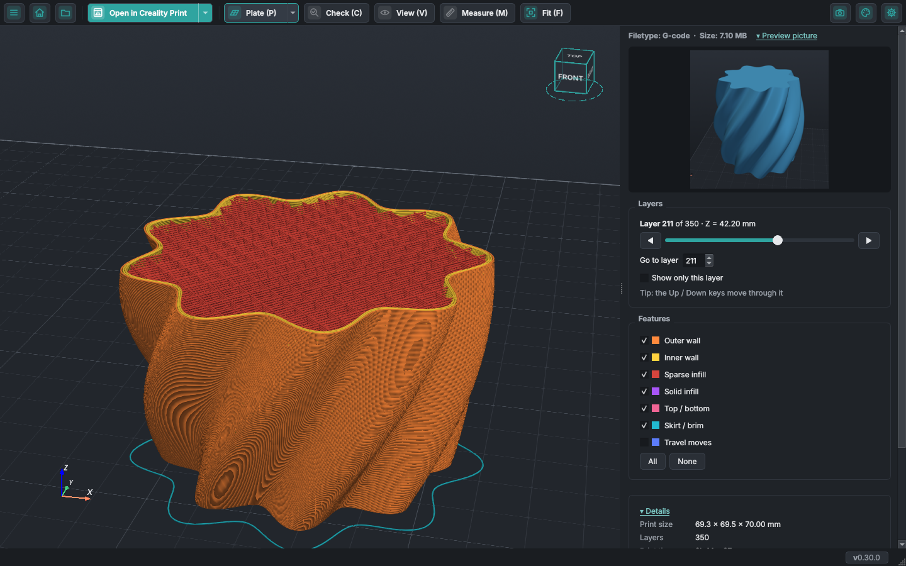
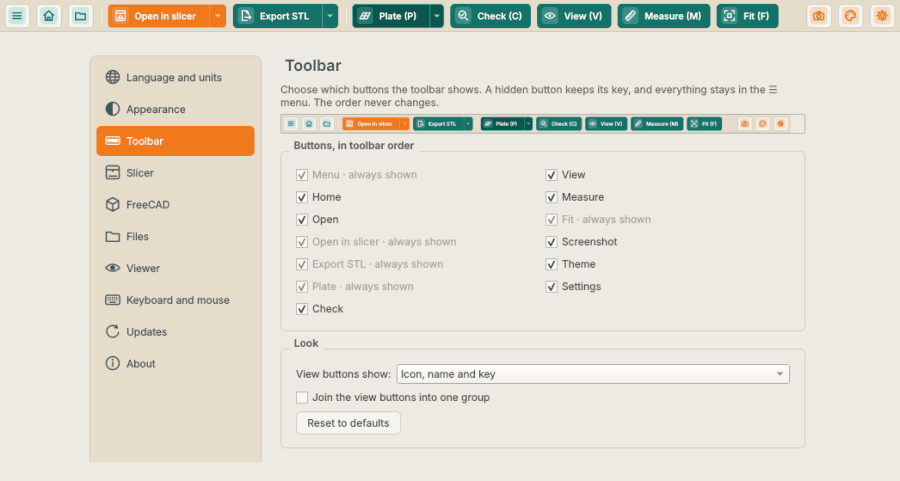
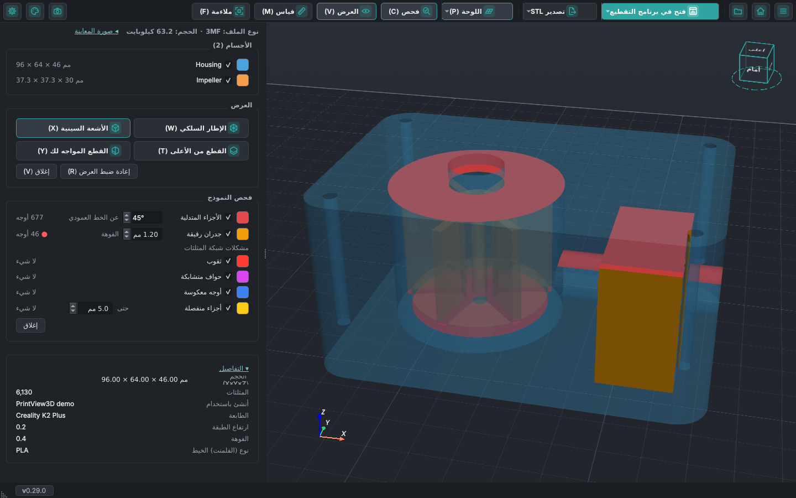
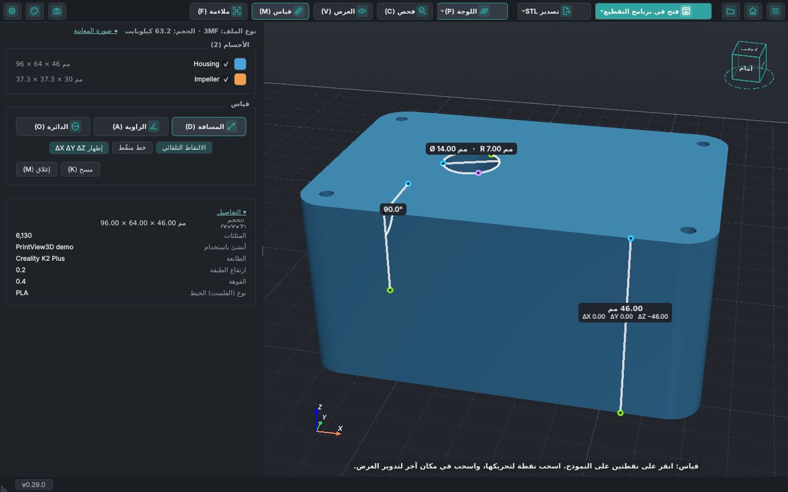
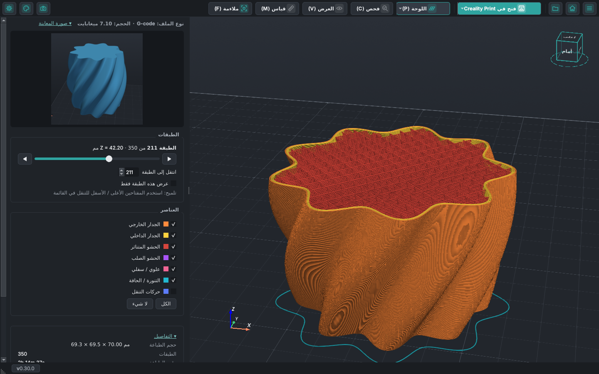

---
hide:
  - navigation
---

# PrintView3D

عارض سريع ومجاني لملفات <b>STL</b> و<b>3MF</b> و<b>G-code</b> و<b>FreeCAD</b> و<b>STEP</b>
و<b>OBJ</b> و<b>PLY</b> و<b>glTF</b> على <b>Windows</b> و<b>Linux</b> و<b>macOS</b>، مع زر واحد يفتح الملف
في <b>برنامج التقطيع الخاص بك</b>.

[تنزيل :material-download:](https://github.com/sevagjb/PrintView3D/releases/latest){ .md-button .md-button--primary }
[طريقة التثبيت](install.md){ .md-button }
[الشيفرة المصدرية على GitHub :material-github:](https://github.com/sevagjb/PrintView3D){ .md-button }

أوقفت Microsoft تطبيق **3D Viewer**، ولم يكن لنظام Linux عارض جيد أصلًا. يملأ PrintView3D هذا الفراغ،
وهو مصنوع لمن يطبعون بالطباعة ثلاثية الأبعاد: يعرض النماذج *و*ملفات G-code المقطّعة، ويبيّن الحجم ومدة
الطباعة وكمية الخيط، ويرسل الملف إلى Creality Print وOrcaSlicer وBambu Studio وPrusaSlicer وCura وغيرها
بنقرة واحدة. تصمّم في FreeCAD؟ افتح ملف `.FCStd` وأرسله إلى برنامج التقطيع كنموذج مباشرةً، دون تصدير
ملف STL أولًا.

## جديد: شريط أدواتك، والفحص والقياس والنظر داخل نماذجك

**جديد في 0.30: شريط أدواتك أنت.** أخفِ الأزرار التي لا تستخدمها، واختصر أزرار العرض إلى اسم أو
اختصار أو أيقونة، واضممها في مجموعة واحدة. تحتفظ الأزرار المخفية باختصاراتها، ويبقى كل شيء في القائمة
**☰**. [كيف يعمل](use.md#toolbar-buttons)

**جديد في 0.29: الفحص قبل الطباعة.** نقرة واحدة تلوّن ما قد يسبب مشكلات عند الطباعة: الأجزاء
المتدلية، والجدران الأرق من فوهتك، والثقوب، والحواف المتشابكة، والأوجه المعكوسة، والأجزاء المنفصلة، مع
عدد لكل منها. وجديد أيضاً: المليمتر أو البوصة، واختصارات لوحة مفاتيح خاصة بك، وفتح مجلد كامل، وأصبح
القياس يلتقط حدود القطع، فتستطيع قياس الجدران داخل النموذج.

**جديد في 0.28: القياس.** انقر على نقطتين لقياس مسافة (مع ΔX ΔY ΔZ)، أو على ثلاث نقاط لقياس زاوية أو
قطر ثقب. تلتقط النقاط الزوايا والحواف تلقائياً، وتُكتب كل قيمة بجانب قياسها مباشرة.

أدِر النموذج عبر قطع يواجهك دائماً، أو اقطعه من الأعلى، أو استخدم القطعين معاً لقطع زاوية منه. ويبقى
ما يزيله القطع ظاهراً كشبح شفاف. اجعله شفافاً، وأعطِ كل جسم لوناً من اختيارك، واعرف حجم كل جسم.

<video class="pv-video" src="../assets/inside/clip-facing.mp4" poster="../assets/inside/clip-facing.jpg"
       autoplay loop muted playsinline preload="metadata" aria-label="غلاف مضخة يدور عبر قطع عمودي فيظهر ما في داخله"></video>

[شاهد كيف يعمل](inspect.md){ .md-button .md-button--primary }

## المزايا

| | |
|---|---|
| **STL** | نموذج بتظليل ناعم على لوحة الطباعة، مع الأبعاد وعدد المثلثات والحجم. |
| **3MF** | كل جسم على اللوحة، بما في ذلك مشاريع Creality Print وOrcaSlicer وBambu Studio. أظهر كل جسم أو أخفِه، واطّلع على إعدادات الطابعة والخيط في المشروع وصورته المصغّرة. إذا كان المشروع مقطّعًا مسبقًا، فاعرض مسارات الطباعة دون إعادة التقطيع. **تصدير STL**: احفظ الأجسام كملفات STL عادية، مجمّعة في ملف واحد أو ملفًا لكل جسم. |
| **G-code** | مسارات ملوّنة حسب النوع (الجدران، الحشو، الأعلى/الأسفل، الدعامات، الجسور، التنقّل…)، وشريط للطبقات، و«عرض هذه الطبقة فقط»، ومدة الطباعة، وكمية الخيط، وصورة المعاينة من برنامج التقطيع. |
| **انظر إلى الداخل** | **العرض** ← الإطار السلكي، والأشعة السينية، والقطع من الأعلى، وقطع يدور مع العرض، كلٌّ وحده أو كلاهما معاً، مع الجزء المقطوع كشبح شفاف؛ وحجم كل جسم، و**القياس** للمسافات والزوايا والدوائر. [التفاصيل](inspect.md). |
| **الفحص قبل الطباعة** | **فحص** ← الأجزاء المتدلية، والجدران الرقيقة، والثقوب، والحواف المتشابكة (non-manifold)، والأوجه المعكوسة، والأجزاء المنفصلة، ملوّنة على النموذج مع عدد لكل منها. [التفاصيل](inspect.md#check-before-printing). |
| **FreeCAD** | افتح مستندات `.FCStd` لمشاهدتها: تظهر ثلاثية الأبعاد كما يعرضها FreeCAD تمامًا (الأجسام الظاهرة فقط)، مع نقرة واحدة لفتحها في FreeCAD أو إرسالها إلى برنامج التقطيع بصيغة STL. يستخدم FreeCAD المثبّت لديك؛ وبدونه ترى صورة المعاينة. [التفاصيل](cad.md#freecad-files). |
| **STEP** | افتح ملفات CAD بصيغة `.step` / `.stp`: تظهر ثلاثية الأبعاد بمساعدة FreeCAD المثبّت لديك (يُحوَّل في الخلفية ثم يُحفَظ)، مع اسم برنامج CAD والمؤلف والتاريخ من الملف. يحصل OrcaSlicer وPrusaSlicer وBambu Studio على ملف STEP نفسه؛ وبرامج التقطيع الأخرى على ملف STL. [التفاصيل](cad.md#step-files). |
| **OBJ وPLY وOFF وglTF / GLB** | صيغ ثلاثية الأبعاد شائعة أخرى، مع الألوان المحفوظة في الملف (لا تُعرض الخامات/الصور). تُدرَج كائنات OBJ ومشاهد glTF كأجسام منفصلة. يذهب OBJ إلى برنامج التقطيع كما هو؛ وتُرسَل PLY وOFF وglTF بصيغة STL، لأن ليس كل برامج التقطيع تقرؤها. [التفاصيل](cad.md#other-3d-formats). |
| **ملفات ZIP** | افتح حزمة نماذج منزّلة (Printables وThingiverse و…) مباشرةً. تُستخدم الملفات ثلاثية الأبعاد فقط؛ وتُتجاهل الصور والمستندات والروابط. اختر نموذجًا من القائمة، أو **اعرض الكل** جنبًا إلى جنب؛ وأرسل نموذجًا واحدًا أو جميعها إلى برنامج التقطيع. [التفاصيل](use.md#zip-files). |
| **الفتح في برنامج التقطيع** | نقرة واحدة (أو `Ctrl+P`) تفتح الملف الحالي في برنامج التقطيع. يُعثَر على برامج التقطيع المثبّتة تلقائيًا. |
| **التطبيق الافتراضي** | اختياري: اجعل PrintView3D يفتح ملفات `.stl` و`.3mf` و`.gcode` عند النقر المزدوج عليها. يمكن التراجع عنه بالكامل. |
| **لغتك** | English والعربية (من اليمين إلى اليسار) وNederlands وDeutsch وFrançais وEspañol وRomână؛ غيّرها في أي وقت من الإعدادات دون إعادة تشغيل. [ساعد في الترجمة](contribute.md#translations). |
| **السمات** | أربعة أنماط — الافتراضي، ورمادي، وغرافيت (دافئ ومريح للعين)، وإمبر (برتقالي وفيروزي) — كلٌّ منها فاتح أو داكن أو يتبع نظامك، للنافذة وللعرض ثلاثي الأبعاد. بدّل من أيقونة لوحة الألوان، أو `Ctrl+T` (النمط التالي)، أو `Ctrl+Shift+T` (فاتح ↔ داكن). تبقى ألوان المسارات كما هي في كل السمات. |
| **الصور المصغّرة** | يعرض مستكشف الملفات في Windows معاينات لملفات 3MF وSTL وG-code وFreeCAD (تُثبَّت مع PrintView3D، اختيارية). وعلى macOS (تجريبي) يعرض Finder صوراً مصغّرة لملفات 3MF وSTL وG-code وFreeCAD وOBJ وPLY، ويعرض **Quick Look** (مفتاح المسافة) نماذج STL و3MF وOBJ وPLY بشكل ثلاثي الأبعاد. [التفاصيل](install.md#quick-look). |
| **التحديثات** | **التحقق من التحديثات** من الإعدادات، أو مرة يوميًا إذا سمحت بذلك. على Windows تقوم نقرة واحدة بتنزيل الإصدار الجديد والتحقق منه وتثبيته. يظهر بجانب رقم الإصدار في الزاوية نقطة حمراء عند توفر تحديث. [ما الذي يُرسَل](use.md#updates-and-privacy). |
| **نافذة واحدة** | الملف الذي تنقر عليه نقرًا مزدوجًا أثناء فتح PrintView3D يظهر في النافذة نفسها بدل فتح نافذة أخرى. تفضّل نافذة لكل ملف؟ **الإعدادات ← الملفات ← فتح كل ملف في نافذة جديدة**. |
| **صفحة البداية** | ملفاتك الأخيرة، مع بطاقة معاينة للملف الذي يمرّ فوقه الماوس: الصورة المحفوظة في ملف 3MF أو G-code (ومنها ملفات Creality Print) أو FreeCAD، أو صورة المصمّم في ملف ZIP، مع اسمه ومجلده. ويمكن إيقافها. [التفاصيل](use.md). |
| **شريط أدواتك** | أخفِ الأزرار التي لا تستخدمها، واختصر أزرار العرض إلى اسم أو اختصار أو أيقونة، واضممها في مجموعة واحدة (**الإعدادات ← شريط الأدوات**). تحتفظ الأزرار المخفية باختصاراتها وتبقى في القائمة **☰**. [التفاصيل](use.md#toolbar-buttons). |
| **سهل الاستخدام** | كاميرا بأسلوب برامج التقطيع، والسحب والإفلات، والملفات الأخيرة، ولقطات الشاشة. |

<table>
<tr>
<td width="50%"> مشروع 3MF: كل جسم مُدرَج، ويمكن إخفاء أي منها.</td>
<td width="50%"> «عرض هذه الطبقة فقط»: جدران وحشو طبقة واحدة.</td>
</tr>
<tr>
<td width="50%"> نموذج STL مع الأبعاد والحجم.</td>
<td width="50%"> السهم ▾ يرسل الملف إلى برنامج تقطيع آخر لمرة واحدة.</td>
</tr>
</table>

## برامج التقطيع المدعومة

يُعثَر عليها تلقائيًا عند تثبيتها:

**Creality Print · OrcaSlicer · Bambu Studio · PrusaSlicer · UltiMaker Cura · Elegoo Slicer · Anycubic Slicer Next**

ويعمل أي برنامج تقطيع آخر أيضًا: اختره كـ **برنامج مخصص** في الإعدادات.

