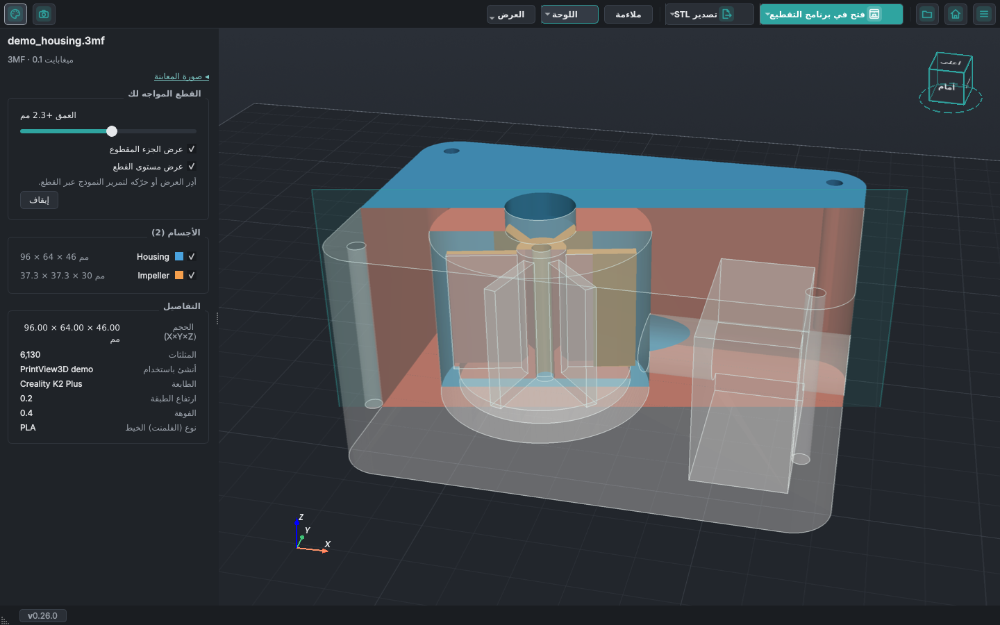
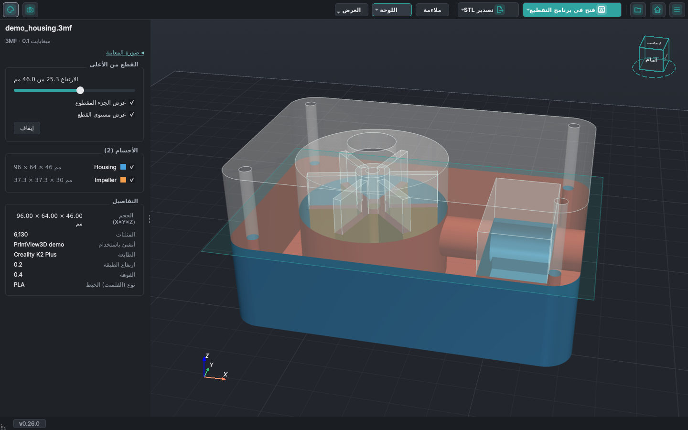
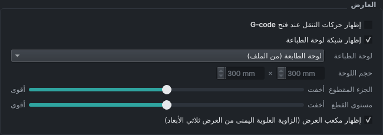
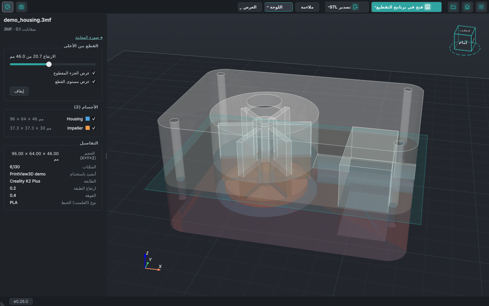
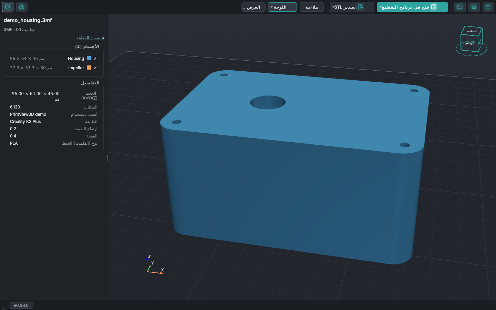

# انظر داخل نماذجك

جدران مجوفة، أجسام مخفية، قنوات، ثقوب براغي: يتيح لك زر **العرض** في شريط الأدوات أن ترى داخل النموذج
قبل طباعته. يعمل مع STL و3MF وOBJ وصيغ النماذج الأخرى (أما G-code فله شريط تمرير الطبقات لهذا الغرض).
*جديد في PrintView3D 0.25؛ وشبح الجزء المقطوع جديد في 0.26.*

<video class="pv-video" src="../assets/inside/clip-facing.mp4" poster="../assets/inside/clip-facing.jpg"
       autoplay loop muted playsinline preload="metadata"
       aria-label="غلاف مضخة يدور عبر قطع عمودي: تظهر الحجرة والمروحة والتجويف وقناة المخرج"></video>

## القطع المواجه لك

قطع عمودي يواجهك دائماً ويُخفي جزء النموذج الواقع أمامه. **أدِر العرض فيدور النموذج عبر القطع**؛ حرّك
العرض (تحريك جانبي) فينزلق النموذج عبره، كأنك تمرّر النموذج أمام ماسح ضوئي. لقطع مستقيم من الأمام أو من
الجانب، انقر ذلك الوجه على مكعب العرض.

يقرّب شريط التمرير في اللوحة الجانبية القطع أو يبعده. يُرسم داخل الجدران التي يكشفها القطع باللون الأحمر،
فترى في الجسم المصمت وجه القطع.

## القطع من الأعلى

يُخفي كل ما فوق ارتفاع معيّن، كما يفعل شريط الطبقات مع G-code. حرّك شريط التمرير في اللوحة الجانبية
لتنزل عبر النموذج طبقة بعد طبقة.

<video class="pv-video" src="../assets/inside/clip-top.mp4" poster="../assets/inside/clip-top.jpg"
       autoplay loop muted playsinline preload="metadata"
       aria-label="قطع ينزل عبر غلاف المضخة ثم يصعد"></video>

قطع واحد في كل مرة: <kbd>C</kbd> و<kbd>V</kbd> يبدّلان بينهما. **إيقاف** في اللوحة الجانبية، أو المفتاح
نفسه مرة أخرى، يعيد عرض النموذج كاملاً.

## شاهد ما يزيله القطع

مع أي من القطعين، يبقى الجزء الذي يخفيه القطع ظاهراً كشبح أبيض شفاف بحواف محددة، ويظهر مستوى القطع
كصفيحة باهتة بحجم النموذج. فترى ما يزيله القطع، وأين.

مربّعا اختيار تحت شريط التمرير، **عرض الجزء المقطوع** و**عرض مستوى القطع**، يُظهران كلاً منهما أو
يخفيانه، ويُحفظ اختيارك. وفي **الإعدادات ← العارض** لكل من **الجزء المقطوع** و**مستوى القطع** شريط
**أخفت … أقوى**، ويتغيّر العرض ثلاثي الأبعاد أثناء السحب.

## الأشعة السينية

تصبح الأجسام شفافة، فتظهر الأجسام الموجودة داخل أجسام أخرى والتجاويف والقنوات وثقوب البراغي، من كل
الجهات.

<video class="pv-video" src="../assets/inside/xray.mp4" poster="../assets/inside/xray.jpg"
       autoplay loop muted playsinline preload="metadata"
       aria-label="غلاف المضخة شفافاً وهو يدور: تظهر المروحة والقنوات في داخله"></video>

يمكن استخدام الخيارات معاً، مثل الأشعة السينية مع القطع:

## الإطار السلكي

مثلثات الشبكة: لترى مدى دقة النموذج، أو لتكتشف الأشكال الهندسية المعطوبة.

## حجم كل جسم

تعرض قائمة **الأجسام** حجم كل جسم (X × Y × Z) بجانب اسمه، وحجم النموذج كاملاً موجود في **التفاصيل**.
أزل علامة الاختيار عن جسم لإخفائه.

## المفاتيح

| المفتاح | |
|---|---|
| <kbd>W</kbd> | الإطار السلكي تشغيل / إيقاف |
| <kbd>X</kbd> | الأشعة السينية تشغيل / إيقاف |
| <kbd>C</kbd> | القطع من الأعلى تشغيل / إيقاف |
| <kbd>V</kbd> | القطع المواجه لك تشغيل / إيقاف |
| <kbd>R</kbd> | إعادة ضبط العرض: إيقاف كل ما سبق وملاءمة النموذج |

تبقى الخيارات مفعّلة عند فتح النموذج التالي. **إعادة ضبط العرض** (<kbd>R</kbd>، وأيضاً في قائمة
**العرض**) يوقفها كلها ويُلائم النموذج، دفعة واحدة.

## جرّبه بنفسك

غلاف المضخة في هذه الصفحة هو الملف
[`examples/demo_housing.3mf`](https://github.com/sevagjb/PrintView3D/raw/main/examples/demo_housing.3mf)
في الكود المصدري: نزّله وافتحه في PrintView3D.

اقترح هذه الميزات [@covrig](https://github.com/covrig)
([#59](https://github.com/sevagjb/PrintView3D/issues/59)،
[#60](https://github.com/sevagjb/PrintView3D/issues/60)،
[#66](https://github.com/sevagjb/PrintView3D/issues/66)). لديك فكرة أيضاً؟
[افتح طلباً (issue)](https://github.com/sevagjb/PrintView3D/issues/new/choose).
