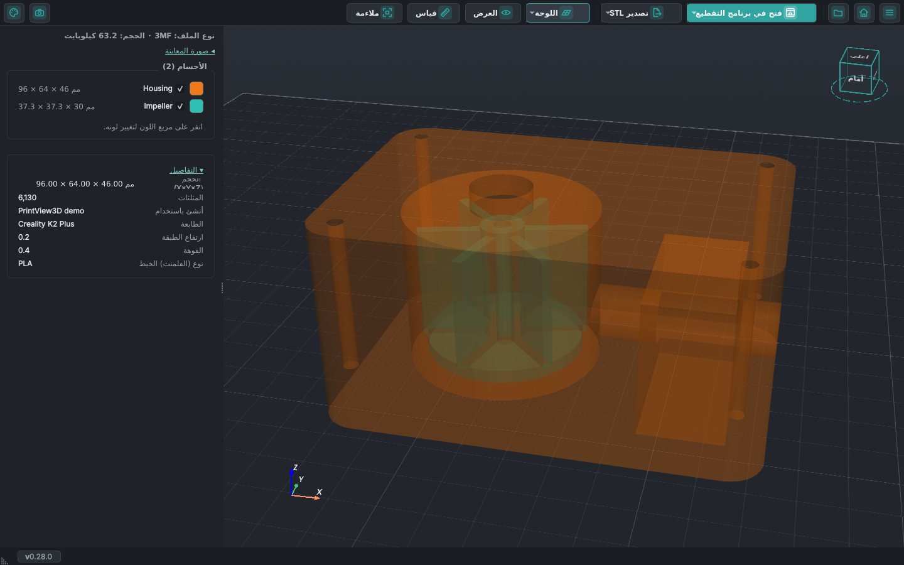

# انظر داخل نماذجك

جدران مجوفة، أجسام مخفية، قنوات، ثقوب براغي: يتيح لك زر **العرض** في شريط الأدوات أن ترى داخل النموذج
قبل طباعته. يعمل مع STL و3MF وOBJ وصيغ النماذج الأخرى (أما G-code فله شريط تمرير الطبقات لهذا الغرض).
يفتح الزر قسم **العرض** في اللوحة الجانبية، وفيه كل خيار على شكل زر: الإطار السلكي والأشعة السينية
والقطع من الأعلى والقطع المواجه لك. تظهر عناصر التحكم في القطع (شريط التمرير والجزء المقطوع ومستوى
القطع والتجميد) في القسم نفسه ما دام القطع مفعّلاً، وينتهي القسم بزرَّي **إعادة ضبط العرض** و**إغلاق**.
والزر المفعّل يظهر أغمق، فترى فوراً ما هو نشط.
*جديد في PrintView3D 0.25؛ وقسم العرض جديد في 0.28.*

<video class="pv-video" src="../assets/inside/clip-facing.mp4" poster="../assets/inside/clip-facing.jpg"
       autoplay loop muted playsinline preload="metadata"
       aria-label="غلاف مضخة يدور عبر قطع عمودي: تظهر الحجرة والمروحة والتجويف وقناة المخرج"></video>

## القطع المواجه لك

قطع عمودي يواجهك دائماً ويُخفي جزء النموذج الواقع أمامه. **أدِر العرض فيدور النموذج عبر القطع**؛ حرّك
العرض (تحريك جانبي) فينزلق النموذج عبره، كأنك تمرّر النموذج أمام ماسح ضوئي. لقطع مستقيم من الأمام أو من
الجانب، انقر ذلك الوجه على مكعب العرض.

يقرّب شريط التمرير في اللوحة الجانبية القطع أو يبعده؛ ويُظهر **العمق** مدى دخول القطع في النموذج، من
عمق النموذج الكامل في ذلك الاتجاه. ويُبقي **تجميد مستوى القطع** القطع في مكانه، فتستطيع تدوير النموذج
وتحريكه دون أن يدور القطع معه. يُرسم داخل الجدران التي يكشفها القطع باللون الأحمر، فترى في الجسم المصمت
وجه القطع.

## القطع من الأعلى

يُخفي كل ما فوق ارتفاع معيّن، كما يفعل شريط الطبقات مع G-code. حرّك شريط التمرير في اللوحة الجانبية
لتنزل عبر النموذج طبقة بعد طبقة.

<video class="pv-video" src="../assets/inside/clip-top.mp4" poster="../assets/inside/clip-top.jpg"
       autoplay loop muted playsinline preload="metadata"
       aria-label="قطع ينزل عبر غلاف المضخة ثم يصعد"></video>

## شاهد ما يزيله القطع

يبقى ما يخفيه القطع ظاهراً كـ**شبح** أبيض شفاف بحواف محددة، ويظهر **مستوى القطع** كصفيحة باهتة
بحجم النموذج، فترى ما يزيله القطع وأين. تحت أشرطة التمرير، يُظهر **عرض الجزء المقطوع** و**عرض مستوى
القطع** كلاً منهما أو يخفيانه (كلاهما مفعّل في البداية، ويُحفظ اختيارك). وفي **الإعدادات ← العارض**
لكلٍّ من **الجزء المقطوع** و**مستوى القطع** شريط أخفت … أقوى، ويتغيّر العرض ثلاثي الأبعاد أثناء
السحب. *جديد في PrintView3D 0.26.*

## القطعان معاً

يشغّل كلٌّ من <kbd>C</kbd> و<kbd>V</kbd> قطعه الخاص ويوقفه، فيمكن تشغيل القطعين معاً: يبقى من
النموذج عندها ما يُبقيه القطعان كلاهما فقط، أي تُقطع منه زاوية. في اللوحة الجانبية شريط تمرير لكل
منهما، **الارتفاع** و**العمق**. ويبقى ما يخفيه القطعان ظاهراً كشبح شفاف واحد متساوٍ، ويتوقف كل
مستوى قطع عند موضع القطع الآخر. **إعادة ضبط العرض** يوقف القطعين؛ والمفتاح نفسه (أو الزر) مرة
أخرى يوقف ذلك القطع وحده. *جديد في PrintView3D 0.27.*

## الأشعة السينية

تصبح الأجسام شفافة، فتظهر الأجسام الموجودة داخل أجسام أخرى والتجاويف والقنوات وثقوب البراغي، من كل
الجهات.

<video class="pv-video" src="../assets/inside/xray.mp4" poster="../assets/inside/xray.jpg"
       autoplay loop muted playsinline preload="metadata"
       aria-label="غلاف المضخة شفافاً وهو يدور: تظهر المروحة والقنوات في داخله"></video>

يمكن استخدام الخيارات معاً، مثل الأشعة السينية مع القطع:

## الإطار السلكي

مثلثات الشبكة: لترى مدى دقة النموذج، أو لتكتشف الأشكال الهندسية المعطوبة.

## حجم كل جسم

تعرض قائمة **الأجسام** حجم كل جسم (X × Y × Z) بجانب اسمه، وحجم النموذج كاملاً موجود في **التفاصيل**.
أزل علامة الاختيار عن جسم لإخفائه.

## القياس

يفتح زر **قياس** بجانب **العرض** (أو <kbd>M</kbd>) قسم القياس. اختر ما تريد قياسه بالأزرار الموجودة
فيه:

- **المسافة**: انقر على نقطتين. يتبع الخط الماوس وتُكتب المسافة بجانبه. فعّل **إظهار ΔX ΔY ΔZ**
  لتُكتب المسافة على طول كل محور تحت كل مسافة، وهذا مفيد لمعرفة "كم الارتفاع من هنا إلى هناك".
- **الزاوية**: انقر على نقطة في ضلع، ثم على الزاوية، ثم على نقطة في الضلع الآخر.
- **الدائرة**: انقر على ثلاث نقاط على حافة دائرة أو ثقب لتقرأ قطرها ونصف قطرها.

ما دام القياس مفعّلاً، تُكتب طريقة استخدام الأداة المختارة أسفل العرض ثلاثي الأبعاد. النقر يضع نقطة،
والسحب لا يزال يدير العرض، فتستطيع تدوير النموذج بين النقاط. تبقى القياسات المكتملة ظاهرة وقيمتها
مكتوبة بجانبها، والنقرة التالية تبدأ قياساً جديداً؛ ويزيلها **مسح** كلها. اسحب نقطة موضوعة لتحريكها.
**الالتقاط التلقائي** (مفعّل عند كل بدء) ينقل النقطة إلى أقرب زاوية أو منتصف حافة أو نقطة على حافة.
و**خط منقّط** يرسم الخطوط منقّطة. وسماكة الخطوط شريط في **الإعدادات ← العارض** (**خطوط القياس**).
والقيم التي قد تتداخل، مثل الدوائر متحدة المركز، تُرتَّب فوق بعضها. ولا يزيل **إعادة ضبط العرض**
قياساتك. *جديد في PrintView3D 0.28.*

## الألوان واللوحة الجانبية

تأتي قائمة **الأجسام** أولاً في اللوحة الجانبية و**التفاصيل** في الأسفل؛ انقر على *التفاصيل* لطيّها
(ويُحفظ اختيارك). وفي الأعلى ترى نوع الملف وحجمه. انقر على مربع لون جسم لتختار لوناً آخر لهذا الجسم
وحده؛ وانقر عليه بزر الماوس الأيمن للعودة إلى لون الملف. لا تُحفظ الألوان التي تختارها: تعود كما كانت
بعد إعادة التشغيل. *جديد في PrintView3D 0.28.*

## المسافات على الشبكة

يكتب **الإعدادات ← العارض ← إظهار المسافات (مم) على الشبكة** (غير مفعّل افتراضياً) أرقاماً صغيرة
بالمليمتر على طول لوحة الطباعة، عند خطوط الشبكة الرئيسية: كل 50 مم على لوحة عادية، وبعدد أقل على
لوحة كبيرة كي تبقى أرقام قليلة مقروءة. تظهر خارج الحافتين الأقرب إليك مباشرة، بلون الشبكة نفسه،
وتبقى قائمة أياً كان اتجاه نظرك، وتختفي عند النظر من أسفل اللوحة. ومع الشبكة اللانهائية تتبع المنطقة
المحيطة بالنموذج. ويختار **المسافة بين الأرقام** مسافة أخرى، من 5 إلى 100 مم، بدلاً من المسافة
التلقائية. *جديد في PrintView3D 0.28.*

## المفاتيح

| المفتاح | |
|---|---|
| <kbd>W</kbd> | الإطار السلكي تشغيل / إيقاف |
| <kbd>X</kbd> | الأشعة السينية تشغيل / إيقاف |
| <kbd>C</kbd> | القطع من الأعلى تشغيل / إيقاف |
| <kbd>V</kbd> | القطع المواجه لك تشغيل / إيقاف |
| <kbd>R</kbd> | إعادة ضبط العرض: إيقاف الإطار السلكي والأشعة السينية والقطع، وملاءمة النموذج (تبقى القياسات) |
| <kbd>M</kbd> | القياس تشغيل / إيقاف |

تبقى الخيارات مفعّلة عند فتح النموذج التالي.

## جرّبه بنفسك

غلاف المضخة في هذه الصفحة هو الملف
[`examples/demo_housing.3mf`](https://github.com/sevagjb/PrintView3D/raw/main/examples/demo_housing.3mf)
في الكود المصدري: نزّله وافتحه في PrintView3D.

اقترح هذه الميزات [@covrig](https://github.com/covrig)، وطوّر أيضاً القياس وقسم العرض وألوان
الأجسام وأرقام الشبكة
([#59](https://github.com/sevagjb/PrintView3D/issues/59)،
[#60](https://github.com/sevagjb/PrintView3D/issues/60)). لديك فكرة أيضاً؟
[افتح طلباً (issue)](https://github.com/sevagjb/PrintView3D/issues/new/choose).
