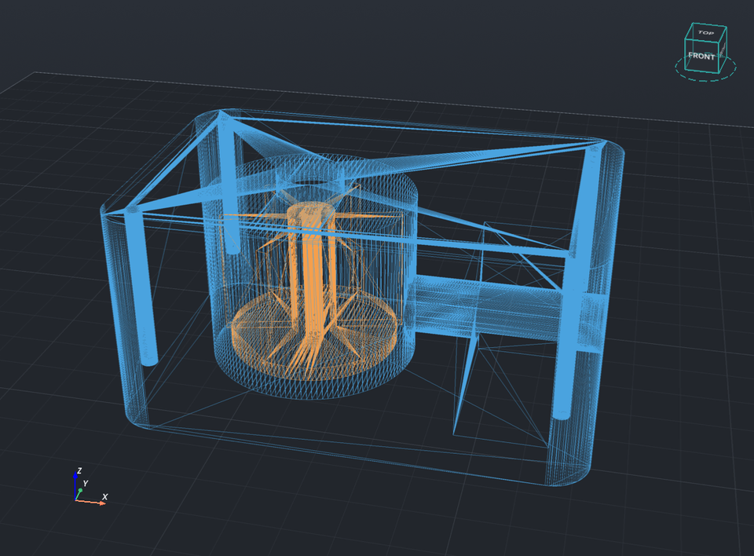
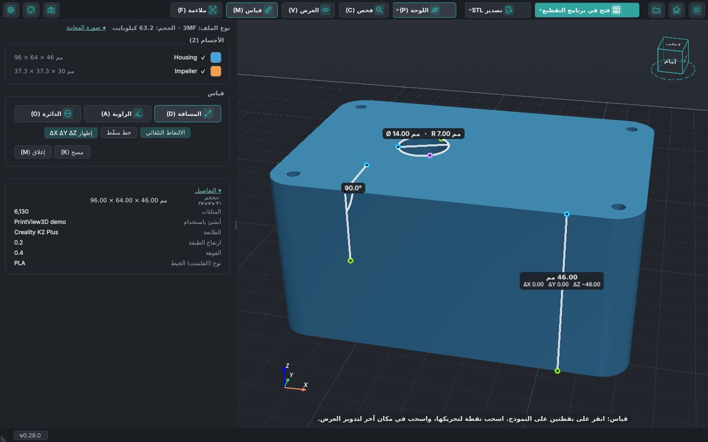
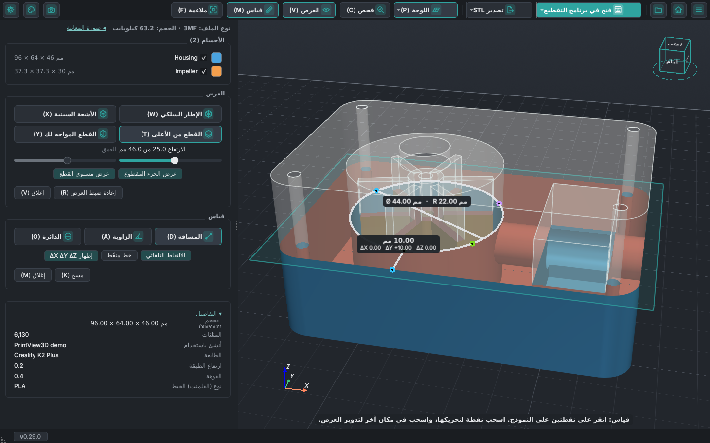
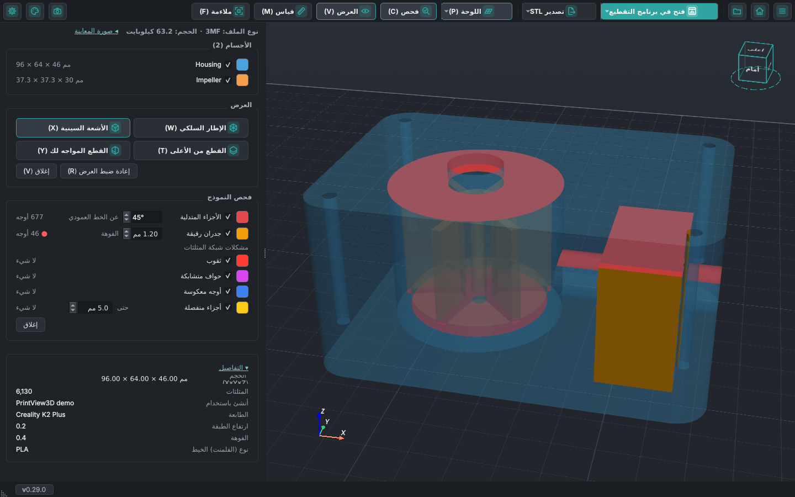
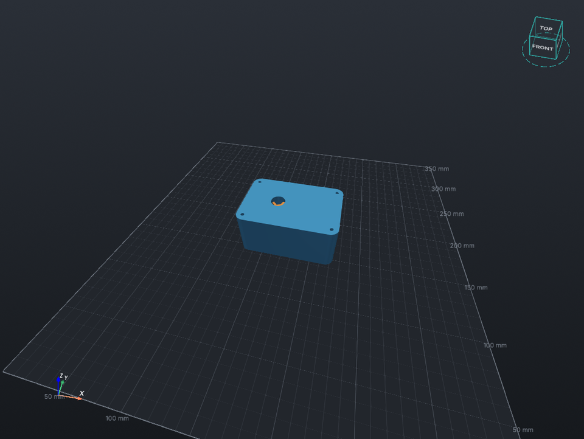

# انظر داخل نماذجك

جدران مجوفة، أجسام مخفية، قنوات، ثقوب براغي: يتيح لك زر **العرض** في شريط الأدوات أن ترى داخل النموذج
قبل طباعته. يعمل مع STL و3MF وOBJ وصيغ النماذج الأخرى (أما G-code فله شريط تمرير الطبقات لهذا الغرض).
يفتح الزر قسم **العرض** في اللوحة الجانبية، وفيه كل خيار على شكل زر: الإطار السلكي والأشعة السينية
والقطع من الأعلى والقطع المواجه لك. تظهر عناصر التحكم في القطع (شريط التمرير والجزء المقطوع ومستوى
القطع وتثبيت القطع المواجه) في القسم نفسه ما دام القطع مفعّلاً، وينتهي القسم بزرَّي **إعادة ضبط
العرض** و**إغلاق**. يوقف **إغلاق** (أو زر العرض) كل خيارات العرض؛ ويفعل **إعادة ضبط العرض** الشيء
نفسه ويلائم النموذج أيضاً. والزر المفعّل يظهر أغمق، فترى فوراً ما هو نشط. وفي لوحة جانبية ضيقة يصغر
خط الأزرار، لكن اللوحة لا تضيق أبداً إلى حدّ تختفي معه أيقونة أو حرف.
*جديد في PrintView3D 0.25؛ وقسم العرض جديد في 0.28.*

<video class="pv-video" src="../assets/inside/clip-facing.mp4" poster="../assets/inside/clip-facing.jpg"
       autoplay loop muted playsinline preload="metadata"
       aria-label="غلاف مضخة يدور عبر قطع عمودي: تظهر الحجرة والمروحة والتجويف وقناة المخرج"></video>

## القطع المواجه لك

قطع عمودي يواجهك دائماً ويُخفي جزء النموذج الواقع أمامه. **أدِر العرض فيدور النموذج عبر القطع**؛ حرّك
العرض (تحريك جانبي) فينزلق النموذج عبره، كأنك تمرّر النموذج أمام ماسح ضوئي. لقطع مستقيم من الأمام أو من
الجانب، انقر ذلك الوجه على مكعب العرض.

يقرّب شريط التمرير في اللوحة الجانبية القطع أو يبعده؛ ويُظهر **العمق** مدى دخول القطع في النموذج، من
عمق النموذج الكامل في ذلك الاتجاه. ويوقف **تثبيت القطع المواجه** (<kbd>L</kbd>، الزر الموجود بجانب
**إعادة ضبط العرض** في قسم العرض) دوران القطع مع العرض، فتستطيع تدوير النموذج وتحريكه والنظر إلى القطع
من الجانب، ويبقى شريط التمرير يحرّكه. هل تقيس على القطع؟ ثبّته أولاً: فالنقطة تبقى حيث وضعتها، وعندما
يدور العرض يتحرك القطع غير المثبّت ويترك النقطة معلّقة في الهواء. وما دام القطع غير مثبّت، يُظهر قسم
القياس بجانب **مسح** نقطة حمراء وعبارة *القطع المواجه لك غير مثبّت*؛ مرّر المؤشر فوقها لمعرفة السبب.
*تثبيت القطع المواجه جديد في 0.29، ويحل محل تجميد مستوى القطع.* يُرسم داخل الجدران التي يكشفها القطع
باللون الأحمر، فترى في الجسم المصمت وجه القطع.

## القطع من الأعلى

يُخفي كل ما فوق ارتفاع معيّن، كما يفعل شريط الطبقات مع G-code. حرّك شريط التمرير في اللوحة الجانبية
لتنزل عبر النموذج طبقة بعد طبقة.

<video class="pv-video" src="../assets/inside/clip-top.mp4" poster="../assets/inside/clip-top.jpg"
       autoplay loop muted playsinline preload="metadata"
       aria-label="قطع ينزل عبر غلاف المضخة ثم يصعد"></video>

## شاهد ما يزيله القطع

يبقى ما يخفيه القطع ظاهراً كـ**شبح** أبيض شفاف بحواف محددة، ويظهر **مستوى القطع** كصفيحة باهتة
بحجم النموذج، فترى ما يزيله القطع وأين. تحت أشرطة التمرير، يُظهر **عرض الجزء المقطوع** و**عرض مستوى
القطع** كلاً منهما أو يخفيانه (كلاهما مفعّل في البداية، ويُحفظ اختيارك). وفي **الإعدادات ← العارض**
لكلٍّ من **الجزء المقطوع** و**مستوى القطع** شريط أخفت … أقوى، ويتغيّر العرض ثلاثي الأبعاد أثناء
السحب. *جديد في PrintView3D 0.26.*

## القطعان معاً

يشغّل كلٌّ من <kbd>T</kbd> و<kbd>Y</kbd> قطعه الخاص ويوقفه، فيمكن تشغيل القطعين معاً: يبقى من
النموذج عندها ما يُبقيه القطعان كلاهما فقط، أي تُقطع منه زاوية. في اللوحة الجانبية شريط تمرير لكل
منهما، **الارتفاع** و**العمق**. ويبقى ما يخفيه القطعان ظاهراً كشبح شفاف واحد متساوٍ، ويتوقف كل
مستوى قطع عند موضع القطع الآخر (ويرسم **الإعدادات ← العارض ← لا تدع مستويي القطع يقطع أحدهما الآخر**
المستويين كاملين، مع خط باهت حيث يلتقيان). يوقف كلَّ قطع زرُّه في قسم العرض أو مفتاحه.
*جديد في PrintView3D 0.27.*

## سحب القطع في العرض ثلاثي الأبعاد

هل تفضّل تحريك القطع حيث تنظر بدلاً من شريط تمريره؟ فعّل **الإعدادات ← العارض ← تحريك مستويات القطع
أيضاً بسحبها في العرض ثلاثي الأبعاد**. عندها يحصل كل قطع على مقبض دائري صغير على حافة مستوى قطعه (قرص
بلون المستوى مع حلقة فاتحة)، يمر فيه خط قصير يُظهر اتجاه حركة القطع: مقبض القطع من الأعلى على جانب
المستوى الأبعد إلى اليمين، ومقبض القطع المواجه لك على الحافة العليا لمستواه. تحت المؤشر يتبادل القرص
والحلقة لونيهما؛ اسحبه فيتبعه القطع وشريط تمريره. عند النظر من الأعلى مباشرة (أو إلى القطع العمودي
بمستوى العين)، اسحب للأعلى لترفع القطع أو تبعده. غير مفعّل افتراضياً. *جديد في PrintView3D 0.29.*

## الأشعة السينية

تصبح الأجسام شفافة، فتظهر الأجسام الموجودة داخل أجسام أخرى والتجاويف والقنوات وثقوب البراغي، من كل
الجهات.

<video class="pv-video" src="../assets/inside/xray.mp4" poster="../assets/inside/xray.jpg"
       autoplay loop muted playsinline preload="metadata"
       aria-label="غلاف المضخة شفافاً وهو يدور: تظهر المروحة والقنوات في داخله"></video>

يمكن استخدام الخيارات معاً، مثل الأشعة السينية مع القطع:

## الإطار السلكي

مثلثات الشبكة: لترى مدى دقة النموذج، أو لتكتشف الأشكال الهندسية المعطوبة.

## حجم كل جسم

تعرض قائمة **الأجسام** حجم كل جسم (X × Y × Z) بجانب اسمه، وحجم النموذج كاملاً موجود في **التفاصيل**.
أزل علامة الاختيار عن جسم لإخفائه.

## القياس

يفتح زر **قياس** بجانب **العرض** (أو <kbd>M</kbd>) قسم القياس. اختر ما تريد قياسه بالأزرار الموجودة
فيه:

- **المسافة**: انقر على نقطتين. يتبع الخط الماوس وتُكتب المسافة بجانبه. فعّل **إظهار ΔX ΔY ΔZ**
  لتُكتب المسافة على طول كل محور تحت كل مسافة، وهذا مفيد لمعرفة "كم الارتفاع من هنا إلى هناك".
- **الزاوية**: انقر على نقطة في ضلع، ثم على الزاوية، ثم على نقطة في الضلع الآخر.
- **الدائرة**: انقر على ثلاث نقاط على حافة دائرة أو ثقب لتقرأ قطرها ونصف قطرها.

ما دام القياس مفعّلاً، تُكتب طريقة استخدام الأداة المختارة أسفل العرض ثلاثي الأبعاد بعد *قياس:*
(وتبدأ تلميحات القطع بـ *القطع:*، فلا يختلط تلميحان معاً). النقر يضع نقطة، والسحب لا يزال يدير العرض،
فتستطيع تدوير النموذج بين النقاط. تبقى القياسات المكتملة ظاهرة وقيمتها مكتوبة بجانبها، والنقرة التالية
تبدأ قياساً جديداً؛ ويزيلها **مسح** (<kbd>K</kbd>) كلها. اسحب نقطة موضوعة لتحريكها. **الالتقاط
التلقائي** (مفعّل عند كل بدء) ينقل النقطة إلى أقرب زاوية أو منتصف حافة أو نقطة على حافة. وعند تشغيل
قطع (العرض ← القطع)، تُعدّ حدود القطع حافةً أيضاً: زواياها ومنتصفات أجزائها المستقيمة وأي نقطة عليها،
فتستطيع قياس الجدران والثقوب داخل النموذج. ولا يُلتقط إلا الجزء الظاهر لك. و**خط منقّط** يرسم الخطوط
منقّطة. وسماكة الخطوط شريط في **الإعدادات ← العارض** (**خطوط القياس**). والقيم التي قد تتداخل، مثل
الدوائر متحدة المركز، تُرتَّب فوق بعضها. ولا يزيل **إعادة ضبط العرض** قياساتك.
*جديد في PrintView3D 0.28؛ والقياس على القطع جديد في 0.29.*

عند تشغيل قطع يمكن القياس على حدود القطع أيضاً، وهنا قطر الحجرة والجدار الذي أمامها، مقطوعين على
ارتفاع 25 مم:

## الألوان واللوحة الجانبية

تأتي قائمة **الأجسام** أولاً في اللوحة الجانبية و**التفاصيل** في الأسفل؛ انقر على *التفاصيل* لطيّها
(ويُحفظ اختيارك). وفي الأعلى ترى نوع الملف وحجمه. انقر على مربع لون جسم لتختار لوناً آخر لهذا الجسم
وحده؛ وانقر عليه بزر الماوس الأيمن للعودة إلى لون الملف. لا تُحفظ الألوان التي تختارها: تعود كما كانت
بعد إعادة التشغيل. وبجانب نوع الملف وحجمه، يطوي *صورة المعاينة* الصورة التي حفظها برنامج التقطيع أو
يفتحها. *جديد في PrintView3D 0.28.*

## الفحص قبل الطباعة {#check-before-printing}

يفتح زر **فحص** (<kbd>C</kbd>، بين اللوحة والعرض) قسم **فحص النموذج** تحت قسم القياس، ويلوّن ما قد
يسبب مشكلات عند الطباعة:

- **الأجزاء المتدلية**: الأوجه التي تتجه إلى الأسفل وتميل عن الخط العمودي أكثر من زاوية معيّنة (45°
  افتراضياً) تحتاج عادةً إلى دعامات. ولا تُحسب الأوجه الملامسة للوحة.
- **الجدران الرقيقة**: الجدران والأوتاد الأرق من الفوهة (0.4 مم افتراضياً). يفحص هذا كل وجه ويعمل في
  الخلفية، لذلك يبقى غير مفعّل حتى تحدّده. يبقى عرض الفوهة بالمليمتر عندما تكون الأطوال بالبوصة
  (فالفوهات تُباع بمقاس 0.4 مم و0.6 مم ...)، ما لم تحدّد **عرض الفوهة بالبوصة أيضاً** بجانب
  **الإعدادات ← اللغة والوحدات ← الأطوال بوحدة**.
- **مشكلات شبكة المثلثات**:
  - **ثقوب**: حواف لها وجه من جهة واحدة فقط (المصطلح التقني: حواف مفتوحة).
  - **حواف متشابكة**: حواف يشترك فيها ثلاثة أوجه أو أكثر (حواف non-manifold).
  - **أوجه معكوسة**: أوجه يتجه وجهها الأمامي إلى داخل النموذج (نواظم معكوسة).
  - **أجزاء منفصلة**: قطع صغيرة غير متصلة بالجسم الرئيسي، حتى حجم تحدده (5 مم افتراضياً، وهو أطول
    أضلاعها). القطع الأكبر تُعدّ أجساماً مستقلة، والتجويف داخل الجزء ليس جزءاً منفصلاً. والعدد هو عدد
    الأجزاء المنفصلة الملوّنة.

  تُستثنى المثلثات التي لا مساحة لها (زواياها الثلاث على خط واحد، وهي شائعة في الملفات المُصدَّرة):
  فهي لا تغيّر الشكل، وبرامج التقطيع تتجاهلها.

لكل فحص مربع لون (انقر لتغييره) وعدد؛ وتُشير نقطة حمراء إلى أعداد المشكلات التي عُثر عليها (الجدران
الرقيقة ومشكلات الشبكة؛ لا الأجزاء المتدلية، فمعظم النماذج فيها شيء منها). مرّر المؤشر فوق اسم لترى
معناه ومصطلحه التقني. وتتبع الألوان القطع والأجسام التي تخفيها. ويُحفظ ما فعّلته من فحوصات والزاوية
وعرض الفوهة وحجم الأجزاء المنفصلة. وتعود الألوان إلى الافتراضية عند إعادة التشغيل، ما لم تحدّد
**الإعدادات ← العارض ← تذكّر ألوان قسم الفحص**. *جديد في PrintView3D 0.29.*

يعمل الفحص مع النماذج (STL و3MF وOBJ وصيغ النماذج الأخرى)، لا مع G-code. إنه يدلّك على المواضع التي
تستحق النظر، أما طريقة الطباعة فيقررها برنامج التقطيع.

## فتح مجلد

يعرض **القائمة ← فتح مجلد…** الملفات ثلاثية الأبعاد في مجلد داخل اللوحة الجانبية ويفتح أولها. تتنقل
<kbd>↑</kbd> / <kbd>↓</kbd> بينها كما في ملف ZIP، أو انقر على اسم. لا تُعرض ملفات ZIP الموجودة في
المجلد: افتحها بـ **فتح ملف أو ZIP…** (<kbd>Ctrl</kbd>+<kbd>O</kbd>). *جديد في PrintView3D 0.29.*

## المليمتر أو البوصة

يعرض **الإعدادات ← اللغة والوحدات ← الأطوال بوحدة** كل الأطوال بالمليمتر أو بالبوصة: الأحجام
والقياسات والقطع والشبكة وأرقامها وحجم اللوحة. لا تتغير الملفات؛ فالملفات ثلاثية الأبعاد دائماً
بالمليمتر. *جديد في PrintView3D 0.29.*

## أرقام المقياس على الشبكة

يكتب **الإعدادات ← العارض ← إظهار أرقام المقياس على الشبكة** (غير مفعّل افتراضياً) أرقاماً صغيرة
(بالوحدة التي اخترتها) على طول لوحة الطباعة، بقدر ما يتسع عند التكبير الذي تنظر به: كبّر على جزء صغير
فتأتي كل 10 مم، وصغّر فتأتي كل 50 أو 100 أو 250 مم. وهي دائماً على خطوط الشبكة ولا تتقارب أكثر من
الخطوط الدقيقة (**خطوط الشبكة كل**). تظهر خارج الحافتين الأقرب إليك مباشرة، بلون الشبكة نفسه، وتبقى
قائمة أياً كان اتجاه نظرك، وتختفي عند النظر من أسفل اللوحة. وتبدأ العدّ من الزاوية الأمامية اليسرى
للوحة (0 هناك، ويُكتب مرة واحدة بجانب الزاوية)، أياً كانت الإحداثيات التي تستخدمها الطابعة، فلا أرقام
سالبة. ومع الشبكة اللانهائية تتبع المنطقة المحيطة بالنموذج وتبدأ العدّ من الزاوية الأمامية اليسرى
للنموذج، حيث تبدأ خطوط الشبكة أيضاً. ويختار **المسافة بين الأرقام** مسافة أخرى، من 5 إلى 100 مم
(مثلاً 10 مم)، بدلاً من المسافة التلقائية. ويضبط **خطوط الشبكة كل** و**الخطوط الرئيسية كل** تباعد
الشبكة نفسها (تلقائياً: 10 و50 مم على لوحة عادية، و¼ و1 بوصة بالبوصة). وتقع الخطوط الرئيسية دائماً على
خطوط دقيقة كي تبقى الشبكة منتظمة: مع خطوط دقيقة كل 20 مم يمكنك اختيار خطوط رئيسية كل 20 أو 100 أو 200
مم، و*تلقائي* يعني حينها كل 100 مم.
*جديد في PrintView3D 0.28؛ وتباعد الشبكة والأرقام التي تتبع التكبير والعدّ من 0 جديدة في 0.29.*

## X وY وZ على اللوحة

يرسم **الإعدادات ← العارض ← إظهار المحاور X وY وZ على لوحة الطباعة أيضاً** (غير مفعّل افتراضياً، تحت
*إظهار شبكة لوحة الطباعة* مباشرة) ثلاثة أسهم صغيرة (X أحمر وY أخضر وZ أزرق، كما في المؤشر في زاوية
العرض) بجانب الزاوية الخلفية اليمنى للنموذج، بحجم عُشر حجمه تقريباً. تبقى في مكانها عند تدوير العرض،
وتختفي مع اللوحة. *جديد في PrintView3D 0.29.*

## المفاتيح

| المفتاح | |
|---|---|
| <kbd>W</kbd> | الإطار السلكي تشغيل / إيقاف |
| <kbd>X</kbd> | الأشعة السينية تشغيل / إيقاف |
| <kbd>T</kbd> | القطع من الأعلى تشغيل / إيقاف |
| <kbd>Y</kbd> | القطع المواجه لك تشغيل / إيقاف |
| <kbd>F</kbd> | الملاءمة: النموذج كاملاً في العرض (ولا يتغير شيء آخر) |
| <kbd>R</kbd> | إعادة ضبط العرض: إيقاف الإطار السلكي والأشعة السينية والقطع، وملاءمة النموذج (تبقى القياسات)؛ ومع G-code يلائم العرض |
| <kbd>M</kbd> | القياس تشغيل / إيقاف |
| <kbd>D</kbd> / <kbd>A</kbd> / <kbd>O</kbd> | قياس مسافة، زاوية، دائرة |
| <kbd>V</kbd> | قسم العرض تشغيل / إيقاف |
| <kbd>C</kbd> | فحص النموذج تشغيل / إيقاف |
| <kbd>P</kbd> | لوحة الطباعة تشغيل / إيقاف |
| <kbd>S</kbd> | الإعدادات |

هذه هي المفاتيح التي يأتي بها PrintView3D؛ ويمكنك في **الإعدادات ← لوحة المفاتيح والماوس** إعطاء أيٍّ
منها مفتاحاً خاصاً بك (و**استعادة الافتراضيات** يعيدها).

تُظهر أزرار شريط الأدوات وأزرار قسمي العرض والقياس مفاتيحها، مثل *قياس (M)* و*ملاءمة (F)* و*الإطار
السلكي (W)*، وتتغير معها عندما تغيّر مفتاحاً.

يبقى الإطار السلكي والأشعة السينية مفعّلين عند فتح النموذج التالي؛ أما القطع والقياسات فتُزال.

## جرّبه بنفسك

غلاف المضخة في هذه الصفحة هو الملف
[`examples/demo_housing.3mf`](https://github.com/sevagjb/PrintView3D/raw/main/examples/demo_housing.3mf)
في الكود المصدري: نزّله وافتحه في PrintView3D.

اقترح هذه الميزات [@covrig](https://github.com/covrig)، وطوّر أيضاً القياس وقسم العرض وألوان
الأجسام وأرقام الشبكة وفحص النموذج
([#59](https://github.com/sevagjb/PrintView3D/issues/59)،
[#60](https://github.com/sevagjb/PrintView3D/issues/60)،
[#77](https://github.com/sevagjb/PrintView3D/pull/77)،
[#80](https://github.com/sevagjb/PrintView3D/pull/80)). لديك فكرة أيضاً؟
[افتح طلباً (issue)](https://github.com/sevagjb/PrintView3D/issues/new/choose).
