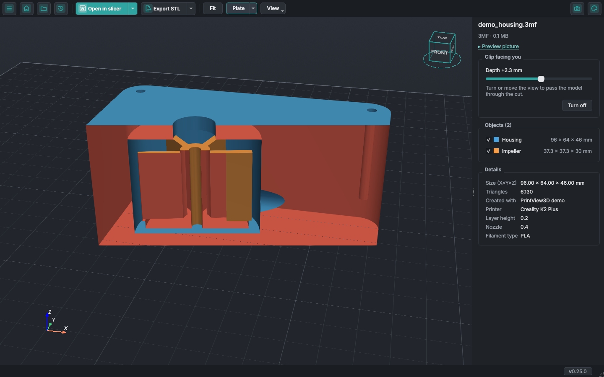
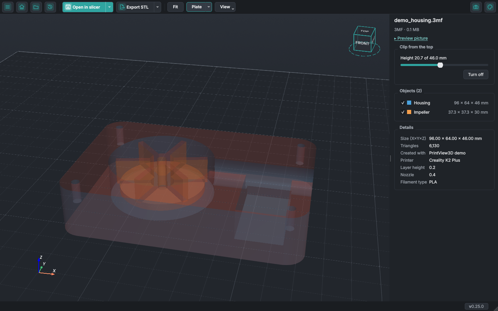
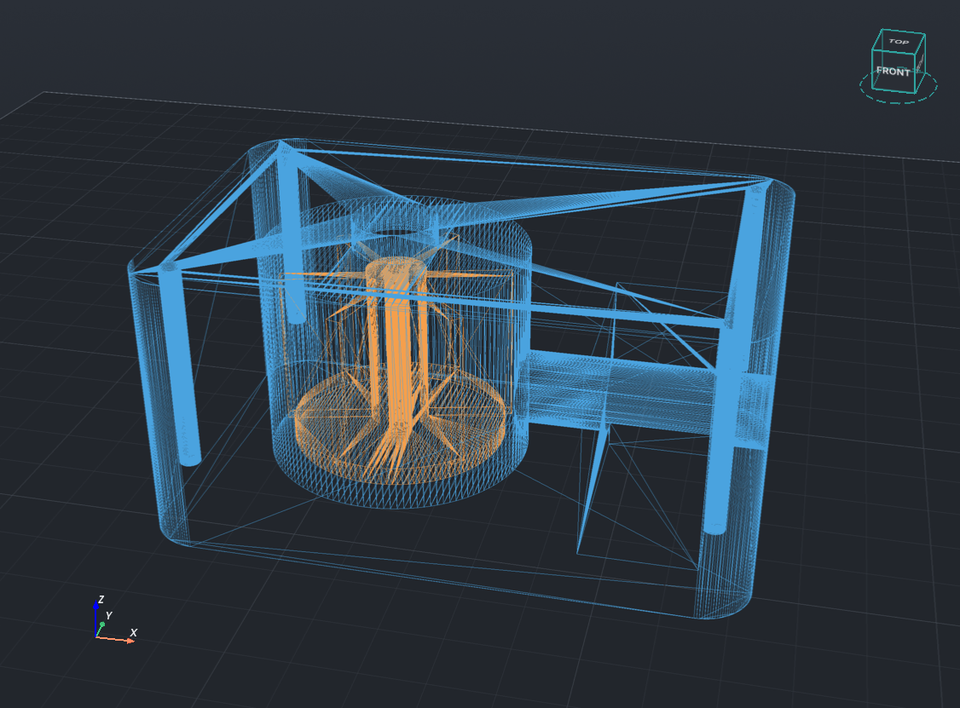
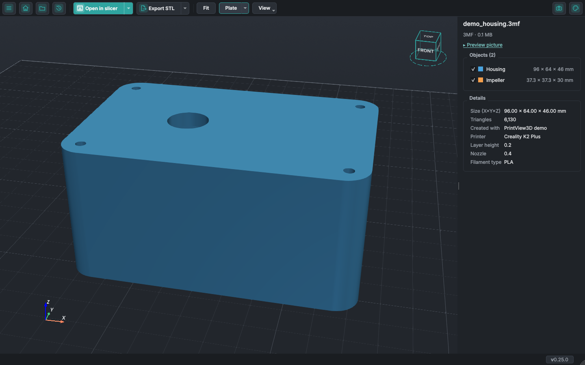
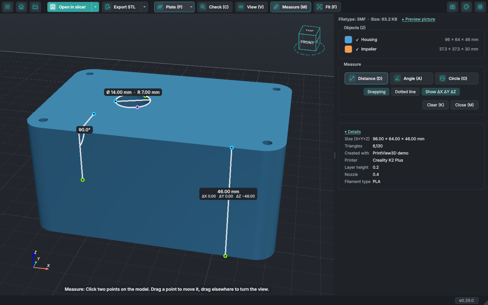
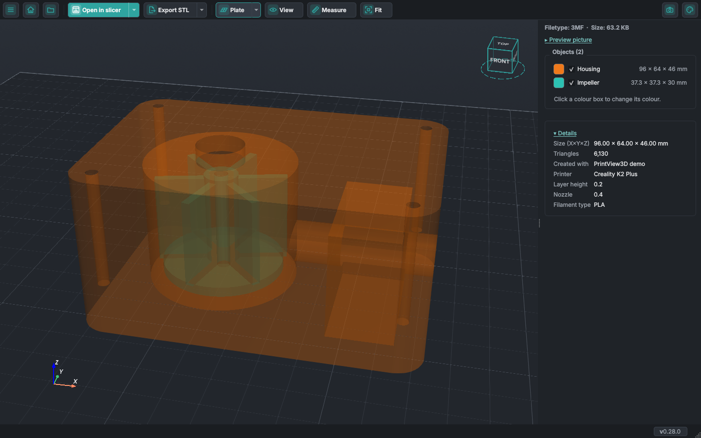
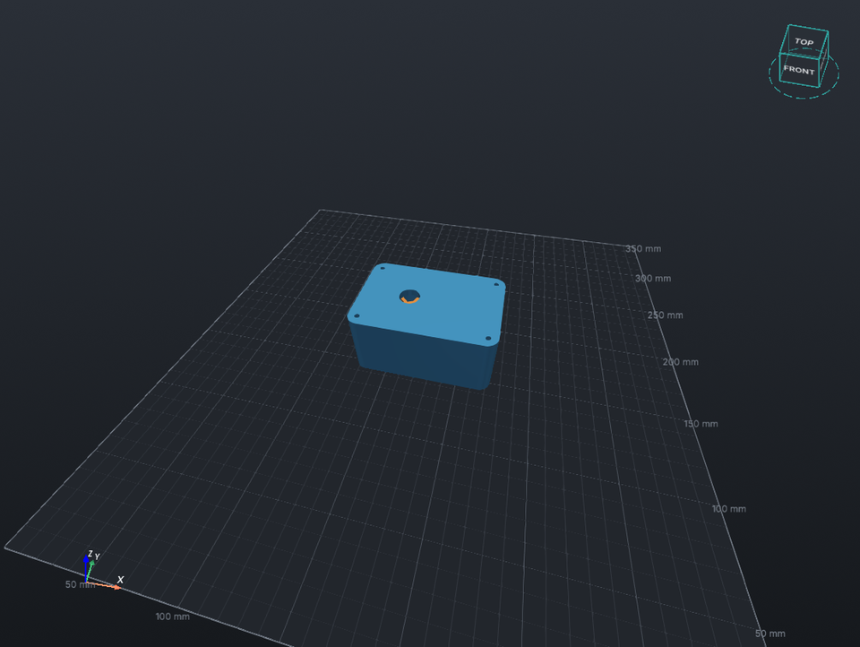

# Look inside your models

Hollow walls, hidden parts, channels, screw holes: the **View** button in the toolbar lets you look
inside a model before you print it. It works for STL, 3MF, OBJ and the other model formats
(G-code has its layer slider for this). The button opens a **View** section in the side panel with
every option as a button: Wireframe, X-ray, Clip from the top and Clip facing you. The controls of a
cut (its slider, the cut-away part, the cutting plane and Freeze) appear in the same section while
the cut is on, and the section ends with **Reset view** and **Close**. Close (or the View button) turns every view
option off; Reset view does the same and fits the model. A button that is on is drawn darker, so you
see at a glance what is active. In a narrow side panel the buttons get a smaller font; the panel never
gets so narrow that an icon or a letter has to go.
*New in PrintView3D 0.25; the View section is new in 0.28.*

<video class="pv-video" src="assets/inside/clip-facing.mp4" poster="assets/inside/clip-facing.jpg"
       autoplay loop muted playsinline preload="metadata"
       aria-label="A pump housing turning through an upright cut: the chamber, impeller, pocket and outlet channel come into view"></video>

## Clip facing you

An upright cut that always faces you and hides the part of the model in front of it.
**Turn the view and the model turns through the cut**; move (pan) the view and it slides across,
as if you held the model up to a scanner. For a cut straight from the front or the side, click
that face on the view cube.

The slider in the side panel moves the cut nearer or further; **Depth** shows how far the cut is
into the model, out of the model's depth in that direction. **Freeze the cutting plane** (in the
View section) keeps the cut where it is, so you can turn and move the model without the cut turning
along. The inside of the walls the cut lays open is drawn in red, so on a solid part you see the cut
face.

## Clip from the top

Hides everything above a height, like the layer slider does for G-code. Move the slider in the
side panel to go down through the model, layer by layer.

<video class="pv-video" src="assets/inside/clip-top.mp4" poster="assets/inside/clip-top.jpg"
       autoplay loop muted playsinline preload="metadata"
       aria-label="A cut moving down through the pump housing and back up"></video>

## See what the cut takes away

What a cut hides stays as a white, see-through **ghost** with outlined edges, and the **cutting
plane** shows as a faint sheet the size of the model, so you see what the cut takes away and where.
Under the sliders, **Show the cut-away part** and **Show the cutting plane** turn each on or off
(both on at first; your choice is remembered). In **Settings → Viewer**, **Cut-away part** and
**Cutting plane** each have a Fainter … Stronger slider, and the 3D view changes while you drag.
*New in PrintView3D 0.26.*

## Both cuts at once

<kbd>C</kbd> and <kbd>V</kbd> each turn their own cut on and off, so both can be on together: the
model then keeps only what both cuts keep, a corner cut away. The side panel has a slider for each,
**Height** and **Depth**. What the cuts hide still shows as one even, see-through ghost, and each
cutting plane stops where the other cut is (**Settings → Viewer → Don't let the two cutting planes
cut each other** draws both whole, with a faint line where they meet). The cut buttons in the View section, or the keys, end each cut.
*New in PrintView3D 0.27.*

## X-ray

The parts become see-through, so parts inside other parts, cavities, channels and screw holes
show, from every side.

<video class="pv-video" src="assets/inside/xray.mp4" poster="assets/inside/xray.jpg"
       autoplay loop muted playsinline preload="metadata"
       aria-label="The pump housing see-through, turning: the impeller and channels inside"></video>

The options work together, for example X-ray with a cut:

## Wireframe

The triangles of the mesh: to see how fine a model is, or to spot broken geometry.

## The size of every object

The **Objects** list shows each object's size (X × Y × Z) next to its name; the size of the
whole model is in **Details**. Untick an object to hide it.

## Measure

The **Measure** button next to **View** (or <kbd>M</kbd>) opens the Measure section. Choose what to
measure with the buttons in it:

- **Distance**: click two points. The line follows the mouse and the distance is written next to
  it. Tick **Show ΔX ΔY ΔZ** to write the distance along each axis under every distance, handy for
  "how tall from here to there".
- **Angle**: click a point on one side, the corner, then a point on the other side.
- **Circle**: click three points on the edge of a circle or hole to read its diameter and radius.

How to use the chosen tool is written at the bottom of the 3D view while Measure is on. A click places a point, a drag still turns the view, so you can turn the model between points.
Finished measurements stay on screen with their value written next to them, and the next click
starts another; **Clear** removes them all. Drag a placed point to move it. **Snapping** (on at
every start) jumps to the nearest corner, the middle of an edge or a point on an edge. **Dotted line**
draws the lines as dots. How thick the lines are is a slider in **Settings → Viewer**
(**Measurement lines**). Values that would overlap, such as concentric circles, are stacked above
each other. **Reset view** leaves your measurements in place. *New in PrintView3D 0.28.*

## Colours and the side panel

The **Objects** list comes first in the side panel and the **Details** last; click *Details* to fold
them away (the choice is remembered). At the top you see the file type and size. Click the colour
box of an object to pick another colour for that object alone; right-click it to go back to the
colour from the file. Colours you pick are not saved: they are back to normal after you restart.
Next to the file type and size, *Preview picture* folds the picture the slicer saved away or opens it. *New in PrintView3D 0.28.*

## Check before printing

The **Check** button (<kbd>K</kbd>, between Plate and View) opens the **Check model** section, below
Measure, and colours what may cause trouble when printing:

- **Overhangs**: faces that face down and lean further from vertical than an angle (45° by default)
  usually need supports. Faces resting on the plate don't count.
- **Thin walls**: walls and pins thinner than the nozzle (0.4 mm by default). This looks at every
  face and runs in the background, so it is off until you tick it.
- **Mesh**:
  - **Holes**: edges with a face on one side only (technical term: open edges).
  - **Tangled edges**: edges shared by three or more faces (non-manifold edges).
  - **Inside-out faces**: faces whose front points into the model (flipped normals).
  - **Loose parts**: small pieces not connected to the main body, up to a size you set (5 mm by
    default, their longest side). Bigger pieces count as objects of their own, and a hollow inside
    a part is not a loose part.

  Triangles with no area (three corners on one line, common in exported files) are left out: they
  don't change the shape and slicers ignore them.

Each has a colour box (click to change it) and a count; hover over a name to see what it means and
its technical term. The highlights follow the cuts and the objects you hide. Which checks are on,
the angle, the nozzle width and the loose-part size are remembered. The colours go back to their
defaults when you restart, unless you tick **Settings → Viewer → Remember the colours of the Check
section**.

## Open a folder

**Menu → Open folder…** lists the 3D files of a folder in the side panel and opens the first one.
<kbd>↑</kbd> / <kbd>↓</kbd> step through them, as in a ZIP, or click a name. ZIP files in the folder
are not listed: open them with **Open file or ZIP…** (<kbd>Ctrl</kbd>+<kbd>O</kbd>).

## Millimetres or inches

**Settings → Language and units → Lengths in** shows every length in millimetres or in inches: sizes,
measurements, the cuts, the grid and its numbers, and the plate size. Files are not changed; 3D
files are always in millimetres.

## Scale numbers on the grid

**Settings → Viewer → Show scale numbers on the grid** (off by default) writes small numbers (in the
unit you chose) along the build plate, on its major grid lines: every 50 mm on a normal plate, thinned
to every 100 or 250 mm on a big one so a few readable numbers remain. They sit just outside the two
edges nearest to you, in the grid's own colour, stay upright whichever way you look, and hide when
you look from under the plate. They count from the plate's front-left corner (0 there), whatever
coordinates the printer uses, so there are no negative numbers. With the endless grid they follow the
area around the model and count from the model's front-left corner, where the grid's lines start too.
**Spacing of the numbers** chooses another spacing, from 5 to 100 mm (for example 10 mm), instead
of the automatic one. **Grid lines every** and **Main grid lines every** set the spacing of the grid
itself (automatic: 10 and 50 mm on a normal plate, ¼ and 1 inch in inches). *New in PrintView3D 0.28.*

## X, Y and Z on the plate

**Settings → Viewer → Also show the X, Y and Z axes on the build plate** (off by default, just under
*Show build plate grid*) draws three small arrows (X red, Y green, Z blue, as in the marker in the
corner of the view) just beside the back-right corner of the model, about a tenth of its size. They
stay there as you turn the view and hide with the plate.

## Keys

| Key | |
|---|---|
| <kbd>W</kbd> | Wireframe on / off |
| <kbd>X</kbd> | X-ray on / off |
| <kbd>C</kbd> | Clip from the top on / off |
| <kbd>V</kbd> | Clip facing you on / off |
| <kbd>R</kbd> | Reset view: wireframe, X-ray and the cuts off, model fitted (measurements stay); on G-code it fits the view |
| <kbd>M</kbd> | Measure on / off |
| <kbd>D</kbd> / <kbd>A</kbd> / <kbd>O</kbd> | Measure a distance, an angle, a circle |
| <kbd>I</kbd> | View section on / off |
| <kbd>K</kbd> | Check model on / off |
| <kbd>P</kbd> | Build plate on / off |

The toolbar buttons and the buttons of the View and Measure sections show their key, for example
*Measure (M)* and *Wireframe (W)*. **Fit** has no key of its own: <kbd>R</kbd> fits the model too.

Wireframe and X-ray stay on when you open the next model; the cuts and the measurements are removed.

## Try it yourself

The pump housing on this page is
[`examples/demo_housing.3mf`](https://github.com/sevagjb/PrintView3D/raw/main/examples/demo_housing.3mf)
in the source code: download it and open it in PrintView3D.

These features were suggested, and Measure, the View section, the object colours and the grid
numbers built, by [@covrig](https://github.com/covrig)
([#59](https://github.com/sevagjb/PrintView3D/issues/59),
[#60](https://github.com/sevagjb/PrintView3D/issues/60)). Have an idea too?
[Open an issue](https://github.com/sevagjb/PrintView3D/issues/new/choose).
