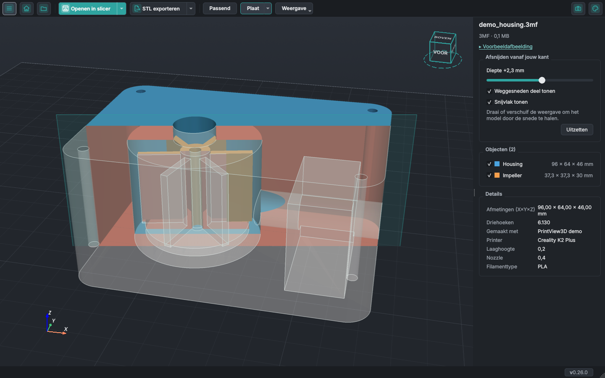
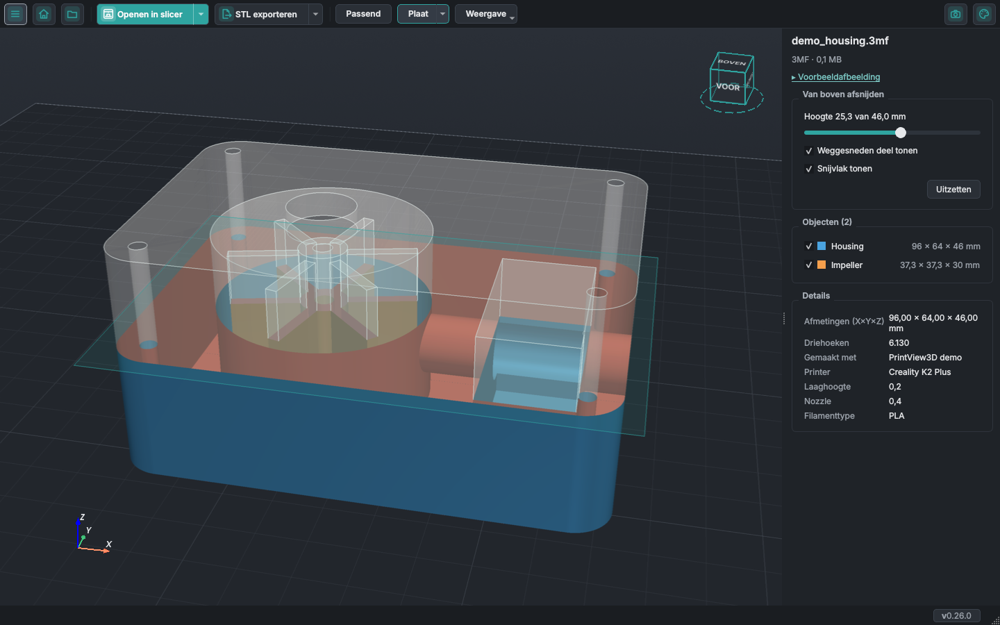
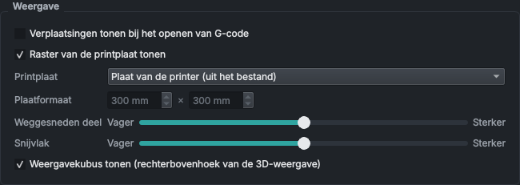
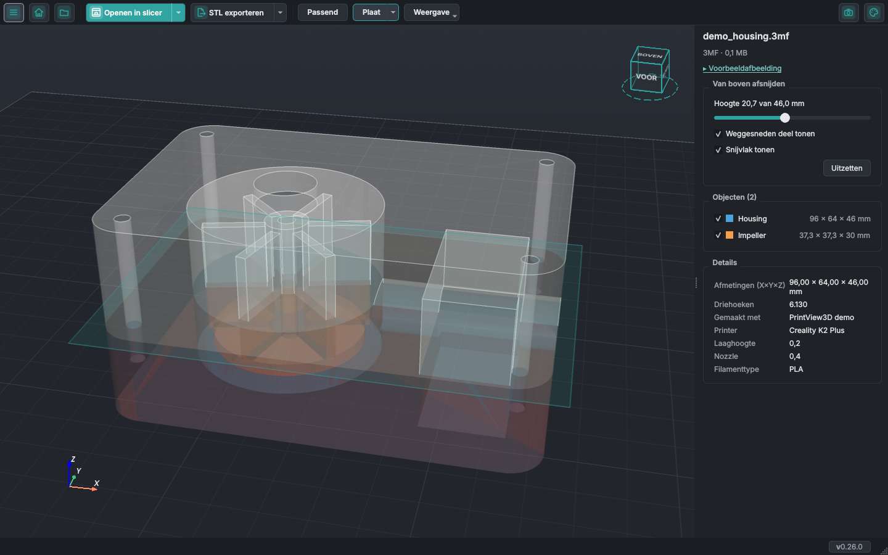
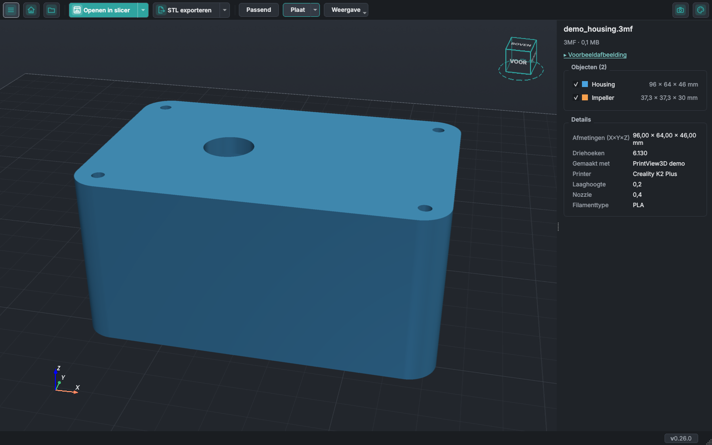

# In je modellen kijken

Holle wanden, verborgen onderdelen, kanalen, schroefgaten: met de knop **Weergave** in de werkbalk kijk
je in een model voordat je het print. Het werkt voor STL, 3MF, OBJ en de andere modelformaten (G-code
heeft hiervoor de laagschuifregelaar). *Nieuw in PrintView3D 0.25; de schim van het weggesneden deel is nieuw in 0.26.*

<video class="pv-video" src="../assets/inside/clip-facing.mp4" poster="../assets/inside/clip-facing.jpg"
       autoplay loop muted playsinline preload="metadata"
       aria-label="Een pomphuis draait door een rechtopstaande snede: de kamer, de waaier, de holte en het uitlaatkanaal worden zichtbaar"></video>

## Afsnijden vanaf jouw kant

Een rechtopstaande snede die altijd naar je toe gericht is en het deel van het model ervoor verbergt.
**Draai de weergave en het model draait door de snede**; verschuif (pan) de weergave en het schuift
erlangs, alsof je het model voor een scanner houdt. Voor een snede recht van voren of van opzij klik je
dat vlak op de weergavekubus aan.

De schuifregelaar in het zijpaneel zet de snede dichterbij of verder weg. De binnenkant van de wanden
die de snede openlegt is rood, dus bij een massief onderdeel zie je het snijvlak.

## Van boven afsnijden

Verbergt alles boven een hoogte, zoals de laagschuifregelaar dat bij G-code doet. Schuif de regelaar in
het zijpaneel om laag voor laag door het model omlaag te gaan.

<video class="pv-video" src="../assets/inside/clip-top.mp4" poster="../assets/inside/clip-top.jpg"
       autoplay loop muted playsinline preload="metadata"
       aria-label="Een snede gaat omlaag door het pomphuis en weer omhoog"></video>

Eén snede tegelijk: <kbd>C</kbd> en <kbd>V</kbd> wisselen ertussen. **Uitzetten** in het zijpaneel, of
dezelfde toets nog eens, toont het hele model weer.

## Zie wat de snede wegneemt

Bij beide sneden blijft het deel dat de snede verbergt zichtbaar als een witte, doorzichtige schim met
omlijnde randen, en het snijvlak verschijnt als een vaag vlak zo groot als het model. Zo zie je wat de
snede wegneemt, en waar.

Twee vinkjes onder de schuif, **Weggesneden deel tonen** en **Snijvlak tonen**, zetten elk aan of uit;
je keuze wordt onthouden. In **Instellingen → Weergave** hebben **Weggesneden deel** en **Snijvlak**
elk een schuif **Vager … Sterker**, en de 3D-weergave verandert terwijl je sleept.

## Röntgen

De onderdelen worden doorzichtig, zodat onderdelen in andere onderdelen, holtes, kanalen en schroefgaten
zichtbaar worden, van alle kanten.

<video class="pv-video" src="../assets/inside/xray.mp4" poster="../assets/inside/xray.jpg"
       autoplay loop muted playsinline preload="metadata"
       aria-label="Het pomphuis doorzichtig en draaiend: de waaier en de kanalen erbinnen"></video>

De opties werken samen, bijvoorbeeld röntgen met een snede:

## Draadmodel

De driehoeken van het mesh: om te zien hoe fijn een model is, of om kapotte geometrie te vinden.

## De maat van elk object

De lijst **Objecten** toont van elk object de maat (X × Y × Z) naast de naam; de maat van het hele model
staat bij **Details**. Vink een object uit om het te verbergen.

## Toetsen

| Toets | |
|---|---|
| <kbd>W</kbd> | Draadmodel aan / uit |
| <kbd>X</kbd> | Röntgen aan / uit |
| <kbd>C</kbd> | Van boven afsnijden aan / uit |
| <kbd>V</kbd> | Afsnijden vanaf jouw kant aan / uit |
| <kbd>R</kbd> | Weergave herstellen: alles hierboven uit, model passend |

De opties blijven aan als je het volgende model opent. **Weergave herstellen** (<kbd>R</kbd>, ook in het
menu **Weergave**) zet ze allemaal uit en past het model in beeld, in één keer.

## Probeer het zelf

Het pomphuis op deze pagina is
[`examples/demo_housing.3mf`](https://github.com/sevagjb/PrintView3D/raw/main/examples/demo_housing.3mf)
in de broncode: download het en open het in PrintView3D.

Deze functies zijn voorgesteld door [@covrig](https://github.com/covrig)
([#59](https://github.com/sevagjb/PrintView3D/issues/59),
[#60](https://github.com/sevagjb/PrintView3D/issues/60),
[#66](https://github.com/sevagjb/PrintView3D/issues/66)). Heb je ook een idee?
[Open een issue](https://github.com/sevagjb/PrintView3D/issues/new/choose).
