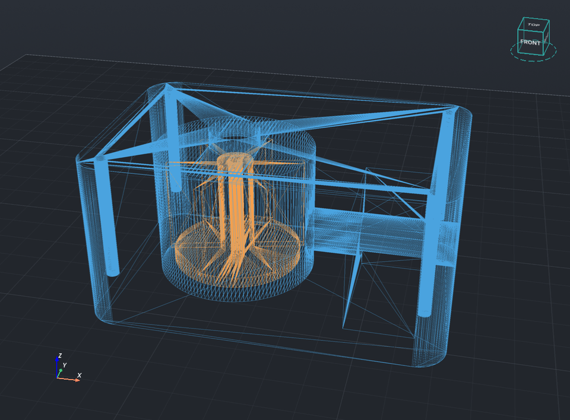
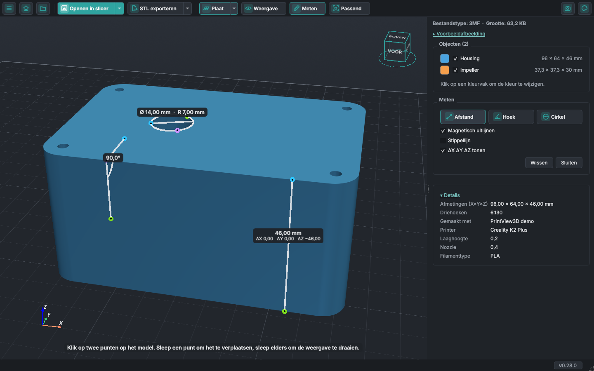
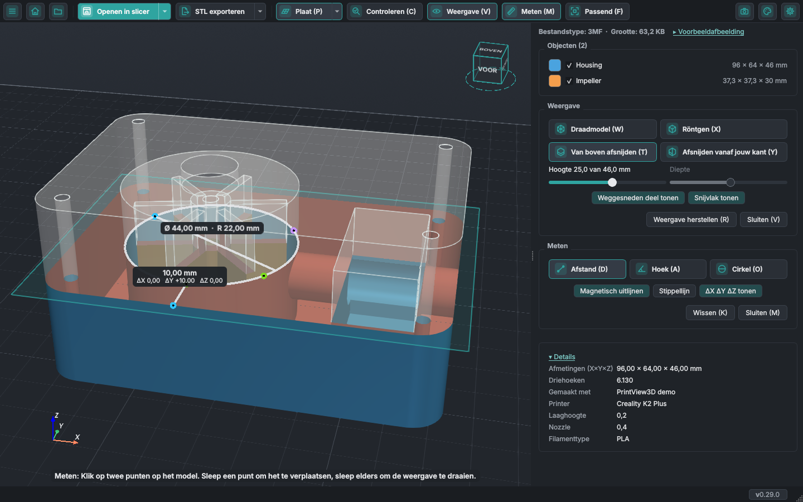
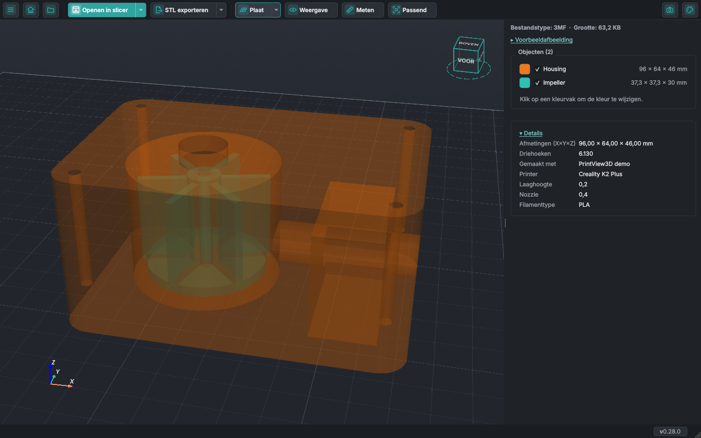
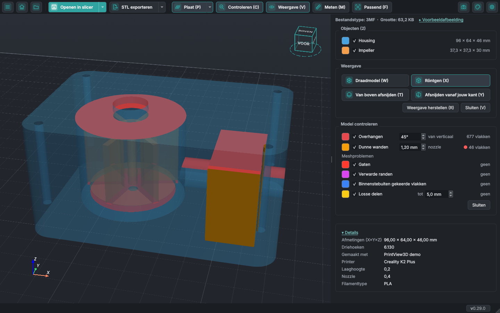
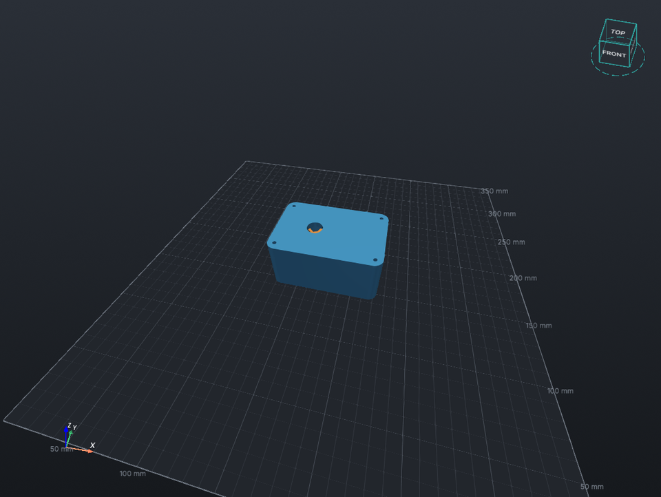

# In je modellen kijken

Holle wanden, verborgen onderdelen, kanalen, schroefgaten: met de knop **Weergave** in de werkbalk kijk
je in een model voordat je het print. Het werkt voor STL, 3MF, OBJ en de andere modelformaten (G-code
heeft hiervoor de laagschuifregelaar). De knop opent het onderdeel **Weergave** in het zijpaneel, met
elke optie als knop: Draadmodel, Röntgen, Van boven afsnijden en Afsnijden vanaf jouw kant. De
instellingen van een snede (de schuif, het weggesneden deel, het snijvlak en Snede vastzetten)
verschijnen daar zolang de snede aan staat, en het onderdeel eindigt met **Weergave herstellen** en
**Sluiten**. Sluiten (of de knop Weergave) zet alle weergave-opties uit; Weergave herstellen doet
hetzelfde en past het model in beeld. Een knop die aan staat is donkerder, zodat je meteen ziet wat
actief is. In een smal zijpaneel krijgen de knoppen een kleinere letter; het paneel wordt nooit zo
smal dat er een pictogram of een letter wegvalt.
*Nieuw in PrintView3D 0.25; het onderdeel Weergave is nieuw in 0.28.*

<video class="pv-video" src="../assets/inside/clip-facing.mp4" poster="../assets/inside/clip-facing.jpg"
       autoplay loop muted playsinline preload="metadata"
       aria-label="Een pomphuis draait door een rechtopstaande snede: de kamer, de waaier, de holte en het uitlaatkanaal worden zichtbaar"></video>

## Afsnijden vanaf jouw kant

Een rechtopstaande snede die altijd naar je toe gericht is en het deel van het model ervoor verbergt.
**Draai de weergave en het model draait door de snede**; verschuif (pan) de weergave en het schuift
erlangs, alsof je het model voor een scanner houdt. Voor een snede recht van voren of van opzij klik je
dat vlak op de weergavekubus aan.

De schuifregelaar in het zijpaneel zet de snede dichterbij of verder weg; **Diepte** toont hoe ver de
snede in het model zit, van de totale diepte van het model in die richting. **Snede vastzetten**
(<kbd>L</kbd>, de knop links van Weergave herstellen in het onderdeel Weergave) zorgt dat de snede niet
meer meedraait met de weergave, zodat je het model kunt draaien en verschuiven en de snede van opzij
kunt bekijken; de schuif verplaatst haar nog steeds. Meet je op de snede? Zet haar dan eerst vast: een
punt blijft waar je het plaatste, dus als de weergave draait, schuift een losse snede door en blijft
het punt in de lucht hangen. Zolang de snede niet vastzit, toont het onderdeel Meten links van Wissen
een rode stip en *Snede vanaf jouw kant niet vastgezet*; beweeg erover voor de uitleg.
*Snede vastzetten is nieuw in 0.29 en vervangt Snijvlak bevriezen.* De binnenkant van de wanden die de
snede openlegt is rood, dus bij een massief onderdeel zie je het snijvlak.

## Van boven afsnijden

Verbergt alles boven een hoogte, zoals de laagschuifregelaar dat bij G-code doet. Schuif de regelaar in
het zijpaneel om laag voor laag door het model omlaag te gaan.

<video class="pv-video" src="../assets/inside/clip-top.mp4" poster="../assets/inside/clip-top.jpg"
       autoplay loop muted playsinline preload="metadata"
       aria-label="Een snede gaat omlaag door het pomphuis en weer omhoog"></video>

## Zie wat de snede wegneemt

Wat een snede verbergt blijft zichtbaar als een witte, doorzichtige **schim** met omlijnde randen,
en het **snijvlak** verschijnt als een vaag vlak zo groot als het model, zodat je ziet wat de snede
wegneemt en waar. Onder de schuiven zetten **Weggesneden deel tonen** en **Snijvlak tonen** elk aan
of uit (eerst allebei aan; je keuze wordt onthouden). In **Instellingen → Weergave** hebben
**Weggesneden deel** en **Snijvlak** elk een schuif Vager … Sterker, en de 3D-weergave verandert
terwijl je sleept. *Nieuw in PrintView3D 0.26.*

## Beide sneden tegelijk

<kbd>T</kbd> en <kbd>Y</kbd> zetten elk hun eigen snede aan en uit, dus beide kunnen tegelijk aan
staan: het model houdt dan alleen over wat beide sneden overlaten, een hoek eruit gesneden. Het
zijpaneel heeft voor elk een schuif, **Hoogte** en **Diepte**. Wat de sneden verbergen blijft
zichtbaar als één gelijkmatige, doorzichtige schim, en elk snijvlak stopt waar de andere snede is
(**Instellingen → Weergave → De twee snijvlakken elkaar niet laten snijden** tekent ze allebei heel,
met een vage lijn waar ze elkaar raken). De snijknoppen in het onderdeel Weergave, of de toetsen,
zetten elke snede uit. *Nieuw in PrintView3D 0.27.*

## De sneden in de 3D-weergave slepen

Verplaats je een snede liever daar waar je kijkt dan met haar schuif? Vink **Instellingen → Weergave →
De snijvlakken ook verplaatsen door ze in de 3D-weergave te slepen** aan. Elke snede krijgt dan een
kleine ronde greep aan de rand van haar snijvlak (een schijfje in de kleur van het vlak met een lichte
ring), met een kort lijntje erdoor dat laat zien in welke richting de snede beweegt: die van Van boven
afsnijden aan de kant van het vlak die het verst naar rechts ligt, die van Afsnijden vanaf jouw kant
aan de bovenrand van haar vlak. Onder de muis wisselen schijf en ring van kleur; sleep eraan en de
snede volgt, met haar schuif. Recht van boven gezien (of de rechtopstaande snede op ooghoogte) sleep je
omhoog om de snede omhoog of verder weg te zetten. Standaard uit. *Nieuw in PrintView3D 0.29.*

## Röntgen

De onderdelen worden doorzichtig, zodat onderdelen in andere onderdelen, holtes, kanalen en schroefgaten
zichtbaar worden, van alle kanten.

<video class="pv-video" src="../assets/inside/xray.mp4" poster="../assets/inside/xray.jpg"
       autoplay loop muted playsinline preload="metadata"
       aria-label="Het pomphuis doorzichtig en draaiend: de waaier en de kanalen erbinnen"></video>

De opties werken samen, bijvoorbeeld röntgen met een snede:

## Draadmodel

De driehoeken van het mesh: om te zien hoe fijn een model is, of om kapotte geometrie te vinden.

## De maat van elk object

De lijst **Objecten** toont van elk object de maat (X × Y × Z) naast de naam; de maat van het hele model
staat bij **Details**. Vink een object uit om het te verbergen.

## Meten

De knop **Meten** naast **Weergave** (of <kbd>M</kbd>) opent het onderdeel Meten. Kies met de knoppen
daarin wat je meet:

- **Afstand**: klik op twee punten. De lijn volgt de muis en de afstand staat ernaast. Zet
  **ΔX ΔY ΔZ tonen** aan om onder elke afstand de afstand langs elke as te schrijven, handig voor
  "hoe hoog van hier tot daar".
- **Hoek**: klik op een punt op de ene zijde, de hoek, en dan een punt op de andere zijde.
- **Cirkel**: klik op drie punten op de rand van een cirkel of gat voor de diameter en de straal.

Zolang Meten aan staat, staat onderaan de 3D-weergave hoe het gekozen gereedschap werkt, na *Meten:*
(de hints van het afsnijden beginnen met *Snede:*, zodat twee tegelijk uit elkaar te houden zijn). Een
klik zet een punt, slepen draait nog steeds de weergave, zodat je het model tussen de punten kunt
draaien. Voltooide metingen blijven staan met hun waarde ernaast, en de volgende klik begint een nieuwe;
**Wissen** (<kbd>K</kbd>) haalt ze allemaal weg. Sleep een geplaatst punt om het te verplaatsen.
**Magnetisch uitlijnen** (bij elke start aan) springt naar de dichtstbijzijnde hoek, het midden van een
rand of een punt op een rand. Met een snede aan (Weergave → afsnijden) telt de omtrek van de snede ook
als rand: haar hoeken, de middens van haar rechte stukken en elk punt erop, zodat je wanden en gaten in
het model kunt meten. Alleen het deel dat je ziet telt mee. **Stippellijn** tekent de lijnen
gestippeld. Hoe dik de lijnen zijn, stel je in bij **Instellingen → Weergave** (**Meetlijnen**).
Waarden die elkaar zouden overlappen, zoals bij concentrische cirkels, komen boven elkaar te staan.
**Weergave herstellen** laat je metingen staan. *Nieuw in PrintView3D 0.28; meten op de snede is nieuw
in 0.29.*

Met een snede aan kun je ook op de omtrek van de snede meten, hier de diameter van de kamer en de wand
ervoor, doorgesneden op 25 mm:

## Kleuren en het zijpaneel

De lijst **Objecten** staat bovenaan in het zijpaneel en **Details** onderaan; klik op *Details* om ze
in te klappen (de keuze wordt onthouden). Bovenaan zie je het bestandstype en de grootte. Klik op het
kleurvak van een object om alleen dat object een andere kleur te geven; rechtsklik zet de kleur uit het
bestand terug. Gekozen kleuren worden niet opgeslagen: na een herstart is alles weer zoals het was.
Naast het bestandstype en de grootte klapt *Voorbeeldafbeelding* de afbeelding die de slicer heeft
opgeslagen in of uit. *Nieuw in PrintView3D 0.28.*

## Controleren voor het printen {#check-before-printing}

De knop **Controleren** (<kbd>C</kbd>, tussen Plaat en Weergave) opent het onderdeel **Model
controleren**, onder Meten, en kleurt wat bij het printen problemen kan geven:

- **Overhangen**: vlakken die naar beneden wijzen en verder dan een hoek (standaard 45°) van verticaal
  hellen, hebben meestal support nodig. Vlakken die op de plaat liggen tellen niet mee.
- **Dunne wanden**: wanden en pinnen dunner dan de nozzle (standaard 0,4 mm). Dit bekijkt elk vlak en
  loopt op de achtergrond, dus het staat uit tot je het aanvinkt. De nozzlebreedte blijft in
  millimeters als lengtes in inch staan (nozzles worden verkocht als 0,4 mm, 0,6 mm ...), tenzij je
  **Nozzlebreedte ook in inch** aanvinkt naast **Instellingen → Taal en eenheden → Lengtes in**.
- **Meshproblemen**:
  - **Gaten**: randen met maar aan één kant een vlak (vakterm: open randen).
  - **Verwarde randen**: randen die door drie of meer vlakken gedeeld worden (non-manifold randen).
  - **Binnenstebuiten gekeerde vlakken**: vlakken waarvan de voorkant het model in wijst (omgedraaide
    normalen).
  - **Losse delen**: kleine stukken die niet aan het hoofddeel vastzitten, tot een grootte die je
    kiest (standaard 5 mm, hun langste kant). Grotere stukken tellen als eigen objecten, en een holte
    in een onderdeel is geen los deel. Het aantal is het aantal losse delen, de gekleurde.

  Driehoeken zonder oppervlak (drie hoeken op één lijn, vaak in geëxporteerde bestanden) worden
  overgeslagen: ze veranderen de vorm niet en slicers negeren ze.

Elk heeft een kleurvak (klik om het te veranderen) en een aantal; een rode stip markeert de aantallen
van gevonden problemen (dunne wanden en de meshproblemen; niet overhangen, die de meeste modellen
hebben). Beweeg over een naam om te zien wat hij betekent en wat de vakterm is. De markeringen volgen de
sneden en de objecten die je verbergt. Welke controles aan staan, de hoek, de nozzlebreedte en de
grootte van losse delen worden onthouden. De kleuren gaan na een herstart terug naar de standaard,
tenzij je **Instellingen → Weergave → De kleuren van het onderdeel Controleren onthouden** aanvinkt.
*Nieuw in PrintView3D 0.29.*

Controleren werkt voor modellen (STL, 3MF, OBJ en de andere modelformaten), niet voor G-code. Het laat
zien waar je moet kijken; hoe het geprint wordt, beslist nog steeds je slicer.

## Een map openen

**Menu → Map openen…** zet de 3D-bestanden van een map in het zijpaneel en opent het eerste.
<kbd>↑</kbd> / <kbd>↓</kbd> gaan erdoor, net als bij een ZIP, of klik op een naam. ZIP-bestanden in de
map staan er niet tussen: open die met **Bestand of ZIP openen…** (<kbd>Ctrl</kbd>+<kbd>O</kbd>).
*Nieuw in PrintView3D 0.29.*

## Millimeter of inch

**Instellingen → Taal en eenheden → Lengtes in** toont elke lengte in millimeters of in inch:
afmetingen, metingen, de sneden, het raster en de getallen erop, en de grootte van de plaat. Bestanden
veranderen niet; 3D-bestanden zijn altijd in millimeters. *Nieuw in PrintView3D 0.29.*

## Schaalgetallen op het raster

**Instellingen → Weergave → Schaalgetallen op het raster tonen** (standaard uit) schrijft kleine
getallen (in de gekozen eenheid) langs de printplaat, zoveel als passen bij de zoom waarmee je kijkt:
zoom in op een klein onderdeel en ze komen om de 10 mm, zoom uit en om de 50, 100 of 250 mm. Ze staan
altijd op rasterlijnen en nooit dichter bij elkaar dan de fijne lijnen (**Rasterlijnen om de**). Ze
staan net buiten de twee randen die het dichtst bij je zijn, in de kleur van het raster, blijven rechtop
hoe je ook kijkt, en verdwijnen als je van onder de plaat kijkt. Ze tellen vanaf de linkervoorhoek van
de plaat (daar 0, één keer naast de hoek geschreven), welke coördinaten de printer ook gebruikt, dus er
zijn geen negatieve getallen. Bij het oneindige raster volgen ze het gebied rond het model en tellen ze
vanaf de linkervoorhoek van het model, waar ook de lijnen van het raster beginnen. **Afstand tussen de
getallen** kiest een andere afstand, van 5 tot 100 mm (bijvoorbeeld 10 mm), in plaats van de
automatische. **Rasterlijnen om de** en **Hoofdlijnen om de** stellen de afstand van het raster zelf in
(automatisch: 10 en 50 mm bij een gewone plaat, ¼ en 1 inch in inch). Hoofdlijnen vallen altijd op
fijne lijnen, zodat het raster gelijkmatig blijft: met fijne lijnen om de 20 mm kun je hoofdlijnen om
de 20, 100 of 200 mm kiezen, en *Automatisch* betekent dan om de 100 mm.
*Nieuw in PrintView3D 0.28; de afstand van het raster, de getallen die de zoom volgen en het tellen
vanaf 0 zijn nieuw in 0.29.*

## X, Y en Z op de plaat

**Instellingen → Weergave → Ook de X-, Y- en Z-as op de printplaat tonen** (standaard uit, net onder
*Raster van de printplaat tonen*) tekent drie kleine pijlen (X rood, Y groen, Z blauw, zoals de
markering in de hoek van de weergave) vlak bij de achterste rechterhoek van het model, ongeveer een
tiende van zijn grootte. Ze blijven daar als je de weergave draait en verdwijnen met de plaat.
*Nieuw in PrintView3D 0.29.*

## Toetsen

| Toets | |
|---|---|
| <kbd>W</kbd> | Draadmodel aan / uit |
| <kbd>X</kbd> | Röntgen aan / uit |
| <kbd>T</kbd> | Van boven afsnijden aan / uit |
| <kbd>Y</kbd> | Afsnijden vanaf jouw kant aan / uit |
| <kbd>F</kbd> | Passend: het hele model in beeld (verder verandert er niets) |
| <kbd>R</kbd> | Weergave herstellen: draadmodel, röntgen en de sneden uit, model passend (metingen blijven); bij G-code past het de weergave aan |
| <kbd>M</kbd> | Meten aan / uit |
| <kbd>D</kbd> / <kbd>A</kbd> / <kbd>O</kbd> | Een afstand, een hoek, een cirkel meten |
| <kbd>V</kbd> | Onderdeel Weergave aan / uit |
| <kbd>C</kbd> | Model controleren aan / uit |
| <kbd>P</kbd> | Printplaat aan / uit |
| <kbd>S</kbd> | Instellingen |

Dit zijn de toetsen waarmee PrintView3D komt; in **Instellingen → Toetsenbord en muis** geef je elk
ervan een eigen toets (en **Standaardwaarden herstellen** zet ze terug).

De knoppen in de werkbalk en in de onderdelen Weergave en Meten tonen hun toets, bijvoorbeeld
*Meten (M)*, *Passend (F)* en *Draadmodel (W)*, en veranderen mee als je een toets wijzigt.

Draadmodel en röntgen blijven aan als je het volgende model opent; de sneden en de metingen verdwijnen.

## Probeer het zelf

Het pomphuis op deze pagina is
[`examples/demo_housing.3mf`](https://github.com/sevagjb/PrintView3D/raw/main/examples/demo_housing.3mf)
in de broncode: download het en open het in PrintView3D.

Deze functies zijn voorgesteld door [@covrig](https://github.com/covrig), die ook Meten, het onderdeel
Weergave, de objectkleuren, de getallen op het raster en Model controleren heeft gebouwd
([#59](https://github.com/sevagjb/PrintView3D/issues/59),
[#60](https://github.com/sevagjb/PrintView3D/issues/60),
[#77](https://github.com/sevagjb/PrintView3D/pull/77),
[#80](https://github.com/sevagjb/PrintView3D/pull/80)). Heb je ook een idee?
[Open een issue](https://github.com/sevagjb/PrintView3D/issues/new/choose).
