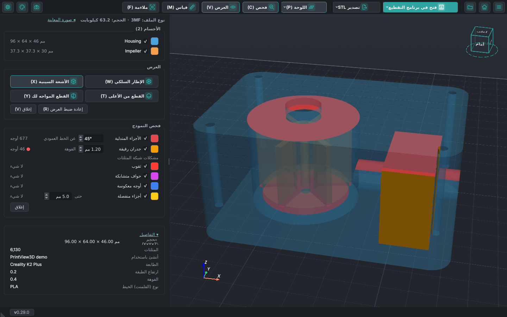
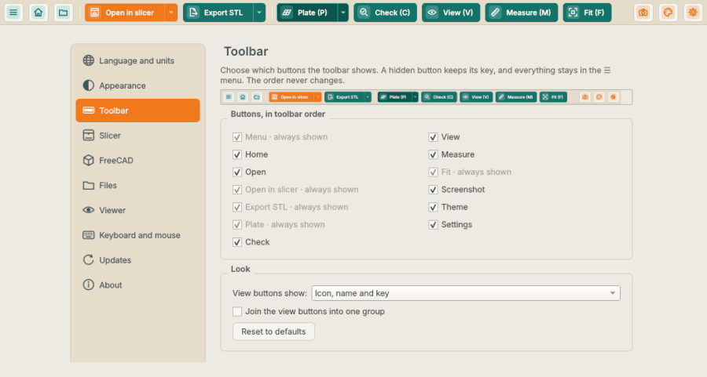

# استخدام PrintView3D

**فتح ملف:** انقر عليه نقرًا مزدوجًا (إذا كان PrintView3D هو البرنامج الافتراضي)، أو اسحبه إلى النافذة، أو
استخدم **فتح ملف أو ZIP…** (`Ctrl+O`)، أو اختره من **الأخيرة** في القائمة **☰** أو في صفحة البداية. جرّب الملفات في [`examples/`](https://github.com/sevagjb/PrintView3D/blob/main/examples) للبدء.

**الرئيسية:** زر المنزل (`Ctrl+W`) يغلق الملف المفتوح ويعود إلى صفحة البداية مع ملفاتك الأخيرة.
ويعيد أيضًا الذاكرة التي استخدمها الملف، وهذا يُحدث فرقًا خاصةً بعد ملف G-code أو ZIP كبير.

في صفحة البداية، مرّر المؤشر فوق ملف حديث فتُظهر بطاقة في الزاوية السفلية صورة معاينته (لمشاريع 3MF
وملفات G-code وFreeCAD التي تحتوي على صورة)، واسمه والمجلد الذي يوجد فيه. ويُظهر ملف ZIP صورة المصمّم
أو العرض المرسوم الموجود فيه، وإلا فصورة أول ملف 3MF أو G-code فيه. وتبقى البطاقة في المكان نفسه
لكل ملف، فتستطيع المرور على القائمة والمقارنة. لا تريدها؟ ألغِ تحديد **الإعدادات ← العارض ← صفحة البداية ←
عرض معاينة للملفات الأخيرة عند مرور الماوس فوقها**؛ وعندها لا تُقرأ الملفات حتى تفتحها.

**مجلد كامل:** يعرض **☰ ← فتح مجلد…** الملفات ثلاثية الأبعاد في مجلد داخل اللوحة الجانبية؛ تنقّل بينها
بـ `↑` / `↓` أو بالنقر.

**نافذة واحدة:** الملف الذي تنقر عليه نقرًا مزدوجًا أثناء فتح PrintView3D يظهر في النافذة نفسها، وتنتقل
هذه النافذة إلى الواجهة. لتعطي كل ملف نافذته الخاصة (لمقارنة نموذجين جنبًا إلى جنب)، فعّل
**الإعدادات ← الملفات ← فتح كل ملف في نافذة جديدة**. تشغيل PrintView3D من قائمة ابدأ أو قائمة التطبيقات
دون ملف يفتح دائمًا نافذة جديدة.

## الماوس {#mouse}

| الحركة | ما تفعله |
|---|---|
| **السحب بالزر الأيسر** | تدوير. اضغط *على النموذج* للتدوير حول تلك النقطة بالضبط؛ واضغط على مساحة فارغة للتدوير حول مركز النموذج. تبقى اللوحة أفقية دائمًا. |
| **السحب بالزر الأيمن** (أو بالزر الأوسط، أو Shift + الزر الأيسر) | تحريك (إزاحة) |
| **عجلة الماوس** | تكبير وتصغير باتجاه مؤشر الماوس |

تنظر من الأسفل؟ تبتعد اللوحة عن الطريق لترى أسفل القطعة.

## لوحة المفاتيح {#keyboard}

هذه هي المفاتيح التي يأتي بها PrintView3D. يعرضها **الإعدادات ← لوحة المفاتيح والماوس** كلها، ويمكنك
هناك إعطاء أيٍّ منها مفتاحاً خاصاً بك: انقر في حقله ثم اضغط المفتاح الجديد (زر المسح يزيل المفتاح).
تُظهر الأزرار عندها مفتاحك. و**استعادة الافتراضيات** يعيدها كلها. لا يمكن اختيار المفاتيح التي يستخدمها
النظام (مفتاح Windows أو Super وAlt+F4 وAlt+Tab و⌘Q وCtrl+Alt+Del وما شابهها) ولا Tab وEnter وEsc
والمسافة، ولا مفتاح مستخدَم لإجراء آخر. أما عناصر التحكم بالماوس فثابتة.

| المفتاح | الإجراء |
|---|---|
| `Ctrl+O` | فتح ملف أو ZIP |
| `Ctrl+W` | إغلاق الملف (العودة إلى صفحة البداية) |
| `Ctrl+P` | فتح الملف في برنامج التقطيع الافتراضي |
| `Ctrl+E` | تصدير STL (مشاريع 3MF وملفات FreeCAD وSTEP) |
| `S` | الإعدادات |
| `Ctrl+Shift+S` | حفظ لقطة شاشة للعرض ثلاثي الأبعاد |
| `Ctrl+T` | نمط السمة التالي (الافتراضي ← رمادي ← غرافيت ← إمبر)، بالوضع الفاتح أو الداكن نفسه |
| `Ctrl+Shift+T` | التبديل بين السمة الفاتحة والداكنة |
| `F` | ملاءمة النموذج داخل العرض |
| `1` · `2` · `3` · `4` | متساوي القياس · أعلى · أمام · يمين |
| `P` | لوحة الطباعة تشغيل / إيقاف |
| `C` · `V` | قسم الفحص · قسم العرض، تشغيل / إيقاف (النماذج) |
| `W` · `X` · `T` · `Y` | الإطار السلكي · الأشعة السينية · القطع من الأعلى · القطع المواجه لك، تشغيل / إيقاف (النماذج) |
| `L` | تثبيت القطع المواجه لك: يتوقف عن الدوران مع العرض (النماذج) |
| `R` | إعادة ضبط العرض: إيقاف الإطار السلكي والأشعة السينية والقطع، وملاءمة النموذج (مع G-code: ملاءمة) |
| `M` | القياس تشغيل / إيقاف (النماذج) |
| `D` · `A` · `O` | قياس مسافة · زاوية · دائرة |
| `K` | إزالة كل القياسات (يبقى القياس مفعّلاً) |
| `↑` / `↓` | الطبقة التالية / السابقة (G-code)، أو الملف الأعلى / الأدنى في ملف ZIP أو مجلد |
| `Page Up` / `Page Down` | ‏10 طبقات للأعلى / للأسفل |
| `Home` / `End` | الطبقة الأولى / الأخيرة |

## العرض: الإطار السلكي والأشعة السينية والقطع {#view-wireframe-x-ray-and-clip}

يفتح زر **العرض** في شريط الأدوات قسم **العرض** في اللوحة الجانبية، وفيه كل خيار على شكل زر (الزر
المفعّل يظهر أغمق). وهو يغيّر طريقة رسم النموذج (STL و3MF وOBJ وصيغ النماذج الأخرى؛ أما G-code فله
شريط تمرير الطبقات بدلاً من ذلك):

- **الإطار السلكي** (`W`): مثلثات الشبكة، لترى مدى دقتها أو تكتشف الأشكال الهندسية المعطوبة.
- **الأشعة السينية** (`X`): تصبح الأجسام شفافة، فتظهر الأجسام الموجودة داخل أجسام أخرى والتجاويف
  والجدران المجوفة.
- **القطع من الأعلى** (`T`): يُخفي كل ما فوق ارتفاع معيّن. يحرّك شريط تمرير في اللوحة الجانبية
  موضع القطع، ويُرسم داخل الجدران التي يكشفها القطع باللون الأحمر. الضغط على `T` أو على الزر مرة
  أخرى يعيد عرض النموذج كاملاً.
- **القطع المواجه لك** (`Y`): قطع عمودي يواجهك دائماً ويُخفي جزء النموذج الواقع أمامه. أدِر العرض
  فيدور النموذج عبر القطع؛ حرّك العرض (تحريك جانبي) فينزلق النموذج عبره، كأنك تمرّر النموذج أمام
  ماسح ضوئي. لقطع من الأمام أو من الجانب، انقر ذلك الوجه على مكعب العرض. يقرّب شريط التمرير القطع
  أو يبعده، ويُظهر **العمق** مدى دخول القطع في النموذج. ويوقف **تثبيت القطع المواجه** (`L`، الزر
  بجانب إعادة ضبط العرض) دوران القطع مع العرض، فتستطيع تدوير النموذج والنظر إلى القطع من الجانب، ويبقى
  شريط التمرير يحرّكه. وما دام القطع غير مثبّت، يُظهر قسم القياس نقطة حمراء وعبارة *القطع المواجه لك
  غير مثبّت*؛ مرّر المؤشر فوقها لمعرفة السبب: النقاط الموضوعة على القطع تبقى في مكانها عندما يدور العرض.
- **القطعان معاً**: يشغّل كلٌّ من `T` و`Y` قطعه الخاص ويوقفه، فيمكن تشغيلهما معاً لقطع زاوية من
  النموذج، مع شريطَي **الارتفاع** و**العمق** في اللوحة الجانبية. **إعادة ضبط العرض** يوقف القطعين.
- **عرض الجزء المقطوع** و**عرض مستوى القطع** (تحت أشرطة التمرير، كلاهما مفعّل افتراضياً): يبقى ما
  يخفيه القطع ظاهراً كشبح أبيض شفاف بحواف محددة، ويظهر مستوى القطع كصفيحة باهتة بحجم النموذج.
  ويُحفظ اختيارك. وفي **الإعدادات ← العارض** لكلٍّ من **الجزء المقطوع** و**مستوى القطع** شريط
  أخفت … أقوى، ويتغيّر العرض ثلاثي الأبعاد أثناء السحب.
- **سحب القطع في العرض ثلاثي الأبعاد** (خيار): فعّل **الإعدادات ← العارض ← تحريك مستويات القطع أيضاً
  بسحبها في العرض ثلاثي الأبعاد** فيحصل كل قطع على مقبض دائري صغير على حافة مستوى قطعه، مع خط قصير يُظهر
  اتجاه حركته. تحت المؤشر تتبادل ألوانه. اسحبه لتحريك القطع، ويتحرك شريط تمريره معه.
- **إعادة ضبط العرض** (`R`): يوقف كل ما سبق ويُلائم النموذج، مثل **ملاءمة**، دفعة واحدة. وتبقى
  القياسات كما هي.

يبقى الإطار السلكي والأشعة السينية مفعّلين عند فتح النموذج التالي؛ أما القطع والقياسات فتُزال. ويمكن استخدام الخيارات معاً (مثل الأشعة السينية مع القطع).

## القياس وألوان الأجسام وأرقام الشبكة {#measure-object-colours-and-grid-numbers}

- **قياس** (`M`، الزر بجانب **العرض**): **المسافة** (مع ΔX ΔY ΔZ إن شئت) و**الزاوية** و**الدائرة**
  (القطر ونصف القطر). النقر يضع نقطة، والسحب لا يزال يدير العرض، ويمكن سحب النقطة الموضوعة لتحريكها.
  تلتقط النقاط الزوايا والحواف تلقائياً، وعند تشغيل قطع تلتقط حدود القطع أيضاً، فتستطيع القياس داخل
  النموذج؛ وتُكتب القيمة بجانب كل قياس، ويزيلها **مسح** (`K`) كلها.
- **ألوان الأجسام**: انقر على مربع اللون لجسم في قائمة **الأجسام** لتعطيه لوناً آخر؛ والنقر بزر
  الماوس الأيمن يعيد لون الملف. لا تُحفظ الألوان.
- **أرقام الشبكة**: **الإعدادات ← العارض ← إظهار أرقام المقياس على الشبكة** يكتب المليمترات على طول
  لوحة الطباعة، بقدر ما يتسع عند التكبير الذي تنظر به.
- **الإعدادات** متاحة أيضاً من أيقونة الترس في طرف شريط الأدوات، بجانب أيقونة السمة
  (إلا إذا أخفيتها: انظر [أزرار شريط الأدوات](#toolbar-buttons)).

المزيد مع الصور: [انظر داخل نماذجك](inspect.md). من تطوير [@covrig](https://github.com/covrig).

## الفحص قبل الطباعة {#check-before-printing}

يفتح زر **فحص** (`C`، بين اللوحة والعرض) قسم **فحص النموذج**، ويلوّن ما قد يسبب مشكلات عند الطباعة،
مع عدد لكل فحص (للنماذج فقط، لا لـ G-code):

- **الأجزاء المتدلية**: أوجه تتجه إلى الأسفل وتميل عن الخط العمودي أكثر من زاوية معيّنة (45°
  افتراضياً)؛ ولا تُحسب الأوجه الملامسة للوحة.
- **الجدران الرقيقة**: جدران وأوتاد أرق من فوهتك (0.4 مم افتراضياً). يعمل في الخلفية، لذلك يبقى غير
  مفعّل حتى تحدّده.
- **مشكلات شبكة المثلثات**: **ثقوب** (حواف مفتوحة)، و**حواف متشابكة** (non-manifold)، و**أوجه
  معكوسة** (نواظم معكوسة)، و**أجزاء منفصلة** حتى حجم تحدده (5 مم افتراضياً).

تُشير نقطة حمراء إلى المشكلات التي عُثر عليها. انقر على مربع لون لتغيير لونه، ومرّر المؤشر فوق اسم
لترى معناه. وتتبع الألوان القطع والأجسام التي تخفيها. المزيد: [الفحص قبل الطباعة](inspect.md#check-before-printing).
من تطوير [@covrig](https://github.com/covrig).

## المليمتر أو البوصة {#millimetres-or-inches}

يعرض **الإعدادات ← اللغة والوحدات ← الأطوال بوحدة** كل الأطوال (الأحجام والقياسات والقطع والشبكة
واللوحة) بالمليمتر أو بالبوصة. لا تتغير الملفات.

## اختيار برنامج التقطيع {#choosing-your-slicer}

**الإعدادات ← برنامج التقطيع ← برنامج التقطيع الافتراضي.** كل برنامج تقطيع مُعلَّم بأنه *مثبّت* أو *غير
موجود*. إذا كان برنامجك مثبّتًا في مكان غير معتاد، فانقر **استعراض…** واختر ملف البرنامج. ولبرنامج تقطيع
غير موجود في القائمة، اختر **برنامج مخصص…**، وأعطه اسمًا، واختر ملف `.exe` الخاص به.

يتغيّر اسم الزر الأخضر ليطابقه («فتح في OrcaSlicer»). والسهم الصغير **▾** بجانبه يعرض برامج التقطيع
الأخرى المثبّتة لديك، لفتح ملف في أحدها لمرة واحدة.

## تصدير STL من 3MF {#export-stl-from-3mf}

عند فتح مشروع 3MF، يحفظ زر **تصدير STL** في شريط الأدوات (`Ctrl+E`) أجسامه كملفات STL عادية، مثلًا
لمشاركة نموذج أو فتحه في برنامج لا يقرأ 3MF.

- تعرض نافذة حوار كل جسم باسمه وعدد مثلثاته، وكلها محدّدة؛ ألغِ تحديد ما لا تحتاجه.
- **السهم بجانب الزر** يعرض كل الطرق مباشرةً: *كل الأجسام في ملف STL واحد* و*ملف STL لكل جسم* و*اختيار
  الأجسام…* (نافذة الحوار). الخيار الذي تنفّذه النقرة يظهر بخط عريض.
- **ما تفعله النقرة** (و`Ctrl+E`) تختاره من **الإعدادات ← الملفات ← تصدير STL**: عرض قائمة الأجسام
  (الافتراضي)، أو حفظ الكل في ملف STL واحد، أو حفظ ملف STL لكل جسم. ويفتح *تغيير ما تفعله النقرة…* في أسفل
  قائمة السهم هذا الإعداد.
- **ملف STL واحد مجمّع**: الأجسام المحدّدة في ملف واحد، بأماكنها على اللوحة.
- **ملف STL لكل جسم**: يُسمّى كل ملف باسم جسمه ويُحفَظ في مجلد تختاره (يسألك PrintView3D قبل استبدال
  ملفات موجودة).
- الملف الذي فيه جسم واحد فقط ينتقل دائمًا مباشرةً إلى نافذة الحفظ.
- **الشكل الهندسي الخام فقط:** تُستبعد المُعدِّلات والأجزاء السالبة ومانعات / فارضات الدعامات (كما
  سجّلها Creality Print وOrcaSlicer وBambu Studio وPrusaSlicer)، وكذلك الألوان والمواد وإعدادات الطباعة.
  الأبعاد بالمليمتر؛ والملفات بصيغة STL ثنائية.

## ملفات ZIP {#zip-files}

غالبًا ما تأتي النماذج المنزّلة في ملف ZIP. افتحه كأي ملف آخر (**فتح ملف أو ZIP…** أو اسحبه إلى النافذة)؛ لا حاجة
إلى فك ضغطه أولًا.

<table>
<tr>
<td width="50%"> <b>عرض الكل جنبًا إلى جنب</b>: حدّد أي نموذج أو ألغِ تحديده؛ ملف G-code يُفتح بمفرده.</td>
<td width="50%"> انقر على ملف في القائمة، أو استخدم ↑ / ↓: هنا ملف G-code المقطّع من ملف ZIP نفسه.</td>
</tr>
</table>

- **تُستخدم الملفات ثلاثية الأبعاد فقط**: STL و3MF وOBJ وPLY وOFF وglTF/GLB وSTEP وFreeCAD وG-code.
  تُتجاهل الصور وملفات PDF وملفات اقرأني وروابط الويب وملفات ZIP داخل ملف ZIP والمجلد المخفي
  `__MACOSX`، وتذكر اللوحة عدد ما تم تجاهله.
- **ملف ZIP فيه ملف ثلاثي الأبعاد واحد** يُفتح تمامًا مثل ذلك الملف.
- **الملفات الأكثر** تُدرَج في اللوحة الجانبية مع شارة ملوّنة لنوعها (STL و3MF وG-code و…) وشرح قصير لكل
  نوع. يظهر الملف الأول؛ انقر على ملف آخر، أو استخدم **↑ / ↓**، للتبديل.
- **عرض الكل جنبًا إلى جنب** يضع النماذج بجانب بعضها: حتى ثلاثة في صف واحد، ثم شبكة (أربعة كـ 2 × 2،
  وستة كـ 3 × 2، وتسعة كـ 3 × 3، …)، متباعدة حسب حجمها الحقيقي. ألغِ تحديد النماذج في **الأجسام**
  لإخفائها. تُفتح ملفات G-code وSTEP وFreeCAD واحدًا تلو الآخر.
- **فتح في برنامج التقطيع** يرسل النموذج الذي تنظر إليه؛ وفي «عرض الكل»، النماذج المحدّدة. وفي السهم
  بجانب الزر خيار **إرسال كل نماذج ملف ZIP**.
- يفتح برنامج التقطيع **ملف 3MF كمشروع مستقل**، لذلك لا يمكنه أخذ ملف 3MF مع ملفات أخرى. عندما تتضمن
  النماذج المرسَلة ملف 3MF، يسألك PrintView3D: مشروع 3MF (بلوحاته وإعداداته)، أو النماذج الأخرى على لوحة
  واحدة، أو **كل شيء بصيغة STL** (تصبح أجسام المشروع ملف STL عاديًا، فتذهب كل النماذج إلى لوحة واحدة).

    

تُفك الملفات ثلاثية الأبعاد في مجلد التخزين المؤقت الخاص بـ PrintView3D (برامج التقطيع تحتاج إلى ملفات
حقيقية)؛ وتُفحَص الأحجام أولًا، فلا يستطيع ملف ZIP تالف أو خبيث ملء القرص. وتُحذف تلقائيًا ملفات ZIP
التي فُتحت قبل أكثر من يوم.

## اللغة {#language}

**الإعدادات ← اللغة والوحدات ← اللغة** تغيّر لغة البرنامج كله فورًا، بما في ذلك نوافذ الملفات والأزرار القياسية. الإنجليزية
هي الافتراضية؛ و*تلقائي* يتبع لغة نظامك. تستخدم العربية تخطيطًا من اليمين إلى اليسار؛ وتُكتب القياسات
دائمًا بالأرقام الغربية (0.20 mm).
كلمة خاطئة أو ناقصة؟ الرابط في تلك الصفحة يقودك إلى [كيف تترجم](TRANSLATING.md).

## السمات {#themes}

انقر **أيقونة لوحة الألوان** في الطرف الأيمن من شريط الأدوات لاختيار سمة، أو اضغط **`Ctrl+T`** للانتقال
إلى السمة التالية. الخيار نفسه موجود في **الإعدادات ← المظهر ← السمة**.

- **تلقائي** يتبع إعداد الوضع الداكن/الفاتح في Windows أو في سطح مكتب Linux (ويتغيّر معه).
- **داكن** أو **رمادي** أو **غرافيت** (لون بني داكن دافئ مريح للعين) أو **فاتح**.

التبديل فوري؛ تتغيّر معه خلفية العرض ثلاثي الأبعاد واللوحة والشبكة، بينما تبقى ألوان G-code والنماذج كما
هي لتطابق برنامج التقطيع دائمًا.

### شفافية النافذة (Windows 11) {#window-transparency-windows-11}

**الإعدادات ← المظهر ← شفافية النافذة** تجعل شريط الأدوات واللوحة الجانبية وشريط الحالة تُظهر ما خلف
النافذة، في أي سمة:

- **Mica**: لون خفيف من خلفية سطح المكتب (كما في مستكشف الملفات).
- **Acrylic**: زجاج مصنفر يطمس سطح المكتب والنوافذ الأخرى خلفه.
- **إيقاف** (الافتراضي): خلفية ثابتة، كما كانت.

يبقى العرض ثلاثي الأبعاد ثابتًا دائمًا. يسري التغيير بعد إعادة التشغيل: عند النقر على OK يسألك
PrintView3D: **إعادة التشغيل الآن** (يُغلَق ويُفتح من جديد بالملف نفسه) أو **لاحقًا**. يرسم Windows التأثير
بنفسه ويعرض لونًا عاديًا عندما لا تكون النافذة نشطة، ويوقفه عند إيقاف *Transparency effects* في إعدادات
Windows أو في وضع توفير البطارية. يحتفظ Windows 10 والأنظمة الأخرى بالشكل العادي.

## أزرار شريط الأدوات {#toolbar-buttons}

تختار **الإعدادات ← شريط الأدوات** (أو **☰ ← تخصيص شريط الأدوات…**، أو النقر بالزر الأيمن على شريط
الأدوات) الأزرار التي يعرضها شريط الأدوات، لشريط أهدأ إن لم تكن تستخدم كل الميزات:

- **يمكن إخفاؤها:** الرئيسية، فتح، فحص، العرض، قياس، لقطة شاشة، السمة والإعدادات.
- **ظاهرة دائماً:** القائمة **☰**، الفتح في برنامج التقطيع، تصدير STL (لملفات 3MF وCAD)، اللوحة وملاءمة.
- **لا يتغيّر الترتيب أبداً.** الزر المخفي يغادر شريط الأدوات فقط؛ تبقى اللوحة أول أزرار العرض
  وملاءمة آخرها.
- **لا يضيع شيء.** يحتفظ الزر المخفي باختصاره (`C` و`V` و`M` و`Ctrl+W`…)، وفي القائمة **☰** كل
  شيء، ومنه فحص والعرض وقياس وقائمة السمة.

تحت **الشكل** تختار كيف تُكتب أزرار العرض (اللوحة، فحص، العرض، قياس وملاءمة): **الأيقونة والاسم
والاختصار** (*اللوحة (P)*، الافتراضي)، **الأيقونة والاسم** (*اللوحة*)، **الأيقونة والاختصار** (*P*)
أو **الأيقونة فقط** (يذكر التلميح اسمها). ويرسمها **ضمّ أزرار العرض في مجموعة واحدة** شريطاً واحداً
متصلاً.

يظهر كل تغيير فوراً في النافذة وفي الصورة أعلى الصفحة: **موافق** يحتفظ به و**إلغاء** يعيد ما كان.
و**استعادة الافتراضيات** تُظهر كل الأزرار من جديد.

## التحديثات {#updates}

**الإعدادات ← التحديثات** تعرض إصدارك وفيها **التحقق من التحديثات الآن**. يمكنك أيضًا تفعيل
**التحقق من التحديثات تلقائيًا (مرة يوميًا)**؛ يسألك PrintView3D مرة واحدة إن كنت تريد ذلك، ويمكنك تغييره
هناك في أي وقت.

عند وجود إصدار جديد، يظهر بجانب رقم الإصدار في الزاوية السفلية اليمنى **نقطة حمراء** (`● v0.10.0 →
0.11.0`)، وكذلك بجانب *التحديثات* في الإعدادات. انقر عليها لترى **ما الجديد**، ثم:

- **Windows (مثبّت بواسطة Setup.exe): تثبيت التحديث.** ينزّل PrintView3D المثبّت الجديد، ويتحقق من بصمة
  SHA-256 الخاصة به مقارنةً بالبصمة التي ينشرها GitHub، ويثبّته (دون أسئلة، مع الاحتفاظ بإعداداتك) ثم
  يشغّل الإصدار الجديد.
- **Linux ‏(AppImage) ونسخة Windows المحمولة: تنزيل التحديث** يفتح صفحة الإصدار؛ نزّل الملف الجديد وضعه
  مكان القديم.
- **تخطي هذا الإصدار** يخفي ذلك الإصدار؛ ويظهر الإصدار الذي يليه من جديد.

بعد التحديث، يعرض أول تشغيل **ما الجديد** للإصدار الذي لديك الآن، مرة واحدة، أيًّا كانت طريقة التحديث
(المثبّت أو winget أو ملف zip أو AppImage). يُقرأ من سجل التغييرات المرفق بالبرنامج، فلا يحتاج إلى اتصال.
ولا يظهر بعد تثبيت جديد.

### التحديثات والخصوصية {#updates-and-privacy}

يعمل PrintView3D دون اتصال. لا يتصل بالإنترنت **إلا** للتحديثات، وفقط عندما تنقر *التحقق من التحديثات
الآن* أو تفعّل التحقق اليومي:

| | |
|---|---|
| **بماذا يتصل** | `api.github.com` (للسؤال عن أحدث إصدار من هذا المشروع)، وعند النقر على *تثبيت التحديث*، التنزيل من `github.com` |
| **كم مرة** | مرة يوميًا على الأكثر (التحقق التلقائي)، أو عندما تنقر *التحقق من التحديثات الآن* |
| **ما الذي يُرسَل** | طلب أحدث إصدار فقط، مع اسم البرنامج وإصداره (`PrintView3D/0.10.0`). لا بيانات شخصية، ولا ملفات، ولا إحصاءات استخدام، ولا معرّف. |
| **ما يراه GitHub** | مثل أي موقع: عنوان IP الخاص بك. راجع [بيان الخصوصية لدى GitHub](https://docs.github.com/site-policy/privacy-policies/github-general-privacy-statement). |
| **كيف توقفه** | الإعدادات ← التحديثات ← ألغِ تحديد *التحقق من التحديثات تلقائيًا*. لا يتصل بشيء بعد ذلك. |

## تدوير أنعم على الحواسيب المحمولة {#smoother-rotation-on-laptops}

في كثير من الحواسيب المحمولة شريحتا رسوميات، وتعمل البرامج افتراضيًا على الأبطأ منهما.
**الإعدادات ← العارض ← الرسوميات** تعرض أيّهما يستخدم PrintView3D. إذا كانت *Intel*، ففعّل
**استخدام بطاقة الرسوميات عالية الأداء** وانقر OK؛ ثم اختر **إعادة التشغيل الآن** (أو **لاحقًا**، فيتم
التبديل في المرة التالية التي تشغّل فيها PrintView3D).

## ملاحظات وحدود {#notes-and-limits}

- نسختا Windows 10/11 وLinux ‏(x86-64) مُحزَّمتان ومختبرتان. نسختا Mac ‏(Apple silicon وIntel، ‏macOS 14.4+)
  [تجريبيتان](install.md#macos). ولا توجد حزمة لـ Linux على ARM ‏(Raspberry Pi وغيره) بعد.
- قد يفقد *مشروع* 3MF محفوظ في برنامج تقطيع من شركة ما إعدادات الطابعة/الطباعة عند فتحه في برنامج من شركة
  أخرى. النموذج نفسه يُحمَّل بشكل سليم؛ هكذا تتصرف برامج التقطيع.
- ملفات G-code الثنائية (`.bgcode`) غير مدعومة بعد.
- الصور المصغّرة في مستكشف الملفات متاحة لملفات 3MF وSTL وG-code وFreeCAD؛ وليس بعد لـ OBJ وPLY وOFF
  وglTF.
- تحتاج مستندات FreeCAD إلى FreeCAD مثبّت للعرض ثلاثي الأبعاد (لا يتضمن PrintView3D محرّك الأشكال الهندسية
  الخاص بـ FreeCAD). قد لا تفتح إصدارات FreeCAD القديمة جدًا أو الحديثة جدًا ملفات بعضها.
