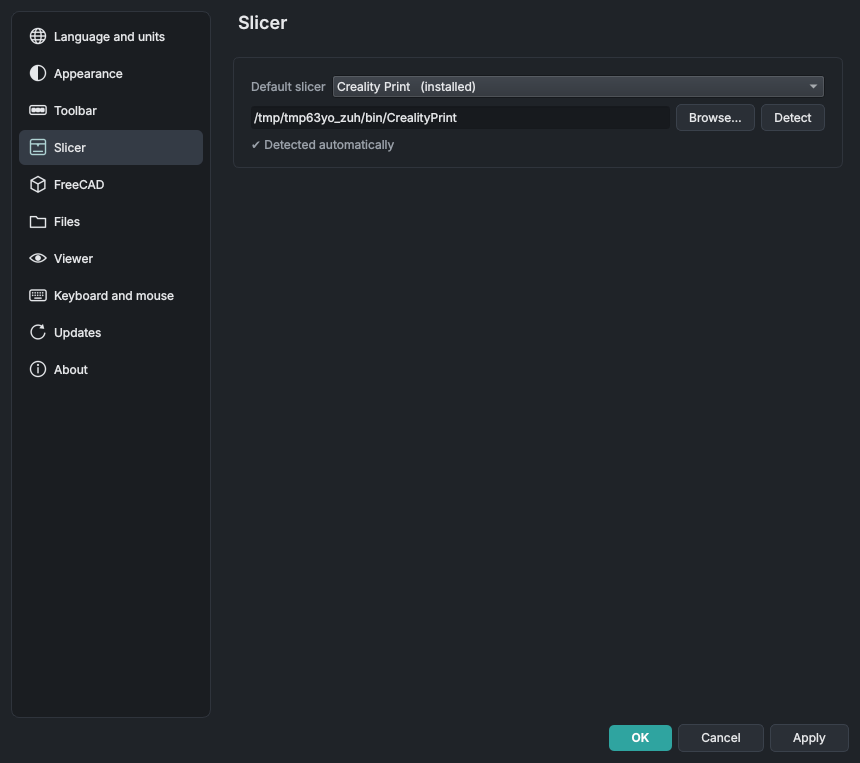
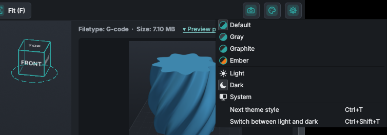
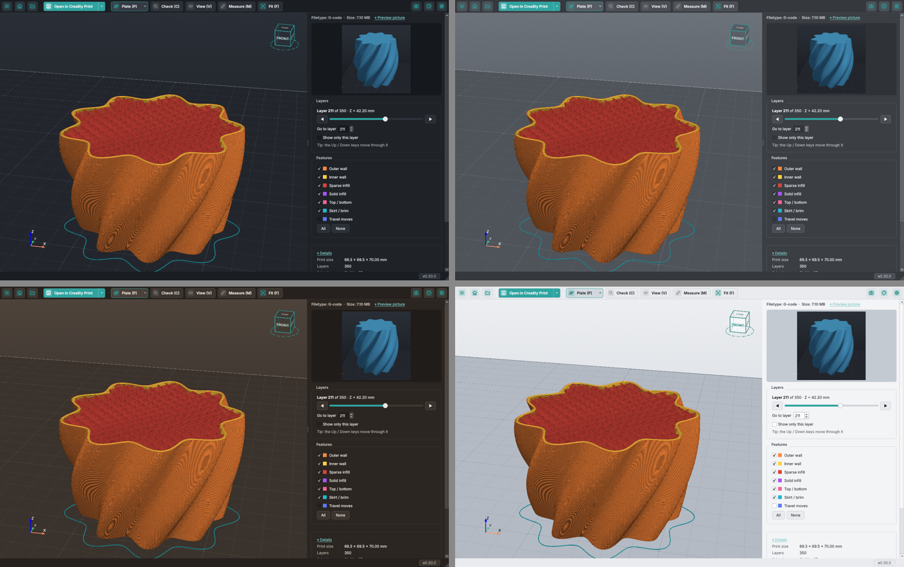
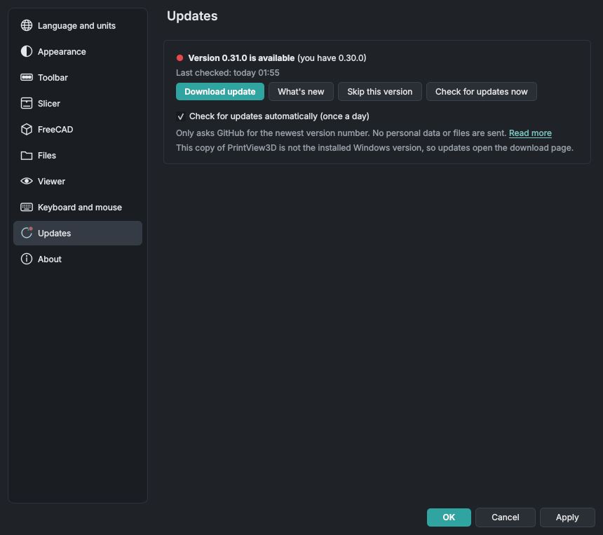

# Using PrintView3D

**Open a file:** double-click it (if PrintView3D is the default), drag it onto the window, use
**Open**, or pick it from **Recent** in the **☰** menu or on the start page. Try the files in [`examples/`](https://github.com/sevagjb/PrintView3D/blob/main/examples) to get started.

**Home:** the house button (`Ctrl+W`) closes the open file and goes back to the start page, with
your recent files. It also gives back the memory the file took, which matters most after a large
G-code or ZIP.

**One window:** a file you double-click while PrintView3D is already open is shown in that window,
which comes to the front. To give every file its own window (to compare two models side by side),
tick **Settings → Files → Open each file in a new window**. Starting PrintView3D from the Start
menu or applications menu, without a file, always opens a new window.

## Mouse

| Action | What it does |
|---|---|
| **Left-drag** | Rotate. Press *on the model* to rotate around that exact point; press on empty space to rotate around the model's centre. The plate always stays level. |
| **Right-drag** (or middle-drag, or Shift + left-drag) | Move (pan) |
| **Mouse wheel** | Zoom towards the mouse pointer |

Looking from underneath? The plate gets out of the way so you can see the bottom of the part.

## Keyboard

The same list is in the program under **Settings → About → Keyboard and mouse**.

| Key | Action |
|---|---|
| `Ctrl+O` | Open a file |
| `Ctrl+W` | Close the file (back to the start page) |
| `Ctrl+P` | Open the file in your default slicer |
| `Ctrl+E` | Export STL (3MF projects, FreeCAD and STEP files) |
| `Ctrl+T` | Next theme style (Default → Gray → Graphite → Ember), same light/dark mode |
| `Ctrl+Shift+T` | Switch the theme between light and dark |
| `1` · `2` · `3` · `4` | Iso · Top · Front · Right view |
| `W` · `X` · `C` · `V` | Wireframe · X-ray · Clip from the top · Clip facing you, on / off (models) |
| `R` | Reset view: wireframe, X-ray and the cuts off, model fitted (on G-code: fit) |
| `M` | Measure on / off (models) |
| `↑` / `↓` | Next / previous layer (G-code), or the previous / next file in a ZIP |
| `Page Up` / `Page Down` | 10 layers up / down |
| `Home` / `End` | First / last layer |

## View: wireframe, X-ray and clip

The **View** button in the toolbar opens the **View** section in the side panel, with every option
as a button (a button that is on is drawn darker). It changes how a model is drawn (STL, 3MF, OBJ
and the other model formats; G-code has its layer slider instead):

- **Wireframe** (`W`): the triangles of the mesh, to see how fine it is or spot broken geometry.
- **X-ray** (`X`): the parts become see-through, so parts inside other parts, cavities and
  hollow walls show.
- **Clip from the top** (`C`): hides everything above a height. A slider in the side panel moves
  the cut; the inside of the walls that the cut lays open is drawn in red. `C` or the button
  again shows the whole model.
- **Clip facing you** (`V`): an upright cut that always faces you and hides the part of the model
  in front of it. Turn the view and the model turns through the cut; move (pan) the view and it
  slides across, as if you held the model up to a scanner. For a cut from the front or the side,
  click that face on the view cube. The slider moves the cut nearer or further, and **Depth**
  shows how far it is into the model. **Freeze the cutting plane** keeps the cut where it is
  while you turn and move the model.
- **Both cuts at once**: `C` and `V` each turn their own cut on and off, so both can be on together
  for a corner cut away, with a **Height** and a **Depth** slider in the side panel. **Reset view**
  ends both.
- **Show the cut-away part** and **Show the cutting plane** (under the sliders, both on by
  default): what the cut hides stays as a white, see-through ghost with outlined edges, and the
  cutting plane shows as a faint sheet the size of the model. Your choice is remembered. In
  **Settings → Viewer**, **Cut-away part** and **Cutting plane** each have a Fainter … Stronger
  slider; the 3D view changes while you drag.
- **Reset view** (`R`): turns all of the above off and fits the model, like **Fit**, in one go.
  Measurements stay.

Wireframe and X-ray stay on when you open the next model; the cuts and the measurements are removed. The options work together (X-ray and clip, for example).

## Measure, object colours and grid numbers

- **Measure** (`M`, the button next to **View**): **Distance** (with ΔX ΔY ΔZ if you like),
  **Angle** and **Circle** (diameter and radius). A click places a point, a drag still turns the
  view, and a placed point can be dragged. Points snap to corners and edges; the value is written
  next to every measurement, and **Clear** removes them all.
- **Object colours**: click the colour box of an object in the **Objects** list to give it another
  colour; right-click goes back to the file's colour. Not saved.
- **Grid numbers**: **Settings → Viewer → Show distances (mm) along the grid** writes millimetres
  along the build plate.

More, with pictures: [Look inside your models](inspect.md). Built by [@covrig](https://github.com/covrig).

## Choosing your slicer

**Settings → Slicer → Default slicer.** Each slicer is marked *installed* or *not found*. If yours
is installed in an unusual place, click **Browse…** and select its program file. For a slicer that
is not in the list, choose **Custom program…**, give it a name and select its `.exe`.

The green button is renamed to match ("Open in OrcaSlicer"). The small **▾** arrow next to it lists
your other installed slicers, for opening a file in one of them just once.

## Export STL from 3MF

With a 3MF project open, **Export STL** in the toolbar (`Ctrl+E`) saves its objects as plain STL
files, for example to share a model or open it in a program that does not read 3MF.

- A dialog lists every object with its name and triangle count, all ticked; untick what you don't
  need.
- **The arrow next to the button** offers every way directly: *All objects as one STL*, *One STL per
  object* and *Choose objects…* (the dialog). The one a click makes is shown in bold.
- **What a click does** (and `Ctrl+E`) is chosen in **Settings → Files → Export STL**: show the list
  of objects (the default), save everything as one STL, or save one STL per object. *Change what a
  click does…* at the bottom of the arrow's menu opens that setting.
- **One combined STL**: the ticked objects in one file, placed as they are on the plate.
- **One STL per object**: each file is named after its object and saved into a folder you choose
  (PrintView3D asks before replacing files that are already there).
- A file with only one object always goes straight to the Save dialog.
- **Raw geometry only:** modifiers, negative parts and support blockers / enforcers are left out
  (as recorded by Creality Print, OrcaSlicer, Bambu Studio and PrusaSlicer), and so are colours,
  materials and print settings. Sizes are in millimetres; the files are binary STL.

## ZIP files

Model downloads often come as a ZIP. Open it like any other file (**Open file or ZIP…** or drag it onto the
window); there is no need to unpack it first.

<table>
<tr>
<td width="50%"> <b>Show all side by side</b>: tick or untick each model; the G-code opens on its own.</td>
<td width="50%"> Click a file in the list, or use ↑ / ↓: here the sliced G-code from the same ZIP.</td>
</tr>
</table>

- **Only the 3D files are used**: STL, 3MF, OBJ, PLY, OFF, glTF/GLB, STEP, FreeCAD and G-code.
  Pictures, PDFs, read-me files, web links, ZIPs inside the ZIP and the hidden `__MACOSX` folder
  are skipped, and the panel says how many were skipped.
- **A ZIP with one 3D file** opens just like that file.
- **More files** are listed in the side panel with a coloured label for their type (STL, 3MF,
  G-code, …) and a short explanation of each type. The first file is shown; click another one, or
  use **↑ / ↓**, to switch.
- **Show all side by side** places the models next to each other: up to three in one row, then a
  grid (four as 2 × 2, six as 3 × 2, nine as 3 × 3, …), spaced by their real size. Untick models in
  **Objects** to hide them. G-code, STEP and FreeCAD files are opened one at a time.
- **Open in slicer** sends the model you are looking at; in Show all, the ticked models. The arrow
  next to the button has **Send all models in the ZIP**.
- A slicer opens a **3MF as a project on its own**, so it cannot take a 3MF together with other
  files. When the models to send include a 3MF, PrintView3D asks: the 3MF project (with its
  plates and settings), the other models on one plate, or **everything as STL** (the project's
  objects become a plain STL, so all models go on one plate).

  

The 3D files are unpacked into PrintView3D's own cache folder (slicers need real files); the sizes
are checked first, so a damaged or malicious ZIP cannot fill your disk. Files from ZIPs opened more
than a day ago are removed automatically.

## Language

**Settings → Language** switches the whole program immediately, including file dialogs and
standard buttons. English is the default; *Automatic* follows your system language. Arabic uses a
right-to-left layout; measurements always use Western digits (0.20 mm).
A wrong or missing word? The link on that page leads to [How to translate](TRANSLATING.md).

## Themes

A theme is a **style** — **Default**, **Gray**, **Graphite** (warm coffee tones) or **Ember**
(orange and teal) — in a **mode**: **Light**, **Dark** or **System** (follows the dark/light setting
of your computer, and switches along when that changes). Every style has a light and a dark version.

Choose in **Settings → Appearance → Theme** (a picture card per style and a Light / Dark / System
selector), or with the **palette icon** at the right end of the toolbar. **`Ctrl+T`** steps to the
next style; **`Ctrl+Shift+T`** switches between light and dark.

The switch is immediate; the 3D background, plate and grid change with it, while G-code and
model colours stay the same so they always match your slicer.

### Window transparency (Windows 11)

**Settings → Appearance → Window transparency** lets the toolbar, side panel and status bar show
what lies behind the window, in any theme:

- **Mica**: a soft tint of your desktop wallpaper (as in File Explorer).
- **Acrylic**: frosted glass that blurs the desktop and other windows behind it.
- **Off** (default): solid, as before.

The 3D view always stays solid. It takes effect after a restart: when you click OK, PrintView3D
asks **Restart now** (it closes and opens again, with the same file) or **Later**. Windows draws the
effect itself and shows a plain colour while the window is not active, and switches it off with
*Transparency effects* off in Windows Settings or in battery saver. Windows 10 and other systems
keep the normal look.

## Updates

**Settings → Updates** shows your version and has **Check for updates now**. You can also switch on
**Check for updates automatically (once a day)**; PrintView3D asks once whether you want this, and
you can change it there at any time.

When a new version exists, the version in the bottom-right corner shows a **red dot** (`● v0.10.0 →
0.11.0`), and so does *Updates* in Settings. Click it to see **What's new**, then:

- **Windows (installed with Setup.exe): Install update.** PrintView3D downloads the new installer,
  checks its SHA-256 fingerprint against the one GitHub publishes, installs it (no questions, your
  settings are kept) and starts the new version.
- **Linux (AppImage) and the portable Windows zip: Download update** opens the release page;
  download the new file and replace the old one.
- **Skip this version** hides that version; the next one is shown again.

After an update, the first start shows **What's new** for the version you now have, once, however
you updated (installer, winget, zip or AppImage). It is read from the changelog that comes with the
program, so it needs no connection. A fresh install doesn't show it.

### Updates and privacy

PrintView3D works offline. It connects to the internet **only** for updates, and only when you
click *Check for updates now* or have switched on the daily check:

| | |
|---|---|
| **What is contacted** | `api.github.com` (to ask for the newest release of this project) and, when you click *Install update*, the download from `github.com` |
| **How often** | At most once a day (automatic check), or when you click *Check for updates now* |
| **What is sent** | Only the request for the newest version, with the program name and version (`PrintView3D/0.10.0`). No personal data, no files, no usage statistics, no ID. |
| **What GitHub sees** | Like any website: your IP address. See [GitHub's privacy statement](https://docs.github.com/site-policy/privacy-policies/github-general-privacy-statement). |
| **How to turn it off** | Settings → Updates → untick *Check for updates automatically*. Nothing is contacted after that. |

## Smoother rotation on laptops

Many laptops have two graphics chips and run programs on the slower one by default.
**Settings → Viewer → Graphics** shows which one PrintView3D uses. If it says *Intel*, tick
**Use the high-performance graphics card** and click OK; choose **Restart now** (or **Later**, and
it switches the next time you start PrintView3D).

## Notes and limits

- Windows 10/11 and Linux (x86-64) are packaged and tested. The Mac versions (Apple silicon and Intel,
  macOS 14.4+) are in [beta](install.md#macos). ARM Linux (Raspberry Pi etc.) is not packaged yet.
- A 3MF *project* saved in one brand of slicer may lose its printer/print settings when opened in a
  different brand. The model itself loads fine; that's how the slicers behave.
- Binary G-code (`.bgcode`) is not supported yet.
- File Explorer thumbnails are made for 3MF, STL, G-code and FreeCAD files; not yet for OBJ, PLY, OFF and glTF.
- FreeCAD documents need an installed FreeCAD for the 3D view (PrintView3D does not include
  FreeCAD's geometry engine). Very old or very new FreeCAD versions may not open each other's files.
