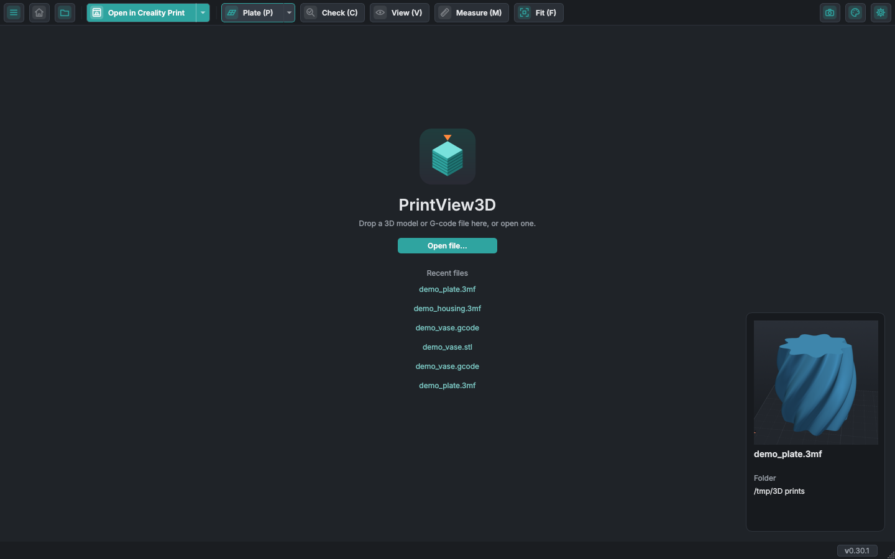
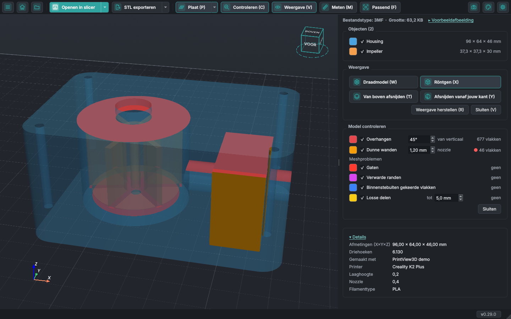
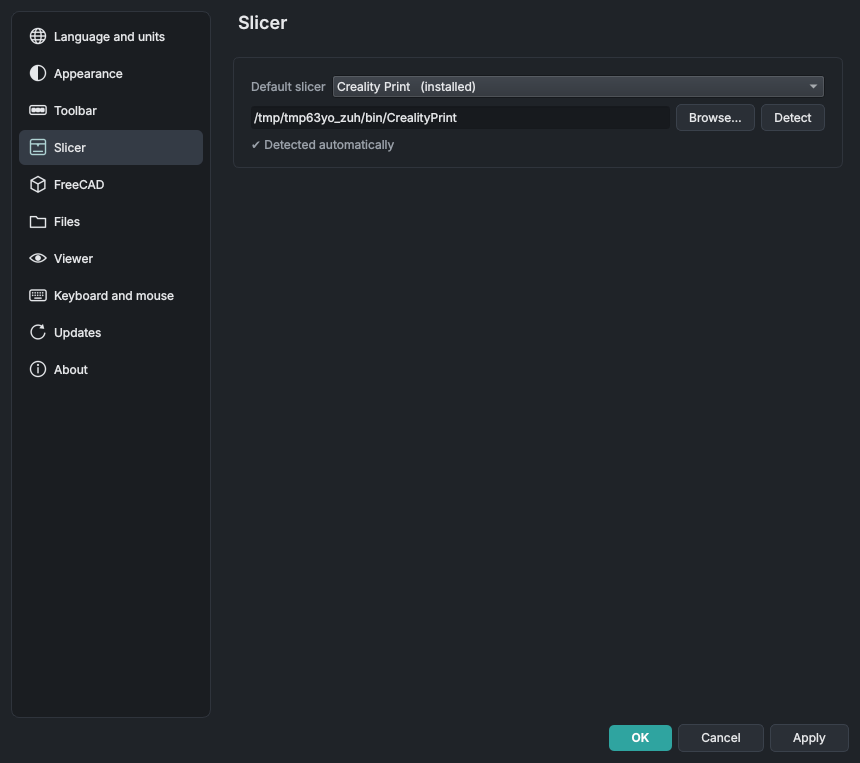
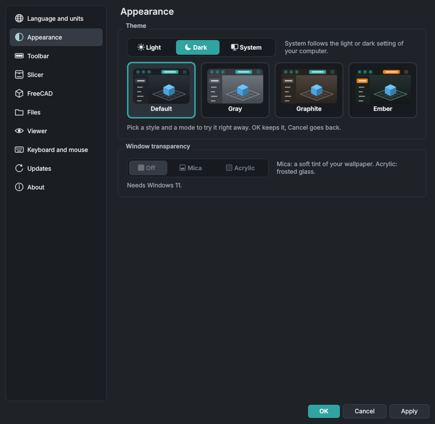
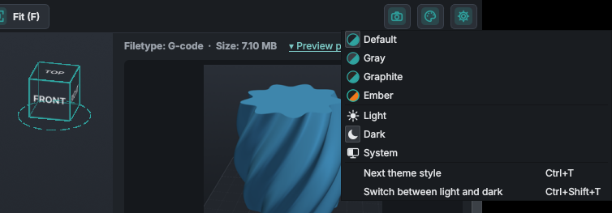
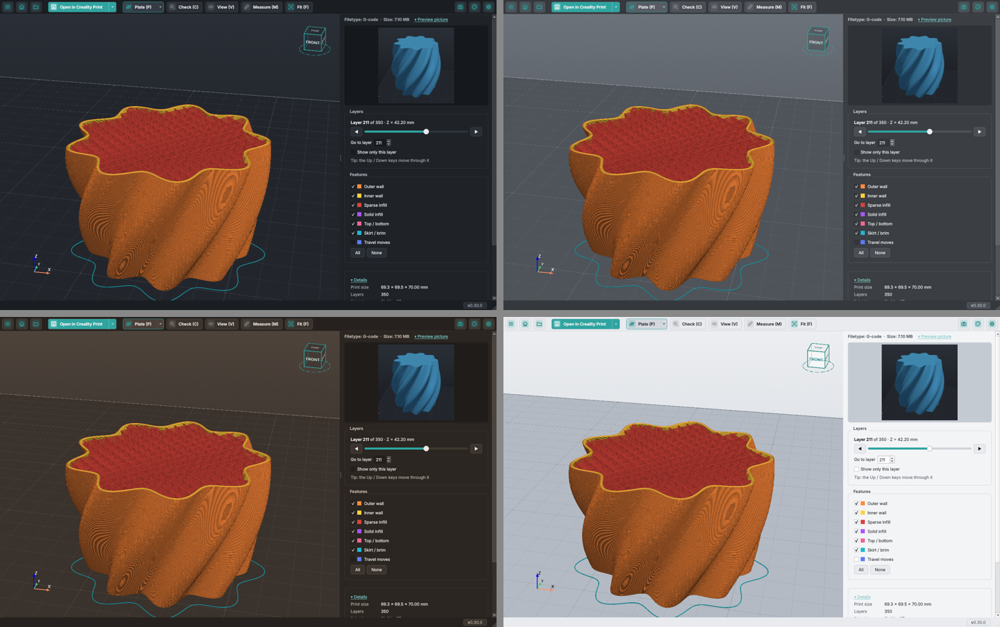
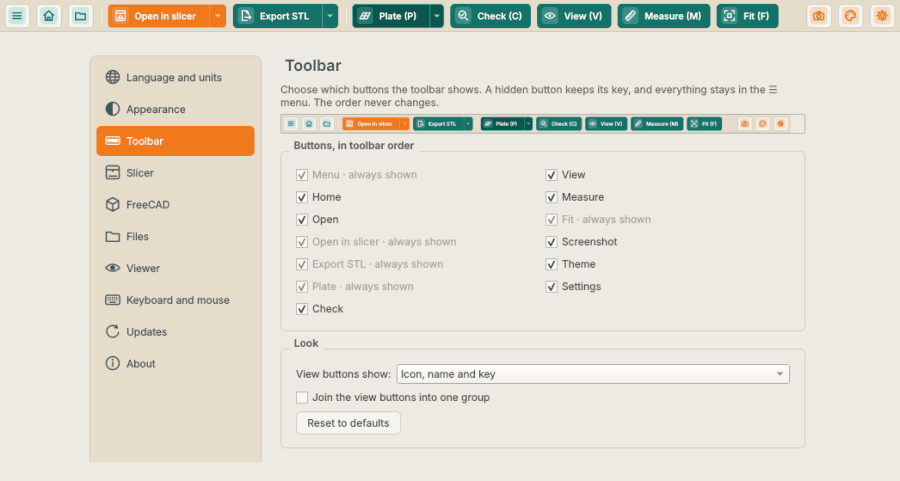
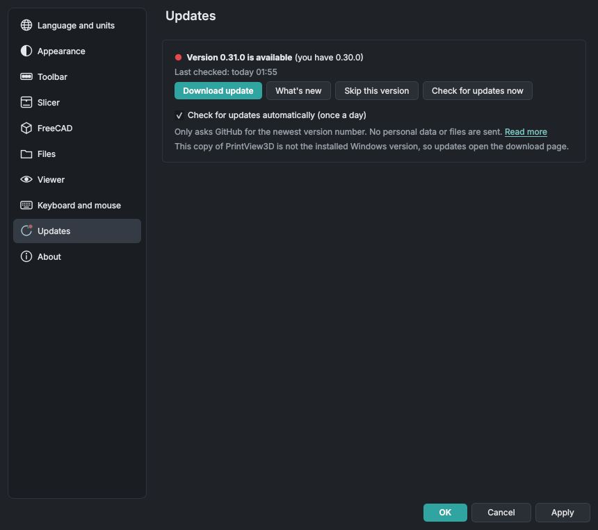

# PrintView3D gebruiken

**Een bestand openen:** dubbelklik erop (als PrintView3D het standaardprogramma is), sleep het naar het venster,
gebruik **Bestand of ZIP openen…** (`Ctrl+O`), of kies het uit **Recent** in het menu **☰** of op de startpagina. Probeer de bestanden in [`examples/`](https://github.com/sevagjb/PrintView3D/blob/main/examples) om te beginnen.

**Start:** de knop met het huisje (`Ctrl+W`) sluit het open bestand en gaat terug naar de startpagina,
met je recente bestanden. Het geeft ook het geheugen terug dat het bestand gebruikte; dat maakt vooral
verschil na een grote G-code of ZIP.

Houd op de startpagina de muis boven een recent bestand en een kaartje rechtsonder toont de
voorbeeldafbeelding (bij 3MF-projecten, G-code en FreeCAD-bestanden die er een hebben), de naam en de
map waarin het staat. Een ZIP toont de foto of render van de maker die erin zit, en anders de
afbeelding van de eerste 3MF of G-code erin. Het kaartje staat voor elk bestand op dezelfde plek,
zodat je de lijst kunt aflopen en vergelijken. Liever niet? Vink **Instellingen → Weergave →
Startpagina → Een voorbeeld van recente bestanden tonen als de muis erboven is** uit; dan worden de
bestanden pas gelezen als je ze opent.

**Een hele map:** **☰ → Map openen…** zet de 3D-bestanden van een map in het zijpaneel; ga erdoor met
`↑` / `↓` of een klik.

**Eén venster:** een bestand waarop je dubbelklikt terwijl PrintView3D al open is, verschijnt in dat venster,
dat naar voren komt. Wil je elk bestand in een eigen venster (om twee modellen naast elkaar te vergelijken),
vink dan **Instellingen → Bestanden → Elk bestand in een nieuw venster openen** aan. PrintView3D starten
vanuit het Startmenu of programmamenu, zonder bestand, opent altijd een nieuw venster.

## Muis {#mouse}

| Handeling | Wat het doet |
|---|---|
| **Slepen met links** | Draaien. Druk *op het model* om precies om dat punt te draaien; druk op een lege plek om om het midden van het model te draaien. De plaat blijft altijd waterpas. |
| **Slepen met rechts** (of met de middelste knop, of Shift + links) | Verschuiven |
| **Muiswiel** | In- en uitzoomen naar de muisaanwijzer |

Kijk je van onderen? De plaat gaat opzij, zodat je de onderkant van het onderdeel ziet.

## Toetsenbord {#keyboard}

Dit zijn de toetsen waarmee PrintView3D komt. **Instellingen → Toetsenbord en muis** toont ze allemaal,
en daar kun je elk ervan een eigen toets geven: klik in het veld en druk op de nieuwe toets (de wisknop
haalt de toets weg). De knoppen tonen dan jouw toets. **Standaardwaarden herstellen** zet ze allemaal
terug. Toetsen die het systeem gebruikt (de Windows- of Super-toets, Alt+F4, Alt+Tab, ⌘Q,
Ctrl+Alt+Del en dergelijke), Tab, Enter, Esc en de spatiebalk kun je niet kiezen, en ook geen toets die
een andere actie al heeft. De muisbediening ligt vast.

| Toets | Actie |
|---|---|
| `Ctrl+O` | Een bestand of ZIP openen |
| `Ctrl+W` | Het bestand sluiten (terug naar de startpagina) |
| `Ctrl+P` | Het bestand in je standaardslicer openen |
| `Ctrl+E` | STL exporteren (3MF-projecten, FreeCAD- en STEP-bestanden) |
| `S` | Instellingen |
| `Ctrl+Shift+S` | Een schermafbeelding van de 3D-weergave opslaan |
| `Ctrl+T` | Volgende themastijl (Standaard → Grijs → Grafiet → Ember), zelfde lichte of donkere modus |
| `Ctrl+Shift+T` | Het thema tussen licht en donker wisselen |
| `F` | Het model passend in beeld brengen |
| `1` · `2` · `3` · `4` | Iso · Boven · Voor · Rechts |
| `P` | Printplaat aan / uit |
| `C` · `V` | Onderdeel Controleren · onderdeel Weergave, aan / uit (modellen) |
| `W` · `X` · `T` · `Y` | Draadmodel · Röntgen · Van boven afsnijden · Afsnijden vanaf jouw kant, aan / uit (modellen) |
| `L` | De snede vanaf jouw kant vastzetten: ze draait niet meer mee met de weergave (modellen) |
| `R` | Weergave herstellen: draadmodel, röntgen en de sneden uit, model passend (bij G-code: passend) |
| `M` | Meten aan / uit (modellen) |
| `D` · `A` · `O` | Een afstand · een hoek · een cirkel meten |
| `K` | Alle metingen verwijderen (Meten blijft aan) |
| `↑` / `↓` | Volgende / vorige laag (G-code), of het bestand erboven / eronder in een ZIP of map |
| `Page Up` / `Page Down` | 10 lagen omhoog / omlaag |
| `Home` / `End` | Eerste / laatste laag |

## Weergave: draadmodel, röntgen en afsnijden {#view-wireframe-x-ray-and-clip}

De knop **Weergave** in de werkbalk opent het onderdeel **Weergave** in het zijpaneel, met elke optie
als knop (een knop die aan staat is donkerder). Het verandert hoe een model getekend wordt (STL, 3MF,
OBJ en de andere modelformaten; G-code heeft daarvoor de laagschuifregelaar):

- **Draadmodel** (`W`): de driehoeken van het mesh, om te zien hoe fijn het is of kapotte geometrie te vinden.
- **Röntgen** (`X`): de onderdelen worden doorzichtig, zodat onderdelen in andere onderdelen,
  holtes en holle wanden zichtbaar worden.
- **Van boven afsnijden** (`T`): verbergt alles boven een hoogte. Een schuifregelaar in het
  zijpaneel verschuift de snede; de binnenkant van de wanden die de snede openlegt is rood.
  `T` of de knop nog eens toont het hele model weer.
- **Afsnijden vanaf jouw kant** (`Y`): een rechtopstaande snede die altijd naar je toe gericht is en
  het deel van het model ervoor verbergt. Draai de weergave en het model draait door de snede;
  verschuif (pan) de weergave en het schuift erlangs, alsof je het model voor een scanner houdt.
  Voor een snede van voren of van opzij klik je dat vlak op de weergavekubus aan. De schuifregelaar
  zet de snede dichterbij of verder weg, en **Diepte** toont hoe ver ze in het model zit.
  **Snede vastzetten** (`L`, de knop links van Weergave herstellen) zorgt dat de snede niet meer
  meedraait met de weergave, zodat je het model kunt draaien en de snede van opzij kunt bekijken; de
  schuif verplaatst haar nog steeds. Zolang de snede niet vastzit, toont het onderdeel Meten een rode
  stip en *Snede vanaf jouw kant niet vastgezet*; beweeg erover voor de reden: punten die op de snede
  geplaatst zijn blijven achter als de weergave draait.
- **Beide sneden tegelijk**: `T` en `Y` zetten elk hun eigen snede aan en uit, dus beide kunnen
  samen aan voor een hoek eruit gesneden, met een schuif **Hoogte** en **Diepte** in het zijpaneel.
  **Weergave herstellen** zet beide uit.
- **Weggesneden deel tonen** en **Snijvlak tonen** (onder de schuiven, standaard allebei aan): wat
  de snede verbergt blijft zichtbaar als een witte, doorzichtige schim met omlijnde randen, en het
  snijvlak verschijnt als een vaag vlak zo groot als het model. Je keuze wordt onthouden. In
  **Instellingen → Weergave** hebben **Weggesneden deel** en **Snijvlak** elk een schuif
  Vager … Sterker; de 3D-weergave verandert terwijl je sleept.
- **De sneden in de 3D-weergave slepen** (een optie): vink **Instellingen → Weergave → De snijvlakken
  ook verplaatsen door ze in de 3D-weergave te slepen** aan en elke snede krijgt een kleine ronde greep
  aan de rand van haar snijvlak, met een kort lijntje dat de richting toont. Onder de muis wisselen de
  kleuren. Sleep eraan om de snede te verplaatsen; haar schuif gaat mee.
- **Weergave herstellen** (`R`): zet alles hierboven uit en past het model in beeld, zoals **Passend**,
  in één keer. Metingen blijven staan.

Draadmodel en röntgen blijven aan als je het volgende model opent; de sneden en de metingen verdwijnen. De opties werken samen (bijvoorbeeld röntgen en afsnijden).

## Meten, objectkleuren en getallen op het raster {#measure-object-colours-and-grid-numbers}

- **Meten** (`M`, de knop naast **Weergave**): **Afstand** (desgewenst met ΔX ΔY ΔZ), **Hoek** en
  **Cirkel** (diameter en straal). Een klik zet een punt, slepen draait nog steeds de weergave, en een
  geplaatst punt kun je verslepen. Punten springen naar hoeken en randen, en met een snede aan ook
  naar de omtrek van de snede, zodat je in het model kunt meten; bij elke meting staat de waarde, en
  **Wissen** (`K`) haalt ze allemaal weg.
- **Objectkleuren**: klik op het kleurvak van een object in de lijst **Objecten** om het een andere
  kleur te geven; rechtsklik zet de kleur uit het bestand terug. Niet opgeslagen.
- **Getallen op het raster**: **Instellingen → Weergave → Schaalgetallen op het raster tonen**
  schrijft millimeters langs de printplaat, zoveel als passen bij de zoom waarmee je kijkt.
- **Instellingen** is ook het tandwielpictogram rechts in de werkbalk, naast het themapictogram
  (tenzij je het verbergt: zie [Knoppen op de werkbalk](#toolbar-buttons)).

Meer, met afbeeldingen: [In je modellen kijken](inspect.md). Gemaakt door [@covrig](https://github.com/covrig).

## Controleren voor het printen {#check-before-printing}

De knop **Controleren** (`C`, tussen Plaat en Weergave) opent het onderdeel **Model controleren** en
kleurt wat bij het printen problemen kan geven, met een aantal per controle (alleen modellen, geen
G-code):

- **Overhangen**: vlakken die naar beneden wijzen en verder dan een hoek (standaard 45°) van verticaal
  hellen; vlakken op de plaat tellen niet mee.
- **Dunne wanden**: wanden en pinnen dunner dan je nozzle (standaard 0,4 mm). Loopt op de achtergrond,
  dus het staat uit tot je het aanvinkt.
- **Meshproblemen**: **Gaten** (open randen), **Verwarde randen** (non-manifold), **Binnenstebuiten
  gekeerde vlakken** (omgedraaide normalen) en **Losse delen** tot een grootte die je kiest (standaard
  5 mm).

Een rode stip markeert de gevonden problemen. Klik op een kleurvak om de kleur te veranderen; beweeg
over een naam om te zien wat hij betekent. De markeringen volgen de sneden en de objecten die je
verbergt. Meer: [Controleren voor het printen](inspect.md#check-before-printing). Gebouwd door
[@covrig](https://github.com/covrig).

## Millimeter of inch {#millimetres-or-inches}

**Instellingen → Taal en eenheden → Lengtes in** toont elke lengte (afmetingen, metingen, sneden, het
raster en de plaat) in millimeters of in inch. Bestanden veranderen niet.

## Je slicer kiezen {#choosing-your-slicer}

**Instellingen → Slicer → Standaardslicer.** Bij elke slicer staat *geïnstalleerd* of *niet gevonden*. Staat
de jouwe op een ongebruikelijke plek, klik dan op **Bladeren…** en kies het programmabestand. Voor een slicer
die niet in de lijst staat kies je **Ander programma…**, geef je hem een naam en kies je zijn `.exe`.

De groene knop krijgt de bijpassende naam ("Openen in OrcaSlicer"). Het kleine pijltje **▾** ernaast toont je
andere geïnstalleerde slicers, om een bestand één keer in een daarvan te openen.

## STL exporteren uit 3MF {#export-stl-from-3mf}

Met een 3MF-project open bewaart **STL exporteren** in de werkbalk (`Ctrl+E`) de objecten als gewone
STL-bestanden, bijvoorbeeld om een model te delen of te openen in een programma dat geen 3MF leest.

- Een venster toont elk object met zijn naam en aantal driehoeken, allemaal aangevinkt; vink uit wat je niet
  nodig hebt.
- **Het pijltje naast de knop** biedt elke manier direct: *Alle objecten als één STL*, *Eén STL per object*
  en *Objecten kiezen…* (het venster). Wat een klik doet, staat vetgedrukt.
- **Wat een klik doet** (en `Ctrl+E`) kies je in **Instellingen → Bestanden → STL exporteren**: de lijst
  met objecten tonen (standaard), alles opslaan als één STL, of één STL per object opslaan.
  *Wijzigen wat een klik doet…* onderaan het menu van het pijltje opent die instelling.
- **Eén gecombineerde STL**: de aangevinkte objecten in één bestand, op hun plek op de plaat.
- **Eén STL per object**: elk bestand krijgt de naam van zijn object en komt in een map die je kiest
  (PrintView3D vraagt het voordat het bestaande bestanden vervangt).
- Een bestand met maar één object gaat altijd direct naar het venster Opslaan.
- **Alleen de pure vorm:** modifiers, negatieve onderdelen en support-blokkers / -afdwingers worden
  weggelaten (zoals vastgelegd door Creality Print, OrcaSlicer, Bambu Studio en PrusaSlicer), en ook kleuren,
  materialen en printinstellingen. Maten zijn in millimeters; de bestanden zijn binaire STL.

## ZIP-bestanden {#zip-files}

Gedownloade modellen komen vaak als ZIP. Open die net als elk ander bestand (**Bestand of ZIP openen…** of sleep het naar het
venster); uitpakken hoeft niet.

<table>
<tr>
<td width="50%"> <b>Alles naast elkaar tonen</b>: vink elk model aan of uit; de G-code opent apart.</td>
<td width="50%"> Klik op een bestand in de lijst, of gebruik ↑ / ↓: hier de gesliceerde G-code uit dezelfde ZIP.</td>
</tr>
</table>

- **Alleen de 3D-bestanden worden gebruikt**: STL, 3MF, OBJ, PLY, OFF, glTF/GLB, STEP, FreeCAD en G-code.
  Afbeeldingen, pdf's, leesmij-bestanden, weblinks, ZIP's in de ZIP en de verborgen map `__MACOSX` worden
  overgeslagen, en het paneel zegt hoeveel.
- **Een ZIP met één 3D-bestand** opent precies zoals dat bestand.
- **Meer bestanden** staan in het zijpaneel met een gekleurd label voor hun soort (STL, 3MF, G-code, …) en
  een korte uitleg per soort. Het eerste bestand wordt getoond; klik op een ander, of gebruik **↑ / ↓**, om te
  wisselen.
- **Alles naast elkaar tonen** zet de modellen naast elkaar: tot drie op een rij, daarna een raster (vier als
  2 × 2, zes als 3 × 2, negen als 3 × 3, …), op afstand volgens hun echte grootte. Vink modellen uit in
  **Objecten** om ze te verbergen. G-code-, STEP- en FreeCAD-bestanden worden één voor één geopend.
- **Openen in slicer** stuurt het model dat je bekijkt; bij Alles tonen de aangevinkte modellen. Het pijltje
  naast de knop heeft **Alle modellen uit de ZIP versturen**.
- Een slicer opent een **3MF als eigen project**, en kan een 3MF dus niet samen met andere bestanden openen. Als
  er een 3MF tussen de modellen zit, vraagt PrintView3D wat je wilt sturen: het 3MF-project (met zijn platen
  en instellingen), de andere modellen op één plaat, of **alles als STL** (de objecten van het project worden
  een gewone STL, zodat alle modellen op één plaat komen).

    

De 3D-bestanden worden uitgepakt in de eigen cachemap van PrintView3D (slicers hebben echte bestanden nodig);
de groottes worden eerst gecontroleerd, zodat een beschadigde of kwaadaardige ZIP je schijf niet kan vullen.
Bestanden uit ZIP's die langer dan een dag geleden geopend zijn, worden automatisch opgeruimd.

## Taal {#language}

**Instellingen → Taal en eenheden → Taal** zet het hele programma meteen om, ook de bestandsvensters en standaardknoppen. Engels
is de standaard; *Automatisch* volgt de taal van je systeem. Arabisch gebruikt een opmaak van rechts naar links;
maten gebruiken altijd westerse cijfers (0.20 mm).
Een fout of ontbrekend woord? De link op die pagina leidt naar [Zo vertaal je](TRANSLATING.md).

## Thema's {#themes}

Klik op het **palet-icoon** rechts in de werkbalk om een thema te kiezen, of druk op **`Ctrl+T`** voor het
volgende. Dezelfde keuze staat in **Instellingen → Uiterlijk → Thema**.

- **Automatisch** volgt de donker/licht-instelling van Windows of je Linux-bureaublad (en wisselt mee als die
  verandert).
- **Donker**, **Grijs**, **Grafiet** (een warme, donkerbruine tint die rustig is voor de ogen) of **Licht**.

Het wisselen gaat meteen; de 3D-achtergrond, de plaat en het raster veranderen mee, terwijl de kleuren van de
G-code en het model gelijk blijven, zodat ze altijd overeenkomen met je slicer.

### Venstertransparantie (Windows 11) {#window-transparency-windows-11}

**Instellingen → Uiterlijk → Venstertransparantie** laat de werkbalk, het zijpaneel en de statusbalk zien wat
achter het venster ligt, in elk thema:

- **Mica**: een zachte tint van je bureaubladachtergrond (zoals in Verkenner).
- **Acrylic**: matglas dat het bureaublad en andere vensters erachter vervaagt.
- **Uit** (standaard): dicht, zoals voorheen.

De 3D-weergave blijft altijd dicht. Het werkt na een herstart: als je op OK klikt, vraagt PrintView3D
**Nu herstarten** (het sluit en opent opnieuw, met hetzelfde bestand) of **Later**. Windows tekent het effect
zelf, toont een effen kleur als het venster niet actief is, en zet het uit als *Transparantie-effecten* uit
staan in Windows Instellingen of in de batterijbesparing. Windows 10 en andere systemen houden het gewone
uiterlijk.

## Knoppen op de werkbalk {#toolbar-buttons}

**Instellingen → Werkbalk** (ook **☰ → Werkbalk aanpassen…**, of klik met rechts op het tandwiel of een lege plek op de
werkbalk)
kiest welke knoppen de werkbalk toont, voor een rustigere werkbalk als je niet alles gebruikt:

- **Kunnen verborgen worden:** Start, Openen, Controleren, Weergave, Meten, Schermafbeelding, Thema
  en Instellingen.
- **Altijd zichtbaar:** het **☰**-menu, Openen in slicer, STL exporteren (3MF- en CAD-bestanden),
  Plaat en Passend.
- **De volgorde verandert nooit.** Een verborgen knop verdwijnt alleen van de werkbalk; Plaat blijft
  de eerste van de weergaveknoppen en Passend de laatste.
- **Er raakt niets kwijt.** Een verborgen knop houdt zijn toets (`C`, `V`, `M`, `Ctrl+W`, …), en het
  **☰**-menu heeft alles, ook Controleren, Weergave, Meten en het themamenu.
- **Klik met rechts op een knop voor zijn instellingen.** Elke knop biedt één item dat Instellingen
  opent bij de eigen opties van die knop:

  | Rechtsklik op | Opent |
  |---|---|
  | Thema | **Uiterlijk** (de thema's) |
  | Schermafbeelding | **Bestanden → Schermafbeeldingen** (de map, opslaan zonder te vragen) |
  | Openen in slicer | **Slicer** (de standaardslicer) |
  | STL exporteren | **Bestanden → STL exporteren** (wat een klik doet) |
  | Plaat | **Weergave → Printplaat** |
  | Controleren, Weergave, Meten | **Weergave → Meten, weergave en controleren** |
  | Instellingen, Start, Openen, Passend of een lege plek | **Werkbalk aanpassen…** |

Onder **Uiterlijk** kies je hoe de weergaveknoppen (Plaat, Controleren, Weergave, Meten en Passend)
eruitzien: **pictogram, naam en toets** (*Plaat (P)*, de standaard), **pictogram en naam** (*Plaat*),
**pictogram en toets** (*P*) of **alleen pictogram** (de tooltip noemt de naam). **Weergaveknoppen
samenvoegen tot één groep** tekent ze als één aaneengesloten balk.

Elke wijziging is meteen te zien in het venster en in de afbeelding boven aan de pagina: **OK** houdt
hem, **Annuleren** gaat terug. **Standaardwaarden herstellen** toont alle knoppen weer.

## Updates {#updates}

**Instellingen → Updates** toont je versie en heeft **Nu controleren op updates**. Je kunt ook
**Automatisch controleren op updates (één keer per dag)** aanzetten; PrintView3D vraagt één keer of je dat
wilt, en je kunt het daar altijd wijzigen.

Is er een nieuwe versie, dan toont de versie rechtsonder een **rode stip** (`● v0.10.0 → 0.11.0`), en
*Updates* in Instellingen ook. Klik erop om **Wat is er nieuw** te zien, en daarna:

- **Windows (geïnstalleerd met Setup.exe): Update installeren.** PrintView3D downloadt de nieuwe installer,
  controleert de SHA-256-vingerafdruk tegen die van GitHub, installeert hem (zonder vragen, je instellingen
  blijven bewaard) en start de nieuwe versie.
- **Linux (AppImage) en de draagbare Windows-zip: Update downloaden** opent de pagina van de nieuwe versie;
  download het nieuwe bestand en vervang het oude.
- **Deze versie overslaan** verbergt die versie; de volgende wordt weer getoond.

Na een update toont de eerste start één keer **Wat is er nieuw** voor de versie die je nu hebt, hoe je ook
bijgewerkt hebt (installer, winget, zip of AppImage). Het komt uit het wijzigingslogboek dat bij het programma
zit, dus er is geen verbinding voor nodig. Na een nieuwe installatie verschijnt het niet.

### Updates en privacy {#updates-and-privacy}

PrintView3D werkt offline. Het maakt **alleen** verbinding met internet voor updates, en alleen als je op
*Nu controleren op updates* klikt of de dagelijkse controle hebt aangezet:

| | |
|---|---|
| **Waarmee verbinding wordt gemaakt** | `api.github.com` (om naar de nieuwste versie van dit project te vragen) en, als je op *Update installeren* klikt, de download van `github.com` |
| **Hoe vaak** | Hooguit één keer per dag (automatische controle), of als je op *Nu controleren op updates* klikt |
| **Wat er verstuurd wordt** | Alleen de vraag naar de nieuwste versie, met de naam en versie van het programma (`PrintView3D/0.10.0`). Geen persoonlijke gegevens, geen bestanden, geen gebruiksstatistieken, geen ID. |
| **Wat GitHub ziet** | Zoals bij elke website: je IP-adres. Zie de [privacyverklaring van GitHub](https://docs.github.com/site-policy/privacy-policies/github-general-privacy-statement). |
| **Uitzetten** | Instellingen → Updates → vink *Automatisch controleren op updates* uit. Daarna wordt nergens meer verbinding mee gemaakt. |

## Soepeler draaien op laptops {#smoother-rotation-on-laptops}

Veel laptops hebben twee grafische chips en laten programma's standaard op de langzaamste draaien.
**Instellingen → Weergave → Grafische kaart** toont welke PrintView3D gebruikt. Staat er *Intel*, vink dan
**De krachtige videokaart gebruiken** aan en klik op OK; kies **Nu herstarten** (of **Later**, dan wisselt het
de volgende keer dat je PrintView3D start).

## Opmerkingen en beperkingen {#notes-and-limits}

- Windows 10/11 en Linux (x86-64) worden verpakt en getest. De Mac-versies (Apple silicon en Intel, macOS 14.4+)
  zijn in [bèta](install.md#macos). Linux op ARM (Raspberry Pi enz.) wordt nog niet verpakt.
- Een 3MF-*project* dat in een slicer van het ene merk is opgeslagen, kan zijn printer- en printinstellingen
  verliezen als het in een slicer van een ander merk wordt geopend. Het model zelf laadt gewoon; zo gedragen
  de slicers zich.
- Binaire G-code (`.bgcode`) wordt nog niet ondersteund.
- Miniaturen in Verkenner zijn er voor 3MF-, STL-, G-code- en FreeCAD-bestanden; nog niet voor OBJ, PLY, OFF en
  glTF.
- FreeCAD-documenten hebben een geïnstalleerde FreeCAD nodig voor de 3D-weergave (PrintView3D bevat de
  geometrie-engine van FreeCAD niet). Heel oude of heel nieuwe FreeCAD-versies openen elkaars bestanden soms
  niet.
